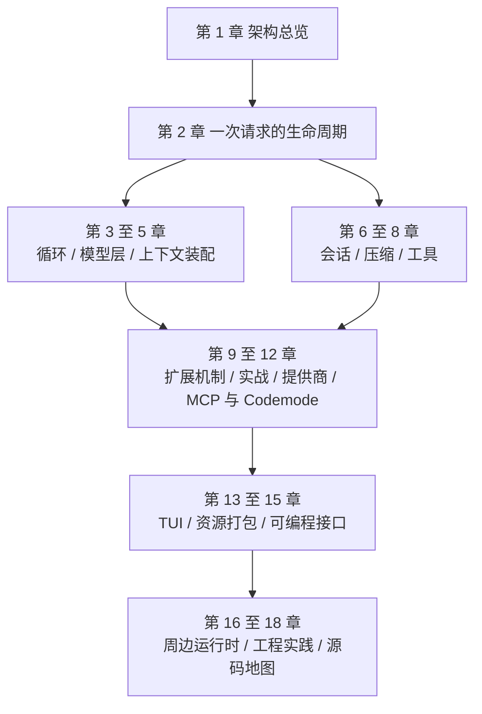

# 前言：这份教程怎么用

← 上一章：[目录索引](README.md) ｜ [返回目录](README.md)

> **读者**：已经用过 Pi（会启动、会提示、会用 `/model` 与 `/settings`），现在想知道它内部怎么运转、能改到哪里去的人。
>
> **不覆盖的内容**：安装与首次登录、终端基础操作、模型选择的界面步骤。这些在《Pi 入门教程》里，本教程假定你已经会。平台适配（[Windows](https://pi.dev/docs/latest/windows)、[tmux](https://pi.dev/docs/latest/tmux)、[Termux](https://pi.dev/docs/latest/termux)）与[本地模型运行](https://pi.dev/docs/latest/llama-cpp)属于运维配置，本教程只在涉及机制时引用它们（第 8、11、13 章）。

## 这份教程解决什么问题

会用一个工具和理解一个工具是两种能力。前者让你完成任务，后者决定你能把任务推到多远：当 Pi 的表现不符合预期时，你能否定位到"是压缩策略、是缓存能力开关、还是扩展处理器的组合语义"；当你需要的功能不存在时，你能否判断它应该是提示词模板、技能、扩展、还是根本不该做进核心。

Pi 的官方立场让这种理解特别有价值：**它是一个刻意做小的内核**。子代理、计划模式、沙箱、MCP、codemode 都不在核心里，而是以扩展形式存在；官方文档反复强调"把 Pi 改成你的工作方式"。所以本教程的主线不是"功能清单"，而是三件事：

1. **内部结构**：包与模块怎么分工，代码放在哪里（第 1、6、9、16 章）。
2. **工作原理**：一次运行到底发生了什么，为什么是这个顺序（第 2、3、4、5、7、8、12、13、15 章）。
3. **定制与扩展开发**：机制（第 9 章）→ 模式（第 10 章）→ 专项接入（第 11、14 章）→ 工程化（第 17 章）。

## 事实来源与版本基线

本教程的每个技术结论都取自两处一手资料，并且都标注了出处：

| 来源 | 用法 |
|---|---|
| 官方文档 `https://pi.dev/docs/latest/<slug>` | 契约、配置键、用户可见行为。它与仓库内 `packages/coding-agent/docs/*.md` 同源。其中 `models-configuration.md` 由 TypeScript 源生成（`npm run generate:references`），`models` / `settings` / `keybindings` / `theme` 四类 JSON Schema 由 `generate-schemas.ts` 从同一批 TypeBox 定义发布，因此这几处与代码不会漂移；其余页面是手写文档 |
| Pi monorepo 源码 | 实现事实、默认值、限额、时序。以 `packages/…/file.ts:line` 形式给出"源码位置" |

版本基线：`@earendil-works/pi-coding-agent` **1.4.0**，仓库 commit **`f09d01b8`**（2026-10-30）。Pi 迭代快，若新版行为与本文不符，以文档与源码为准，并先查各包的 `CHANGELOG.md`（阅读方法见 18.5 节）。

文档与代码冲突时，本教程只写代码里的实际行为。写作过程中核对出的几处需要留意的点，都已在正文里就地说明：

- `agent_end` 不是运行结束信号，终态是 `agent_settled`（2.5、15.2）。
- `@earendil-works/pi-ai` 在扩展运行时解析到 **compat** 入口而不是核心入口（9.1）。
- `tool_call` 处理器抛错会**阻塞工具**而不是被吞掉，`user_bash` 同理不回落到本地执行（9.4）。
- `bash` 工具的进程树终止是立即 SIGKILL（macOS 前置 SIGSTOP），与 `pi.exec()` 的 SIGTERM→5 秒→SIGKILL 规则不同（8.5）。
- "actionable boundary" 是文档用语，代码里没有这个词，对应实现是 `emitBoundary()`（9.3）。

## 阅读路线

四条推荐路径：

- **改行为的人（要写扩展）**：第 1、2 章 → 第 9 章（机制）→ 第 10 章（照着做）→ 第 8 章（工具契约）→ 第 5、7 章（上下文与压缩）→ 第 14 章（打包）→ 第 17 章；附录 A、B 常备。
- **接模型的人（提供商、路由、评测）**：第 1、2 章 → 第 4、5 章 → 第 11 章 → 第 7 章 → 第 12 章（非对话模型）→ 第 15 章（自动化）→ 第 18 章；附录 C 常备。
- **做集成的人（IDE、CI、其他语言）**：第 1、2 章 → 第 15 章 → 第 3 章 → 第 6 章 → 第 12 章 → 第 16 章 → 第 17 章（隔离与信任边界）。
- **读源码的人**：第 1、2、3、6、9 章 → 第 18 章，然后按 18.1 的三圈法进入代码。

单章可独立阅读：每章开头有"本章你将学会"与对应官方文档，正文里的跨章引用都带节号，结尾有小结、带验收标准的练习与延伸阅读。附录（A 事件与钩子总表、B 扩展 API 与上下文速查、C 数值与配置速查、D 术语对照）按查阅场景组织，不需要顺序读。

## 正文约定

- 每章标题下方有"上一章"链接，文末有"下一章"链接，两者都附[返回目录](README.md)；章节顺序为前言 → 第 1 至 18 章 → 附录 A 至 D，可以顺序通读，也可以按下面的路线跳读。
- 简体中文；术语首次出现给英文原文。命令、文件名、配置键、环境变量、代码标识符保留英文并加反引号。
- **命令可直接复制执行**。交互界面里的输入用 `text` 块并注明"在 Pi 的编辑器中输入"。输出示例一律标注"示例输出"。
- **源码位置**相对仓库根目录，例如 `packages/coding-agent/src/core/agent-session.ts:1779`；链接指向本机 checkout 的绝对路径，方便边读边跳。行号取自基线 commit，代码移动后以符号名为准。
- 结构图、时序图、决策图用 Mermaid（GitHub、VS Code 等支持 Mermaid 的阅读器会渲染）；总体架构图另存有 SVG（`assets/`）。终端截图取自 Pi 官方仓库 `packages/coding-agent/docs/images/`，界面会随版本变化。
- 数值一律给实际数字并注明出处文件：限额、默认值、超时、字节数都按代码写法呈现，不四舍五入、不写"大约"。
- 本教程**不假设你没读过官方文档**，但也不复述它：能在文档里查到的字段清单一律链接过去，正文只做组织、解释与代码层补证。
- 代码片段有两类：摘自仓库（标注来源）与本教程为讲解编写的示例（可直接当模板用，但都按本章机制核对过语义）。示例扩展代码为聚焦机制会省略错误处理，生产代码请补齐。

## 许可与致谢

本教程基于 Pi 官方文档（MIT 许可）与 Pi 源码整理、改写与补充；示例命令、配置与结论均按仓库代码核对。Pi 由 Earendil Inc. 与社区开发，项目主页 <https://pi.dev>，仓库 <https://github.com/earendil-works/pi>。`assets/` 中的终端截图与 Pi 标志来自 Pi 官方仓库与 pi.dev，仅用于介绍 Pi。

---

→ 下一章：[第 1 章 架构总览](01-architecture-overview.md) ｜ [返回目录](README.md)
