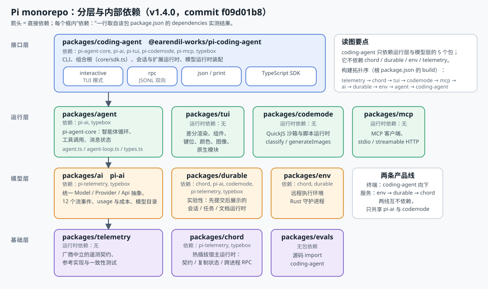
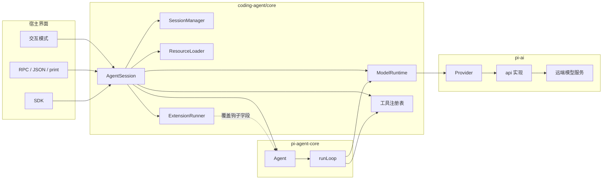

# 第 1 章 架构总览

← 上一章：[前言：这份教程怎么用](00-preface.md) ｜ [返回目录](README.md)

> **本章你将学会**：说出 11 个包各自的职责与依赖方向；在 `coding-agent` 的源码目录里定位任意一类行为；解释三条塑造架构的硬约束（最小内核、Node 直跑 TypeScript、供应链按代码评审）；判断一个需求应该落在哪一层。
>
> **对应官方文档**：[Overview](https://pi.dev/docs/latest) · [How Pi Works](https://pi.dev/docs/latest/how-pi-works) · 仓库 `README.md`、`CONTRIBUTING.md`、`AGENTS.md`

Pi 的官方定位是一句：**minimal, extensible agent harness**（最小而可扩展的智能体运行框架）。这句话在代码里有具体的形状——内核只提供循环、模型抽象、会话与工具调度，功能型特性（子代理、计划模式、沙箱、MCP、codemode）全部作为扩展存在，包括它自带的四个内置扩展。本章给全景，第 2 章给动态路径，后面各章逐层下钻。



<p align="center"><sub>图 1-1　分层与内部依赖（依赖边取自各包 <code>package.json</code>，基线 commit <code>f09d01b8</code>；素材说明见 <code>assets/README.md</code>）。</sub></p>

## 1.1 三条塑造架构的约束

理解 Pi 的设计决定，先接受三条约束：

1. **核心最小**。`CONTRIBUTING.md` 把这条写成第一原则：不属于核心的功能就应该是扩展；让核心变臃肿的 PR 大概率被拒；连扩展的钩子点本身都要经过讨论才加入，因为钩子会带来组合复杂度。这解释了为什么 Pi 不内置 plan mode 与 sub-agent（官方 README 明确点名这两个"别的工具会内置"的功能），也解释了为什么 `pi.registerProvider()` 这类钩子的语义写得极其具体——它们是不可轻动的公共契约。
2. **同一份源码要能在 Node 里直接跑**。扩展经 jiti 求值、TypeScript 不需要编译步骤（第 9 章）；仓库根规则要求被检查的代码只用"可擦除语法"（no parameter properties、no `enum`、no `namespace`、no `import =`），因为 Node 的 strip-only 模式无法降级需要代码生成的语法（[AGENTS.md 的 Code Quality](file:///D:/workspace/harness/earendil/pi/AGENTS.md)）。同样地，资源路径必须经 `src/config.ts` 的辅助函数解析，不许直接用 `__dirname`——因为同一份代码要能跑在源码 checkout、npm 安装、standalone 单文件二进制三种形态下。
3. **依赖变化当代码评审**。直接依赖锁死确切版本、`.npmrc` 设 `save-exact=true` 与 `min-release-age=2`、`package-lock.json` 是依赖事实来源、installer 从生成物 `install-lock/` 安装以固定传递依赖、带 lifecycle scripts 的新依赖必须显式进 allowlist 否则卡检查（[README 的 Supply-chain hardening](file:///D:/workspace/harness/earendil/pi/README.md)）。这条约束直接导致"Pi 正常安装不需要 lifecycle scripts"，也解释了 13.5 节里 TUI 原生模块为什么要走 prebuild + 多路径查找。

## 1.2 包清单

| 目录 | npm 包名 | 职责 | 规模感 |
|---|---|---|---|
| `packages/ai` | `@earendil-works/pi-ai` | 统一多提供商 LLM API：类型、流协议、10 种 chat api、目录生成、鉴权 | `src/api/` 43 个文件（含各 api 的 `.lazy.ts`） |
| `packages/agent` | `@earendil-works/pi-agent-core` | 领域无关的智能体循环、`Agent`、消息与工具类型 | 6 个源文件 |
| `packages/tui` | `@earendil-works/pi-tui` | 差分终端 UI 库：组件、布局、键位、颜色、图像、原生模块 | 30 个源文件，零运行时依赖 |
| `packages/coding-agent` | `@earendil-works/pi-coding-agent` | CLI、会话、扩展运行时、四种模式、SDK | 最大的包 |
| `packages/codemode` | `@earendil-works/pi-codemode` | QuickJS 沙箱与脚本运行时（Worker 隔离） | `src/runtime/` |
| `packages/mcp` | `@earendil-works/pi-mcp` | MCP 客户端、stdio/streamable HTTP、OAuth | `src/transports/` |
| `packages/telemetry` | `@earendil-works/pi-telemetry` | 厂商中立遥测契约与一致性测试，无后端 | 纯契约 |
| `packages/chord` | `@earendil-works/chord` | 热插拔宿主运行时：契约、复制状态、跨进程 RPC | 多子入口 |
| `packages/durable` | `@earendil-works/pi-durable` | 实验性：先提交后展示的会话/任务/文档运行时 | 独立产品线 |
| `packages/env` | `@earendil-works/pi-env` | 远程执行环境（Rust 守护进程 + SSH 帧协议） | 含 `daemon/` |
| `packages/evals` | `@earendil-works/pi-evals` | 行为评测与文档提升评测 | 无包依赖 |

依赖方向（各包 `package.json` 的实测结果）：

```text
pi-agent-core  → pi-ai, typebox
pi-ai          → pi-telemetry, typebox
chord          → pi-telemetry, typebox
pi-durable     → chord, pi-ai, pi-codemode, pi-telemetry, typebox
pi-env         → chord, pi-durable
pi-coding-agent→ pi-agent-core, pi-ai, pi-codemode, pi-mcp, pi-tui, typebox
pi-tui / pi-mcp / pi-codemode / pi-telemetry / pi-evals → （无内部依赖）
```

两条读法：**终端产品线**是 `coding-agent → {agent, ai, tui, codemode, mcp} → ai → telemetry`；**服务产品线**是 `env → durable → chord → telemetry`。`coding-agent` 与 `durable`/`chord`/`env` 互不依赖，`telemetry` 是它们唯一的公共下游。第 16 章专门讲这条第二产品线为什么存在。

## 1.3 coding-agent 的内部地图

`packages/coding-agent/src/` 的目录切分就是行为的归属：

```text
src/
├── main.ts / cli.ts / rpc-entry.ts / bun/         入口与打包形态
├── config.ts                                      路径、名字、CONFIG_DIR_NAME、agent 目录
├── cli/args.ts                                    全部命令行参数的定义处
├── core/                                           会话、扩展、模型、工具、压缩、设置（本章重点）
│   ├── sdk.ts                                      组合根：createAgentSession
│   ├── agent-session.ts                            会话级智能体编排（4479 行，最大文件）
│   ├── agent-session-runtime.ts / -services.ts     运行时替换与服务装配
│   ├── session-manager.ts / session-export.ts      entry 树与导出（第 6 章）
│   ├── compaction/                                 压缩与分支摘要（第 7 章）
│   ├── system-prompt.ts                            提示词段结构与 diff（第 5 章）
│   ├── skills.ts / prompt-templates.ts             资源语义（第 14 章）
│   ├── resource-loader.ts / package-manager.ts     发现、优先级、安装
│   ├── project-trust.ts / trust-manager.ts         信任决策与存储
│   ├── model-runtime.ts / model-registry.ts / provider-composer.ts
│   │   model-resolver.ts / model-config.ts / remote-catalog-provider.ts / virtual-models.ts
│   ├── auth-storage.ts / runtime-credentials.ts / resolve-config-value.ts
│   ├── tools/                                      8 个内置工具 + truncate + 变更队列
│   ├── extensions/                                 loader / runner / types / virtual-modules
│   ├── cache-warmer.ts / cache-stats.ts            缓存经济学（5.7）
│   ├── bash-executor.ts / exec.ts / nested-tool-calls.ts / usage-totals.ts
│   ├── keybindings.ts / keybindings-schema.ts / slash-commands.ts / footer-data-provider.ts
│   ├── diagnostics.ts / crash-log.ts / timings.ts / bug-report*.ts / settings-diagnostics.ts
│   └── export-html/                                HTML 导出
├── extensions/{mcp,codemode,tool-search,llama}     四个内置扩展（builtin:*）
├── modes/                                          interactive（含 components/）、rpc、print、json-event
├── experimental.ts / migrations.ts / config.ts     实验开关与旧数据迁移
└── utils/                                          shell 解析、输出文件、字符串与终端工具
```

`core/` 里 60 余个文件的分工有一条清晰的分界线：**"读一遍就知道它是什么"的文件是契约与格式**（`session-manager.ts`、`system-prompt.ts`、`messages.ts`、`settings-schema.ts`、`extensions/types.ts`），**"要看它何时被调用才明白"的文件是编排**（`agent-session.ts`、`resource-loader.ts`、`package-manager.ts`、`model-runtime.ts`）。读源码时先读前者、再倒推后者，比顺序通读 `agent-session.ts` 有效得多。

## 1.4 数据流一览



三个方向性事实：界面**只消费事件**，不直接指挥模型（`AgentSession` 是唯一入口）；扩展**不注册进循环**，而是通过 `ExtensionRunner` 覆盖 `Agent` 上的钩子字段（第 3 章）；模型侧**只认 transcript**，提示词与工具住在消息里（第 6 章）。

## 1.5 四种运行形态

| 形态 | 获取方式 | 依赖固定程度 |
|---|---|---|
| installer 脚本 | `curl -fsSL https://pi.dev/install.sh \| sh`（Windows 有 `.ps1`） | 全依赖固定，`pi update` 更新 |
| npm | `npm install -g --ignore-scripts @earendil-works/pi-coding-agent` | 不固定传递依赖 |
| Nix | `nix run github:earendil-works/pi/stable` | 离线构建，模型数据取自 `nix/model-catalog.json` 里 pin 的目录 revision（第 4 章） |
| standalone 二进制 | GitHub release 的源码归档 + `scripts/build-binaries.sh` | 含 release 模型数据与原生 prebuild |

`pi-test.sh` / `pi-test.ps1` / `pi-test.bat` 从源码直接跑 Pi（可在任意目录），`./test.sh` 跑不含 e2e 的测试。Node 要求 22.19 或更高（第 17 章的开发回环）。

## 1.6 Pi 用自己的机制开发自己

仓库根有一个 `.pi/` 目录，这是 Pi 团队的日常工作面，也是本教程各章机制的现网样本：

| 资源 | 内容 | 对应章节 |
|---|---|---|
| `.pi/extensions/` | `tps.ts`（token/秒观测）、`redraws.ts`（`/tui` 显示重绘统计）、`prompt-url-widget.ts`、`import-repro.ts` | 10、13（状态、widget、快捷键） |
| `.pi/prompts/` | `wr.md`（收尾：changelog+commit+push）、`is.md`、`pr.md`、`cl.md`、`dup.md`、`sa.md`、`deslop.md` | 14.5（参数语法与命令名） |
| `.pi/skills/` | `add-llm-provider.md`、`github-work.md`、`interactive-testing.md`、`release.md` | 14.4、17（发布与测试流程写成可加载指令） |

`AGENTS.md` 里两处直接引用技能："测试 pi 交互模式时加载并遵循 `.pi/skills/interactive-testing.md`"、"发布相关工作加载并遵循 `.pi/skills/release.md`"。这不是彩蛋，而是 Pi 的核心主张的实践形态：**工作流应该是可替换的资源，而不是硬编码在产品里**。同一目录也解释了第 5.5 节的技能语义——这些技能正是靠 `description` 里的"何时使用"被路由的。

## 1.7 需求落点速查

| 我想改/查的东西 | 落在哪 | 入口文件 |
|---|---|---|
| 加模型、改端点、改价 | 配置层（不写代码） | `<agent-dir>/models.json`，4.5、11.1 |
| 接新提供商/自定义协议 | `pi-ai` 的 provider 边界 | 11.2、11.6 |
| 改提示词内容或段的组织 | 上下文装配 | `core/system-prompt.ts`，5.2 |
| 改工具调度、队列、并发、重试 | 循环 | `packages/agent/src/agent-loop.ts`，3.3 |
| 改某个工具的行为 | 工具层或覆盖注册 | `core/tools/`，8.2、8.6 |
| 拦截/审计/注入 | 扩展事件 | `core/extensions/`，9、10 |
| 会话格式、分支、压缩策略 | 存储与摘要 | `core/session-manager.ts`、`core/compaction/`，6、7 |
| 终端外观、组件、键位 | TUI 与主题 | `packages/tui/src/`，13 |
| 被别的程序驱动 | 接口层 | `modes/rpc/`、`core/sdk.ts`，15 |
| 持久服务/崩溃恢复/远程执行 | 第二产品线 | `packages/durable`、`packages/env`，16 |

## 小结

- Pi 的架构由三条约束塑形：核心最小（不属于核心的一律做扩展）、Node 直跑 TypeScript（可擦除语法、路径经 `config.ts`）、供应链按代码评审（精确 pin、`--ignore-scripts`、allowlist）。
- 终端产品线是 `coding-agent → {agent, ai, tui, codemode, mcp} → telemetry`；服务产品线是 `env → durable → chord → telemetry`；两者互不依赖。
- `core/` 里契约类文件（格式、类型、段结构）与编排类文件（会话、资源、模型运行时）分工清晰，先读前者再倒推后者。
- 界面只消费事件，扩展靠覆盖循环钩子字段生效，模型只认 transcript——这三条方向性事实解释了绝大多数时序行为。
- 四种运行形态（installer/npm/Nix/二进制）共享同一份代码，差异在依赖固定方式与模型数据来源。
- 仓库自己的 `.pi/` 目录是本章机制的现网样本：扩展做观测、模板做收尾、技能承载发布与测试流程。

## 练习

1. 用 `grep -c` 或 `wc -l` 统计 `packages/coding-agent/src/core/agent-session.ts`、`extensions/types.ts`、`session-manager.ts` 的行数，并对照 1.3 的分界（契约 vs 编排）说明为什么最大的文件是编排类。
2. 只看各包 `package.json`，画出依赖图并检查它与 1.2 的清单是否一致。验收标准：解释为什么 `pi-tui` 零依赖会影响 13.5 的原生模块设计。
3. 读 `CONTRIBUTING.md` 的 Philosophy 一节，找出一个 Pi 明确"不做"的功能并在 `examples/extensions/` 里找到社区做法。验收标准：说明该做法用到了哪些钩子，为什么核心不内置它。
4. 打开仓库 `.pi/prompts/wr.md` 与 `.pi/skills/github-work.md`，判断哪个功能应该用模板、哪个应该用技能。验收标准：给出判据（是否需要多文件、是否由模型决定读取时机、是否需要参数替换）。

## 延伸阅读

- [Overview](https://pi.dev/docs/latest) 与 [How Pi Works](https://pi.dev/docs/latest/how-pi-works)（官方最短叙述）
- 仓库 `README.md`（包清单、Nix、供应链加固）、`AGENTS.md`（约束的原始出处）、`CONTRIBUTING.md`（核心最小的立场）
- 第 2 章：动态路径；第 17 章：这些约束如何进入日常开发与发布流程

---

→ 下一章：[第 2 章 一次请求的完整生命周期](02-request-lifecycle.md) ｜ [返回目录](README.md)
