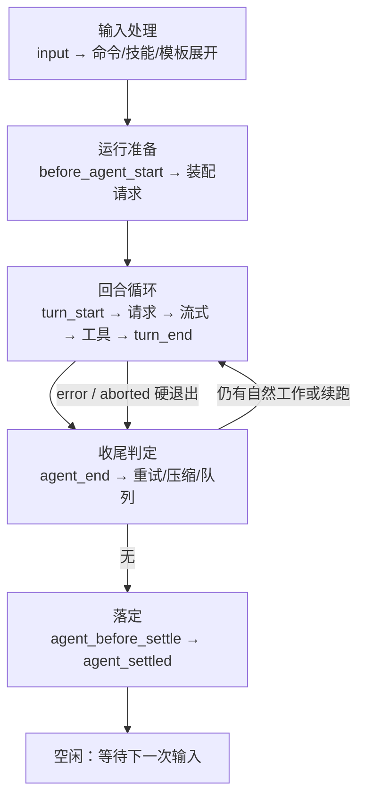
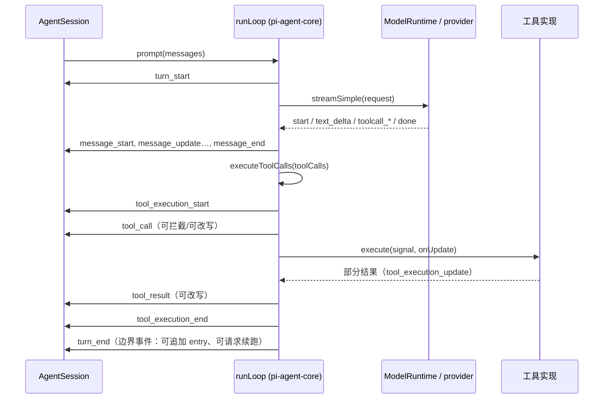

# 第 2 章 一次请求的完整生命周期

← 上一章：[第 1 章 架构总览](01-architecture-overview.md) ｜ [返回目录](README.md)

> **本章你将学会**：追踪一次按键从终端到 provider 再回到屏幕的完整路径；说出这条路径上每个阶段所属的模块与文件；判断某个扩展钩子在这条路径上的准确插入位置；用事件流反推一次运行发生了什么。
>
> **对应官方文档**：[How Pi Works](https://pi.dev/docs/latest/how-pi-works) · [JSON Event Stream](https://pi.dev/docs/latest/json) · [Extensions](https://pi.dev/docs/latest/extensions)

第 1 章给了静态分层。本章走一条动态路径：你在编辑器里按下回车，Pi 做第一轮工作，中间可能压缩上下文、并行跑三个工具、失败后重试一次，最后空闲下来。这条路径上发生的每一件事都能落到具体文件，因此它也决定了后面各章的展开顺序：3 章讲循环本体，4 章讲模型层，5 章讲上下文装配，6、7 章讲存储与压缩，8 章讲工具，9、10 章讲扩展怎么切入这条路径。

## 2.1 阶段划分

一次提交（prompt）的生命周期分五段，边界由事件名定义：



| 阶段 | 谁负责 | 关键代码 |
|---|---|---|
| 输入处理 | `AgentSession` 的输入管线与 `ExtensionRunner` 的 `input` 分发 | `packages/coding-agent/src/core/agent-session.ts`、`src/core/extensions/runner.ts` |
| 运行准备 | `AgentSession._buildRuntime()` 装配工具与扩展，`agent-session-services.ts` 装配服务 | `src/core/agent-session-services.ts`、`src/core/sdk.ts` |
| 回合循环 | pi-agent-core 的 `runLoop()` | `packages/agent/src/agent-loop.ts:172` |
| 收尾判定 | `AgentSession` 的压缩检查、重试、队列 | `src/core/agent-session.ts`、`src/core/compaction/compaction.ts` |
| 落定 | 边界事件与空闲通知 | `agent-session.ts` 的 `_runBeforeSettleBoundary()` / `_emitAgentSettled()` |

一个容易忽略的事实：**阶段 2 到阶段 5 全都在同一个进程、同一个 JS 事件循环里完成**。Pi 没有独立的"引擎进程"，界面、扩展、工具、provider 客户端是同进程协作的组件；跨进程边界只在你显式使用 RPC 模式或 `codemode` 的 worker 时才出现（分别见第 15 章、12 章）。

## 2.2 输入处理：斜杠命令优先于一切

文本进入 Pi 后按固定顺序被消费，这个顺序决定了"为什么我的 `input` 钩子没看到某条消息"：

1. **扩展命令**（`/mycommand`）先匹配。命中即执行命令处理函数，`input` 事件**不会**触发。
2. `input` 事件：可拦截（`handled`）、可改写（`transform`）、可放行（`continue`）。此时看到的是**原始文本**，技能命令与提示词模板尚未展开。
3. 技能命令 `/skill:name` 展开为技能正文。
4. 提示词模板 `/template` 展开。
5. 剩余文本成为 user 消息，进入 `before_agent_start`。

`pi.sendUserMessage()` 注入的消息默认跳过第 1、3、4 步，只有显式传 `expandPromptTemplates: true` 才会走命令与展开路径。这是扩展之间互相驱动（例如"让模型执行一条内置命令"）时的关键开关。

如果 Pi 正在流式输出，输入不会被"准备"而是被**排队**：回车是 steering（在当前助手回合及其工具执行结束后插入），`Alt+Enter` 是 follow-up（等整轮任务收尾）。队列的实现在第 3 章。

## 2.3 请求装配：一次模型请求由四份输入合成

```typescript
// 概念示意：一次请求的组成
{
  systemPrompt,   // 5 章：section 结构与补丁回放
  messages,       // 6 章：从活动分支投影出来的 Message[]
  tools,          // 8 章：活动工具的声明（loadout）
  requestOptions, // 4 章：model / reasoning / 采样参数 / 头
}
```

装配顺序上，Pi 先由 `SessionManager` 给出规范上下文（第 6 章的三段管线），再由 `buildSystemPromptSections()` 产出结构化提示词段（5.2 节），然后与工具注册表的声明合成请求。合成结果交给 `ModelRuntime`，由它按 provider 分派到具体 API 实现（4.2 节）。

扩展在这一步有四个插入点，顺序固定且不可调换：

| 钩子 | 能看到 | 能改什么 |
|---|---|---|
| `context` | 不含系统消息的对话 | 返回新消息列表（Pi 会重新注入提示词与工具头） |
| `context_with_system` | 完整 transcript，含系统消息 | 完全接管这一份请求的提示词与工具声明 |
| `before_provider_headers` | 已组装的 HTTP 头 | 原地增删头（设 `null` 删除） |
| `before_provider_request` | provider 专属 payload | 替换 payload（序列化后的最后机会） |

`after_provider_response` 与 `provider_stream_event` 在响应侧：前者在流被消费前拿到状态码与响应头，后者逐条拿到解析后的原始流事件（只读，且处理慢会拖慢整个流）。

## 2.4 回合与工具执行

一个回合 = 一次模型响应 + 该响应里全部工具调用。回合内部的事件顺序是：



三个必须精确理解的细节：

- **工具调用先串行预检、再并发执行**。同一条助手消息里的多个调用，`tool_execution_start` 与 `tool_call` 按消息源顺序串行发出，实际 `execute()` 用 `Promise.all` 并发，`tool_execution_end` 按完成顺序发出，而最终的 `toolResult` 消息仍按源顺序补发。这解释了为什么在 `tool_call` 里不能假定能看到兄弟调用的结果。
- **`stopReason: "length"` 时整批工具不执行**。响应被输出上限截断，任何参数都可能不完整，Pi 直接把这一批全部标为失败结果（第 7 章会看到这条路径与溢出恢复的衔接）。
- **提前终止需要整批一致**。只有当一个批次里**所有**最终结果都带 `terminate: true`，循环才在此停下。

## 2.5 收尾：`agent_end` 不是"结束了"

低层运行结束时发出 `agent_end`，但它之后仍可能发生：自动重试、溢出后的压缩重试、队列里的 steering/follow-up 消息、扩展在边界请求的续跑。因此判断"Pi 不会再自动做事"的唯一事件是 `agent_settled`；判断"还能改这轮结果"的最后机会是 `agent_before_settle`。集成代码里把 `agent_end` 当完成信号，是最常见的一类错误（第 15 章的 JSON/RPC 客户端按此约定写）。

## 2.6 界面只是这条路径的另一个消费者

四种模式共用同一条生命周期，区别只在事件出口：

| 模式 | 出口 | 事件覆盖 |
|---|---|---|
| interactive | `pi-tui` 渲染组件树 | 全部 |
| rpc | JSONL 事件 + 双向命令 | 全部，另有 `extension_error`、`bash_execution_update` |
| json | 单向 JSONL（首条是 session header） | 会话事件（无 header 之外的输入能力） |
| print | 最终文本 | 不外发事件 |

这也是"扩展要按模式分支"的根因：`ctx.mode` 与 `ctx.hasUI` 表达的就是这条路径的出口能力（9.8 节）。

> 源码位置：`packages/coding-agent/src/core/agent-session.ts`（输入管线、边界、收尾判定）、`packages/agent/src/agent-loop.ts`（回合与工具执行）、`packages/coding-agent/src/modes/`（四个出口）。

## 小结

- 生命周期按事件分五段：输入 → 准备 → 回合循环 → 收尾判定 → 落定；`agent_settled` 才是空闲信号。
- 扩展命令先于 `input`，`input` 先于技能与模板展开；`sendUserMessage()` 默认绕过命令与展开。
- 一次请求由提示词段、上下文投影、工具声明、请求参数四份输入合成，四个装配钩子按固定顺序插入。
- 工具调用"串行预检 + 并发执行 + 源顺序补发结果"；截断响应整批失败；批级提前终止要求全体 `terminate`。
- 四种模式只是这条路径的不同出口，扩展的模式差异来自出口能力差异。

## 练习

1. 运行 `pi --mode json "读取 README 并总结" 2>/dev/null | tee run.jsonl`，按 `type` 统计事件顺序。验收标准：指出 `turn_start` 出现几次、每次对应哪条 `toolCall`，并说明 `agent_end` 与 `agent_settled` 之间隔着什么。
2. 写一个临时扩展，注册同名命令 `/echo`，并监听 `input`。分别输入 `/echo hi` 与 `hi`。验收标准：解释为什么前者没有触发 `input`，并给出一个需要 `expandPromptTemplates: true` 才能复现的命令派发例子。
3. 用 `debug-provider.ts` 示例（`pi -e packages/coding-agent/examples/extensions/debug-provider.ts`）观察一次带两个工具调用的回合。验收标准：画出你看到的 `tool_execution_start` / `tool_execution_end` 顺序，并确认它符合本章的"串行预检、并发执行、完成顺序发 end"。
4. 在一次运行中途按 `Escape` 中断。验收标准：用事件流证明 `agent_before_settle` 被跳过、`agent_settled` 的 `aborted` 为 `true`。

## 延伸阅读

- [How Pi Works](https://pi.dev/docs/latest/how-pi-works)（官方对同一流程的简版描述）
- [JSON Event Stream](https://pi.dev/docs/latest/json)（每个事件的字段）
- 第 3 章：循环本体的代码细节；第 9 章：钩子分发与组合语义

---

→ 下一章：[第 3 章 智能体循环内核](03-agent-loop-internals.md) ｜ [返回目录](README.md)
