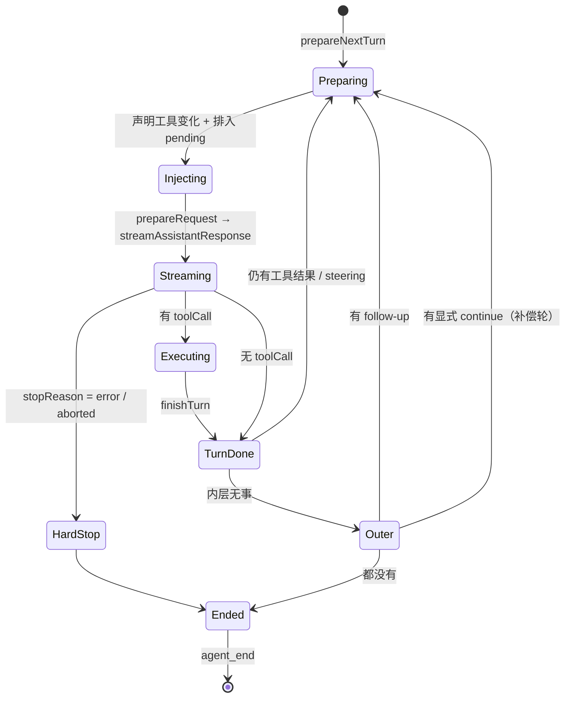

# 第 3 章 智能体循环内核

← 上一章：[第 2 章 一次请求的完整生命周期](02-request-lifecycle.md) ｜ [返回目录](README.md)

> **本章你将学会**：读懂 `packages/agent` 的 959 行循环代码；说清 `Agent` 与 `AgentSession` 的职责切分；解释 steering/follow-up 队列、并行工具执行、abort 传播、两层重试的实际实现；判断哪些循环行为是 pi-agent-core 的通用语义、哪些是 coding-agent 的策略叠加。
>
> **对应官方文档**：[How Pi Works](https://pi.dev/docs/latest/how-pi-works) · [SDK](https://pi.dev/docs/latest/sdk) · [Settings](https://pi.dev/docs/latest/settings)

Pi 刻意把"循环"与"编码助手的策略"分成两层：`@earendil-works/pi-agent-core` 只提供一个不知道自己正在写代码的智能体循环；`@earendil-works/pi-coding-agent` 通过覆盖循环上的公开钩子字段，把会话存储、压缩、扩展事件、重试策略叠上去。看穿这一层分工，你就理解了为什么 Pi 能被用作通用 harness（第 16 章的 `durable` 包正是另一套叠加），也理解了为什么很多"Pi 行为问题"要到 `agent-session.ts` 而不是 `agent-loop.ts` 里找答案。

## 3.1 包的分工

| 文件 | 职责 |
|---|---|
| `packages/agent/src/types.ts` | `AgentMessage` 可扩展联合、`AgentContext`、`AgentLoopConfig`、`AgentEvent`、`ToolExecutionMode`、`QueueMode` |
| `packages/agent/src/agent-loop.ts` | 纯函数循环：`runLoop()` 及其外壳 `agentLoop` / `runAgentLoop` / `agentLoopContinue` |
| `packages/agent/src/agent.ts` | `Agent` 类：transcript 所有权、事件订阅、两个队列、运行与中断 |
| `packages/agent/src/stream-fn.ts` | `setDefaultStreamFn()`：没有显式注入流函数时的兜底 |
| `packages/agent/src/proxy.ts` | 代理流函数：把 LLM 调用路由到自家服务器，由服务端管理鉴权 |

循环本体（`runLoop`）不接受"会话"概念，只接受 `AgentContext`（`messages` + `tools`）、`AgentLoopConfig`（model、reasoning、四个取消息/准备请求的回调）、`AbortSignal`、事件 sink、以及一个 `StreamFn`。这种参数形状使它可以脱离 coding-agent 单独使用——SDK 里 `agent.prompt()` 与 `agentLoop()` 的差别正在于此。

## 3.2 `Agent`：把扩展点做成公开字段

`Agent` 的类注释就是它的职责声明："Stateful wrapper around the low-level agent loop"（[packages/agent/src/agent.ts:194](file:///D:/workspace/harness/earendil/pi/packages/agent/src/agent.ts#L194)）。私有部分是 `_state`、`listeners`、`steeringQueue`、`followUpQueue`、`activeRun`；公开部分是一组**可以被宿主直接赋值的钩子字段**（[agent.ts:200-223](file:///D:/workspace/harness/earendil/pi/packages/agent/src/agent.ts#L200-L223)）：

| 钩子字段 | 循环在何时调用 | coding-agent 用它接入什么 |
|---|---|---|
| `convertToLlm` | 每次发请求前，把 `AgentMessage[]` 折叠成 `Message[]` | `messages.ts` 的角色折叠（6.2 节） |
| `transformContext` | 同上，折叠之前 | `context` 扩展事件 |
| `streamFunction` | 实际发请求 | 委托 `ModelRuntime.streamSimple` |
| `prepareRequest` | 每次请求前，可换 context/model/thinkingLevel | `context_with_system` 与提示词补丁投影（`_installAgentRequestProjection`，[agent-session.ts:803](file:///D:/workspace/harness/earendil/pi/packages/coding-agent/src/core/agent-session.ts#L803)） |
| `beforeToolCall` / `afterToolCall` | 单个工具调用的前后 | `tool_call` / `tool_result`（`_installAgentToolHooks`，[agent-session.ts:668](file:///D:/workspace/harness/earendil/pi/packages/coding-agent/src/core/agent-session.ts#L668)） |
| `finishTurn` | 一个回合落定后，可返回 `end` / `continue` | `turn_end` 边界（`_installAgentBoundaryHooks`，[agent-session.ts:902](file:///D:/workspace/harness/earendil/pi/packages/coding-agent/src/core/agent-session.ts#L902-L911)） |
| `prepareNextTurn` / `prepareNextTurnWithContext` | 下一回合开始前，可整体替换 context | 阈值压缩、工具与提示词 loadout 刷新（[agent-session.ts:914](file:///D:/workspace/harness/earendil/pi/packages/coding-agent/src/core/agent-session.ts#L914)） |

`AgentSession` 构造完 `Agent` 后按固定顺序覆盖这些字段（[agent-session.ts:526-534](file:///D:/workspace/harness/earendil/pi/packages/coding-agent/src/core/agent-session.ts#L526-L534)）：`subscribe(this._handleAgentEvent)`（`:526`）→ `_installAgentToolHooks()`（`:527`，定义在 `:668`）→ `_installAgentNextTurnRefresh()`（`:528`，定义在 `:914`）→ `_installAgentRequestProjection()`（`:529`，定义在 `:803`）→ `_installAgentBoundaryHooks()`（`:530`，定义在 `:902`）→ `_installHiddenDeclarationsProjection()`（`:531`，定义在 `:1808`）→ `_installAgentForcedPromptProjection()`（`:532`，定义在 `:1828`）→ `_buildRuntime()`（`:534`，定义在 `:3687`）。这串赋值就是"编码助手策略"注入循环的全部入口。`toolExecution` 是例外：coding-agent 不设置它，因此始终取 `Agent` 的默认 `"parallel"`（[agent.ts:261](file:///D:/workspace/harness/earendil/pi/packages/agent/src/agent.ts#L261)），会话侧只在 [agent-session.ts:754](file:///D:/workspace/harness/earendil/pi/packages/coding-agent/src/core/agent-session.ts#L754) 读它。换句话说：**循环本身没有扩展系统，扩展系统靠覆盖循环的钩子字段实现**。这条事实解释了第 9 章里许多时序行为——例如为什么 `turn_end` 处理器的返回值能影响是否再发一次请求，而 `message_update` 处理器不能。

## 3.3 双层循环

`runLoop` 的结构值得原文读一遍（[agent-loop.ts:172](file:///D:/workspace/harness/earendil/pi/packages/agent/src/agent-loop.ts#L172)）：

```typescript
// packages/agent/src/agent-loop.ts（结构摘录）
while (true) {                                    // 外层：消化 follow-up
    let hasMoreToolCalls = true;
    while (hasMoreToolCalls || pendingMessages.length > 0) {   // 内层：工具与 steering
        if (lastCompletedTurn) {
            const nextTurnSnapshot = await config.prepareNextTurn?.(lastCompletedTurn);
            // 可替换 context / model / reasoning；随后补捞压缩期间排入的 steering
            if (pendingMessages.length === 0) pendingMessages = (await config.getSteeringMessages?.()) || [];
            await emit({ type: "turn_start" });
        }
        for (const message of declareToolChanges(currentContext, [...preparedMessages, ...pendingMessages])) {
            await emit({ type: "message_start", message });
            await emit({ type: "message_end", message });
            currentContext.messages.push(message);
        }
        const requestUpdate = await config.prepareRequest?.({ context, model, thinkingLevel }, signal);
        const message = await streamAssistantResponse(currentContext, config, signal, emit, streamFunction);
        if (message.stopReason === "error" || message.stopReason === "aborted") { /* 硬退出 */ }
        const toolCalls = message.content.filter((c) => c.type === "toolCall");
        const executedToolBatch = message.stopReason === "length"
            ? await failToolCallsFromTruncatedMessage(toolCalls, emit)
            : await executeToolCalls(currentContext, message, config, signal, emit);
        hasMoreToolCalls = !executedToolBatch.terminate;
        const decision = await config.finishTurn?.(lastCompletedTurn, signal);
        if (decision?.action === "end") { await emit({ type: "agent_end", ... }); return; }
        explicitContinuation = decision?.action === "continue";
        pendingMessages = (await config.getSteeringMessages?.()) || [];
    }
    const followUpMessages = (await config.getFollowUpMessages?.()) || [];
    if (followUpMessages.length > 0) { pendingMessages = followUpMessages; continue; }
    if (explicitContinuation) { explicitContinuation = false; continue; }   // 补偿轮
    break;
}
await emit({ type: "agent_end", messages: newMessages });
```

几个只在代码里才看得清的设计决定：

1. **`turn_start` 在 `prepareNextTurn` 之后发**。压缩、分支摘要这类耗时准备发生在"回合外"，因此界面看到的是回合边界干净、准备阶段可被 `Escape` 打断。
2. **准备阶段结束后二次捞 steering**（`agent-loop.ts:213`）。注释明确说明只在第一次捞取为空时才补捞——否则 `one-at-a-time` 模式会在同一回合交付两条消息。这是"少丢消息"与"不越序"之间的显式折中。
3. **`error` / `aborted` 是硬退出**：先 `finishTurn`、`turn_end`，再 `agent_end`，直接 `return`。第 2 章说"错误与中断响应是硬退出"，出处就在这 12 行（[agent-loop.ts:254-265](file:///D:/workspace/harness/earendil/pi/packages/agent/src/agent-loop.ts#L254-L265)）。
4. **`explicitContinuation` 会被自然工作抵消**。若扩展请求了 `continue`，但工具结果或 steering 已经要触发下一次请求，就把这个请求"记账抵消"（`agent-loop.ts:303-307`）；只有外层确实无事可做时，才补一个纯上下文请求（[agent-loop.ts:319-323](file:///D:/workspace/harness/earendil/pi/packages/agent/src/agent-loop.ts#L319-L323)）。这正是文档里"`continue: true` 保证恰好一次后续 provider 请求"的实现依据。



## 3.4 工具变化也是消息

`declareToolChanges()`（[agent-loop.ts:342](file:///D:/workspace/harness/earendil/pi/packages/agent/src/agent-loop.ts#L342)）是第 6 章那条设计的执行端：它比较"transcript 回放出来的当前工具集"与"`context.tools` 想要的工具集"，把差异挂到本轮待注入的那条系统消息上（`toolsAdded` / `toolsRemoved`）。若待注入消息里已有系统消息，就地改写；否则新建。于是 `pi.setActiveTools()` 或动态注册工具，不需要任何"重新发一遍完整工具列表"的动作——下一请求只带一条小补丁，缓存前缀得以保留。

## 3.5 两个队列与模式

`PendingMessageQueue`（[agent.ts:149](file:///D:/workspace/harness/earendil/pi/packages/agent/src/agent.ts#L149)）的 `mode` 只有 `all` 与 `one-at-a-time`（[packages/agent/src/types.ts:55](file:///D:/workspace/harness/earendil/pi/packages/agent/src/types.ts#L55)），默认 `one-at-a-time`（[agent.ts:261](file:///D:/workspace/harness/earendil/pi/packages/agent/src/agent.ts#L261)），由设置键 `steeringMode` / `followUpMode` 控制。取用点固定：`getSteeringMessages` 在循环开头、准备之后、回合结尾三处；`getFollowUpMessages` 只在外层准备退出前。

`AgentSession` 另外维护一份**文本副本**队列（`_steeringMessages` / `_followUpMessages`，[agent-session.ts:408-410](file:///D:/workspace/harness/earendil/pi/packages/coding-agent/src/core/agent-session.ts#L408-L410)），以及 `_pendingNextTurnMessages` / `_pendingCustomMessages`。副本存在的理由是界面要显示队列、`Alt+Up` 要把队列退回编辑器，而 `Agent` 的队列只承载语义。`queue_update` 事件里的 `steering` / `followUp` 数组来自副本，不是来自 `Agent`。

## 3.6 并行工具执行的确切语义

`executeToolCalls()` 先选分支：`config.toolExecution === "sequential"`，或本批**任一**工具声明 `executionMode: "sequential"`，整批串行（[agent-loop.ts:526-532](file:///D:/workspace/harness/earendil/pi/packages/agent/src/agent-loop.ts#L526-L532)）。并行路径（[agent-loop.ts:596](file:///D:/workspace/harness/earendil/pi/packages/agent/src/agent-loop.ts#L596)）分三步：

1. 逐个 `emit(tool_execution_start)` → `await prepareToolCall(...)`，也就是**校验参数、跑 `tool_call` 钩子、决定放行或拦截**这一段是串行的；
2. 放行成功的调用被包成闭包塞进数组，最后 `Promise.all` 并发执行 `execute()`；
3. `tool_execution_end` 由各闭包在完成时刻发出（完成顺序），而 `toolResult` 消息在全部落定后按**助手消息源顺序**补发。

由此得出三条实践结论：`tool_call` 处理器不能假设能看到兄弟调用的结果；同一文件被两个工具改必须走 `withFileMutationQueue()`（8.4 节）；一个 `executionMode: "sequential"` 的工具会拖慢整批，只应在真正共享可变内存状态时使用。

批级提前终止由 `shouldTerminateToolBatch()` 判定，要求该批**每一个**最终结果都带 `terminate === true`（[agent-loop.ts:700](file:///D:/workspace/harness/earendil/pi/packages/agent/src/agent-loop.ts#L700)）。

## 3.7 abort 是一条链，不是一个开关

`Agent.abort()` 触发 `activeRun.abortController.abort()`（[agent.ts:350](file:///D:/workspace/harness/earendil/pi/packages/agent/src/agent.ts#L350)）。signal 沿三条路向下传：`runLoop` → `streamAssistantResponse` 的 `options.signal`（[agent-loop.ts:416](file:///D:/workspace/harness/earendil/pi/packages/agent/src/agent-loop.ts#L416)）；`executePreparedToolCall` → `tool.execute(..., signal, ...)`（[agent-loop.ts:842](file:///D:/workspace/harness/earendil/pi/packages/agent/src/agent-loop.ts#L842)）；预检与各并行闭包里的 `signal?.aborted` 短路，产出 `"Operation aborted"` 结果（[agent-loop.ts:630](file:///D:/workspace/harness/earendil/pi/packages/agent/src/agent-loop.ts#L630)、[748](file:///D:/workspace/harness/earendil/pi/packages/agent/src/agent-loop.ts#L748)、[767](file:///D:/workspace/harness/earendil/pi/packages/agent/src/agent-loop.ts#L767)）。

`AgentSession.abort()` 做的是聚合：置 `_agentRunAbortRequested`、`abortRetry()`、`abortCompaction()`、`abortBranchSummary()`、`agent.abort()`，最后 `waitForIdle()`（[agent-session.ts:2519-2528](file:///D:/workspace/harness/earendil/pi/packages/coding-agent/src/core/agent-session.ts#L2519-L2528)）。也就是说一次 `Escape` 同时终结四件事：模型流、工具执行、自动重试等待、后台压缩/摘要；`!` 命令另有 `_bashAbortControllers` 独立管理。扩展拿到的 `ctx.signal` 就是这条链上的当前 signal（9.5 节解释它在哪些事件里一定为 `undefined`）。

## 3.8 两层重试

Pi 的重试分两层，互不重叠：

| 层 | 位置 | 语义 | 默认 |
|---|---|---|---|
| provider 请求重试 | `packages/ai/src/utils/provider-retry.ts:107` | 同一个 HTTP 请求的瞬时失败重发，指数 `0.5 * 2^i`，封顶 8 秒 | 由 provider 决定；`retry.provider.maxRetryDelayMs = 60000` 是延迟上限 |
| 回合重试 | `agent-session.ts:3843` 的 `_prepareRetry()` | 整个助手回合失败后重跑一次请求，产生 `auto_retry_start` / `auto_retry_end` | `enabled: true`、`maxRetries: 3`、`baseDelayMs: 2000`、`maxAgentDelayMs: 60000`（[packages/coding-agent/src/core/settings-defaults.ts:18-26](file:///D:/workspace/harness/earendil/pi/packages/coding-agent/src/core/settings-defaults.ts#L18-L26)） |

回合退避用 `baseDelayMs * 2^(attempt-1)` 并以 `maxAgentDelayMs` 封顶（[packages/ai/src/utils/retry.ts:146](file:///D:/workspace/harness/earendil/pi/packages/ai/src/utils/retry.ts#L146)）。可重试性由 `_isRetryableError()`（[agent-session.ts:3790](file:///D:/workspace/harness/earendil/pi/packages/coding-agent/src/core/agent-session.ts#L3790)）判定；是否"结束后还会再来一轮"由 `_willRetryAfterAgentEnd()`（[agent-session.ts:1216](file:///D:/workspace/harness/earendil/pi/packages/coding-agent/src/core/agent-session.ts#L1216)）表达，这也是 `agent_end` 带 `willRetry` 字段的原因。`abort_retry`（RPC）与 `Escape` 的区别在于：前者只取消重试等待，后者取消整个运行。

## 3.9 代理流函数

`packages/agent/src/proxy.ts` 面向"客户端不持有 provider 凭证"的部署：把 LLM 调用发到自家服务器，由服务端鉴权并转发。它的 `ProxyAssistantMessageEvent` 刻意剥掉 `partial` 字段以省带宽，只保留 `text_delta` / `toolcall_delta` 这类增量与必要的 `id`、`toolName`。这条路径说明 `StreamFn` 是可替换边界——同一循环既能直连 provider，也能走网关，还能被 SDK 换成录放用的假实现（`registerFauxProvider` 在 compat 入口，见 4.1 节）。

## 小结

- `pi-agent-core` 提供与领域无关的循环；`AgentSession` 通过覆盖 `Agent` 的公开钩子字段叠加策略，Pi 没有独立的插件式循环。
- 双层循环的分工：内层消化工具结果与 steering，外层消化 follow-up 与显式 `continue`；错误与中断是硬退出。
- 工具与提示词的集合变化以系统消息补丁的形式注入下一请求（`declareToolChanges()`），保住缓存前缀。
- 队列模式只有 `all` 与 `one-at-a-time`，默认后者；界面队列是 `AgentSession` 的文本副本，不是队列本体。
- 并行执行"串行预检 + 并发执行 + 源顺序补发结果"；串行化条件是全局 `toolExecution` 或任一工具声明。
- abort 是一条 signal 链，`AgentSession.abort()` 聚合运行、重试、压缩、分支摘要四类工作。
- 重试分 provider 请求层与助手回合层，后者默认 3 次、基础延迟 2000 ms、上限 60000 ms。

## 练习

1. 打开 `packages/agent/src/agent-loop.ts`，在 `runLoop` 的四 `emit` 点（`turn_start`、`prepareRequest` 前、`finishTurn` 前、`agent_end`）加临时 `console.error` 时间戳，用 `pi -e` 跑一个两工具调用的任务。验收标准：你的输出顺序与 3.3 节的结构摘录一致，并能指出压缩发生在哪个位置。
2. 在同一个扩展里注册三个工具：两个默认并发、一个 `executionMode: "sequential"`，让模型一次调用三个。验收标准：从 `tool_execution_start` 与 `tool_execution_end` 的时间戳证明整批被串行化。
3. 用 `pi --mode json` 触发一次 429 或 529 后观察 `auto_retry_start`。验收标准：写出 `attempt`、`maxAttempts`、`delayMs` 三个字段的实际取值，并指出 2000 ms 与 4000 ms 来自哪个设置键。
4. 阅读 `packages/agent/src/proxy.ts` 的事件类型，与 `packages/ai/src/types.ts` 的 `AssistantMessageEvent` 对比。验收标准：列出被剥离的字段，并说明为什么 `toolcall_start` 需要额外携带 `id` 与 `toolName`。

## 延伸阅读

- 源码：`packages/agent/src/agent-loop.ts`（循环）、`packages/agent/src/agent.ts`（`Agent`、队列、abort）、`packages/agent/src/types.ts`（契约）
- 第 2 章：这条循环在完整生命周期里的位置；第 9 章：钩子字段背后的扩展事件分发
- 第 16 章：`pi-durable` 如何在同一循环上叠加"先落库再展示"的崩溃恢复语义

---

→ 下一章：[第 4 章 pi-ai：统一模型层](04-pi-ai-model-layer.md) ｜ [返回目录](README.md)
