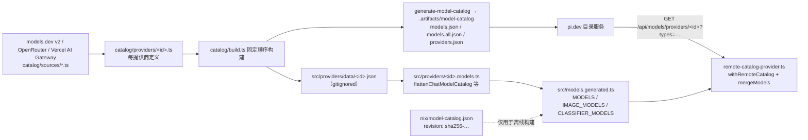

# 第 4 章 pi-ai：统一模型层

← 上一章：[第 3 章 智能体循环内核](03-agent-loop-internals.md) ｜ [返回目录](README.md)

> **本章你将学会**：区分 `Model`、`Provider`、`Api` 三个概念并说清各自的字段所有权；读懂 `stream` 与 `streamSimple` 的契约差别；解释 Pi 的模型目录从生成、发布到运行时覆盖的完整链路；按正确顺序追踪一次凭证解析；用 transcript 辅助函数从消息列表反推提示词与工具集。
>
> **对应官方文档**：[Choose a Model](https://pi.dev/docs/latest/models) · [Models Configuration](https://pi.dev/docs/latest/models-configuration) · [Providers](https://pi.dev/docs/latest/providers) · [Custom Providers](https://pi.dev/docs/latest/custom-provider)

`@earendil-works/pi-ai` 是 Pi 唯一知道"提供商"这件事的包。上面两层（`pi-agent-core` 与 `pi-coding-agent`）只处理"消息 + 工具 + 一个流函数"，下面所有差异——Anthropic 的 `cache_control` 打点、OpenAI Responses 的 `configuration_update`、Bedrock 的 SigV4、Mistral 的 camelCase 键——都收敛在这个包的 `src/api/` 里。本章不讲怎么配模型（入门教程第 4 章已覆盖），讲的是这套抽象为什么长成这样，以及扩展接入新服务时要在哪一层落地。

## 4.1 包的入口形状

`package.json` 的 `exports` 把能力切成几组，切法本身就是设计意图的说明（[packages/ai/package.json:13](file:///D:/workspace/harness/earendil/pi/packages/ai/package.json#L13)）：

| 子路径 | 内容 | 为什么单独切 |
|---|---|---|
| `.` | 核心类型、事件流、无副作用工具 | 不含生成目录、provider 工厂、api 注册表、OAuth、compat（[src/index.ts:4](file:///D:/workspace/harness/earendil/pi/packages/ai/src/index.ts#L4)），保证只想拿类型的宿主不被迫加载全部提供商 SDK |
| `./models` | `Provider`、`Models`、`createModels`、`createProvider`、`hasApi`、`calculateCost`、`clampThinkingLevel`、`ModelsError` | 提供商与目录能力 |
| `./providers/all` | `getBuiltinModel(s)`、`getBuiltinImageModel*`、`getBuiltinClassifierModel*`、`getBuiltinProviders`、`getBuiltinModelDataGeneratedAt` | 内置目录只在这里出现 |
| `./api/<id>`、`./api/<id>.lazy` | 各 API 实现及其惰性包装 | 按需加载，避免打包全部 SDK |
| `./compat` | 旧的全局流函数与 api 注册表 | 见 4.7 |
| `./oauth` | **仅类型**（`OAuthAuthInfo`、`OAuthCredentials`、`OAuthLoginCallbacks`、`OAuthPrompt`、`OAuthDeviceCodeInfo` 等） | 让扩展写类型而不引入 OAuth 实现 |
| `./utils/transcript`、`./utils/model-operations` | transcript 反推与模型操作 | 见 4.6 |

结论：新代码应当从 `./models` 与 `./api/*` 走，把 `./compat` 留给历史兼容。文档里 `pi.registerProvider()` 示例用的正是 `createProvider` + `openAICompletionsApi()` 这类 compat 面（第 11 章），因为扩展需要"注册即生效"的共享注册表。

## 4.2 三个抽象：Model、Provider、Api

```mermaid
flowchart TD
    subgraph ModelLayer["模型条目（数据）"]
        BASE["BaseModel<br/>id / name / api / provider<br/>baseUrl / input / inputLimits<br/>cost / headers"]
        CHAT["Model（type: chat）<br/>reasoning / thinkingLevelMap / promptCache<br/>contextWindow / maxTokens<br/>samplingParams / compat"]
        IMG["ImageModel<br/>output: text｜image"]
        CLS["ClassifierModel<br/>contextWindow"]
        BASE --> CHAT
        BASE --> IMG
        BASE --> CLS
    end
    subgraph ProviderLayer["提供商（行为）"]
        PROV["Provider<br/>auth / getModels / refreshModels / filterModels<br/>stream / streamSimple<br/>generateImages? / classify?"]
        API["Api 实现（按 model.api 分派）<br/>ProviderStreams: stream + streamSimple"]
        PROV --> API
    end
    CHAT -.model.api 选择实现.-> API
    CHAT -.model.provider 归属.-> PROV
    MR["Models / MutableModels<br/>createModels()；coding-agent 侧为 ModelRuntime"] --> PROV
```

（`?` 表示可选字段。逐字段清单见 [`packages/ai/src/types.ts`](file:///D:/workspace/harness/earendil/pi/packages/ai/src/types.ts) 与 [Models Configuration](https://pi.dev/docs/latest/models-configuration)。）

三条边界值得单独强调：

- **`Api` 是字符串，不是类**。`KnownApi` 有 10 个成员，但类型是 `KnownApi | (string & {})`（[packages/ai/src/types.ts:64](file:///D:/workspace/harness/earendil/pi/packages/ai/src/types.ts#L64)），所以自定义 api id 合法且必然要走自定义 streaming。图像与分类各有独立枚举：`KnownImageApi = "openrouter-images"`，`KnownClassifierApi = "typesafe-system-one" | "cloudflare-workers-ai-system-one" | "llama-cpp-classify" | "openai-decisions"`（[types.ts:78](file:///D:/workspace/harness/earendil/pi/packages/ai/src/types.ts#L78)、[82](file:///D:/workspace/harness/earendil/pi/packages/ai/src/types.ts#L82)）。
- **模型类型靠 `type` 判别**，`chat` 是默认。同一 provider 下相同 ID 的不同操作互不冲突（[custom-provider.md](https://pi.dev/docs/latest/custom-provider)）。这也是 `mergeModels()` 用 `type\0id` 作键的原因（4.5 节）。
- **`Provider` 拥有 streaming 能力，`Model` 只描述能力**。`createProvider()` 用 `apiFor`/`dispatch` 按 `model.api` 选实现，缺实现时产出一个错误流而不是抛异常（[packages/ai/src/models.ts:1106](file:///D:/workspace/harness/earendil/pi/packages/ai/src/models.ts#L1106-L1119)）。

`Model` 上的 `compat` 字段是按 api 条件解析的每提供商差异开关（[types.ts:876](file:///D:/workspace/harness/earendil/pi/packages/ai/src/types.ts#L876)），`openai-completions` 的兼容面最宽：`thinkingFormat` 有 11 种取值、`maxTokensField`、`chatTemplateKwargs/Args`、`openRouterRouting`/`vercelGatewayRouting`、`vllmPriority`（[packages/ai/src/providers/compat-schema.ts:188](file:///D:/workspace/harness/earendil/pi/packages/ai/src/providers/compat-schema.ts#L188)）。文档对此有一句重要提醒：兼容开关描述的是**已验证**的差异，不要因为端点自称兼容就打开它们（[models.md](https://pi.dev/docs/latest/models)）。

## 4.3 `stream` 与 `streamSimple`

同一个 `Provider` 必须同时提供两者（[models.ts:158](file:///D:/workspace/harness/earendil/pi/packages/ai/src/models.ts#L158)）。差别只在选项类型：

| | `stream` | `streamSimple` |
|---|---|---|
| 选项 | `ApiOptionsMap` 逐 api 的具体类型（[types.ts:290](file:///D:/workspace/harness/earendil/pi/packages/ai/src/types.ts#L290) → `ApiStreamOptions` [307](file:///D:/workspace/harness/earendil/pi/packages/ai/src/types.ts#L307)） | 全 api 同一个 `SimpleStreamOptions`（[types.ts:377](file:///D:/workspace/harness/earendil/pi/packages/ai/src/types.ts#L377)） |
| 可用字段 | 提供商原生（如 `thinkingEnabled`、`thinkingBudgetTokens`、`effort`、`thinkingDisplay`、`tool_choice` 的原生联合） | 提供商中立：`reasoning?: ThinkingLevel`、`toolChoice?: "auto"|"none"`、`thinkingBudgets`、`deferred`、`onPayload`/`onResponse`/`onProviderStreamEvent` |
| 谁在用 | 需要精确控制的 API 实现内部 | 循环与扩展（`ctx.modelRegistry.streamSimple`） |

这就是"用 `streamSimple` 拿 `reasoning`，用 `complete` 拿 API 专属参数"的实现依据；也是为什么扩展必须走 `ctx.modelRegistry`，而不是 `pi-ai/compat` 的顶层流函数——后者看不到扩展注册的 provider（[extensions.md 的 Streaming model calls](https://pi.dev/docs/latest/extensions)）。

上下文形态也有讲究。公共入口接受 `Context`（`systemPrompt?` + `messages` + `tools?`），但真正传给 API 实现的是 `TranscriptContext`——它只含 `{ messages }`，并通过 `transcriptContextBrand` 标记，只能由 `normalizeContext()` 产生（[types.ts:800](file:///D:/workspace/harness/earendil/pi/packages/ai/src/types.ts#L800)、[src/utils/transcript.ts:30](file:///D:/workspace/harness/earendil/pi/packages/ai/src/utils/transcript.ts#L30)）。提示词与工具住在 transcript 的系统消息里（第 6 章），因此 `TranscriptContext` 是唯一的真相载体。自定义 streaming 若假设 `context.systemPrompt` 存在，就会在读扩展注入的会话时拿到 `undefined`。

## 4.4 流式事件协议

`AssistantMessageEvent` 恰好 12 个成员（[types.ts:821](file:///D:/workspace/harness/earendil/pi/packages/ai/src/types.ts#L821-L837)）：

```text
start
text_start / text_delta / text_end
thinking_start / thinking_delta / thinking_end
toolcall_start / toolcall_delta / toolcall_end
done   reason ∈ stop | length | toolUse | deferred
error  reason ∈ aborted | error
```

除 `done`/`error` 外，每条都携带 `partial: AssistantMessage`——同一份可变消息对象的当前快照。协议约束（[custom-provider.md 的 Implement custom streaming](https://pi.dev/docs/latest/custom-provider)）：请求建立成功后先发一条 `start`；每个内容块在发出暴露该状态的**事件之前**先更新它；`toolcall_end` 时的参数必须是完整可解析的 `ToolCall`；终态必须恰好一条 `done` 或 `error` 并关闭流；取消要表现为 aborted 结果。认证缺失可以在返回流之前同步抛出；请求建立失败可以跳过 `start` 直接 `error`。

载体是 `AssistantMessageEventStream`（[src/utils/event-stream.ts:97](file:///D:/workspace/harness/earendil/pi/packages/ai/src/utils/event-stream.ts#L97)）：`push()` / `end()` / `result()`，并自动写入 `durationMs`。`lazyStream()`（[src/api/lazy.ts:60](file:///D:/workspace/harness/earendil/pi/packages/ai/src/api/lazy.ts#L60)）让"同步返回流、异步装配实现"成为可能——这是每个 api 都有 `.lazy.ts` 变体的原因，也是首 token 延迟不被 SDK 加载拖累的实现手段。

用量与成本：`Usage` 含 `input`、`output`、`cacheRead`、`cacheWrite`、`cacheWrite1h?`、`reasoning?`、`totalTokens` 与 `cost{input,output,cacheRead,cacheWrite,total,totalFromProvider?}`（[types.ts:459](file:///D:/workspace/harness/earendil/pi/packages/ai/src/types.ts#L459)）。两条容易搞错的语义：`reasoning` 已含在 `output` 里，不要重复相加；`cacheWrite1h` 是 `cacheWrite` 中按一小时保留写入的子集。计价用 `calculateCost()`（[models.ts:1236](file:///D:/workspace/harness/earendil/pi/packages/ai/src/models.ts#L1236)），支持 `tiers` 上下文分层计价（[src/providers/model-schema.ts:42](file:///D:/workspace/harness/earendil/pi/packages/ai/src/providers/model-schema.ts#L42)）——这是长上下文模型阶梯价的来源。

`ModelRuntime` **不在** pi-ai，而在 coding-agent（`packages/coding-agent/src/core/model-runtime.ts:174`，实现 `Models` 接口）。这个切法让 pi-ai 保持"库"的定位，把"带目录、带凭证存储、带扩展注册表"的运行时留给 harness。

## 4.5 模型目录：从生成到运行时覆盖



链路要点（全部可在仓库核对）：

1. 生成器是 `packages/ai/catalog/generate.ts`，由 `npm run generate-models` 以 `--strict` 调用；产物写入逻辑在 [catalog/generate.ts:187](file:///D:/workspace/harness/earendil/pi/packages/ai/catalog/generate.ts#L187-L245)。
2. `hydrate-model-data` / `check:model-data` 走 `packages/ai/scripts/check-model-data.ts` → `validateGeneratedModelData()`（[scripts/model-data.ts:303](file:///D:/workspace/harness/earendil/pi/packages/ai/scripts/model-data.ts#L303)），比对 `data/.manifest.json`。根 `build` 脚本先刷新模型数据再构建，`build:offline` 用已有数据——这就是"构建需要网络、复构建不需要"的出处。
3. 发布给 pi.dev 的 JSON 由 `generate-model-catalog` 写到 `.artifacts/model-catalog`，协议定义在根目录 [`scripts/model-catalog-protocol.ts:28`](file:///D:/workspace/harness/earendil/pi/scripts/model-catalog-protocol.ts#L28-L39)（`MODEL_CATALOG_REVISION_RE` 在 `:31`）。
4. `nix/model-catalog.json` 里的 `revision`（形如 `sha256-<64 hex>`）只用于 Nix/发布的离线构建固定数据版本，**运行时 overlay 不按 revision 取**。
5. 运行时覆盖发生在 coding-agent：`withRemoteCatalog()`（[packages/coding-agent/src/core/remote-catalog-provider.ts:104](file:///D:/workspace/harness/earendil/pi/packages/coding-agent/src/core/remote-catalog-provider.ts#L104)）把内置 provider 包一层，`mergeModels()`（`:32`）以 `type\0id` 为键让远端条目覆盖内置条目；`isNewer()`（`:67`）用远端 `lastModified` 与内置 `generatedAt` 比较决定是否采用；带 `If-None-Match`/304 再校验，刷新窗口 `REMOTE_CATALOG_REFRESH_INTERVAL_MS` 为 4 小时（`:16`）。OpenRouter 走 `withPersonalizedCatalog()`（`:195`），凭证化的模型列表整体替换目录。装配点在 [model-runtime.ts:229](file:///D:/workspace/harness/earendil/pi/packages/coding-agent/src/core/model-runtime.ts#L229-L241)。
6. 持久化契约是 `ModelsStoreEntry { models, lastModified, checkedAt, etag }`（[packages/ai/src/models-store.ts:3](file:///D:/workspace/harness/earendil/pi/packages/ai/src/models-store.ts#L3)）。

`models.json` 的用户覆盖永远在 provider 之上——包括扩展注册的原生 provider（[custom-provider.md](https://pi.dev/docs/latest/custom-provider)）。分层顺序因此是：**内置生成目录 < 远端目录 overlay < 扩展注册 < `models.json` 用户配置**。

## 4.6 凭证解析顺序与"不静默回落"

解析入口 `resolveProviderAuth()`（[packages/ai/src/auth/resolve.ts:33](file:///D:/workspace/harness/earendil/pi/packages/ai/src/auth/resolve.ts#L33)）；请求侧的合并在 `applyAuth()`（[models.ts:856](file:///D:/workspace/harness/earendil/pi/packages/ai/src/models.ts#L856)，`transformHeaders` 最后）。顺序：

1. **显式覆盖**：`overrides.apiKey` 最优先（[resolve.ts:56](file:///D:/workspace/harness/earendil/pi/packages/ai/src/auth/resolve.ts#L56)）。运行期 `--api-key` 走 coding-agent 的 `RuntimeCredentials.read()`（[packages/coding-agent/src/core/runtime-credentials.ts:24](file:///D:/workspace/harness/earendil/pi/packages/coding-agent/src/core/runtime-credentials.ts#L24)）。
2. **存储凭证**（`auth.json`）：`CredentialStore.read()`，唯一写路径是 `modify`（[src/auth/types.ts:65](file:///D:/workspace/harness/earendil/pi/packages/ai/src/auth/types.ts#L65)）。存了 `oauth` 走 `resolveStoredOAuth`，存了 `api_key` 走 `resolveApiKey`。**类型不匹配直接返回 `undefined`，不静默回落到环境变量**（[resolve.ts:27](file:///D:/workspace/harness/earendil/pi/packages/ai/src/auth/resolve.ts#L27-L32) 的注释与 README 同段）。这条设计能防止"你以为在用订阅、实际用了环境变量里的 API Key"这种账目混乱，也是"同一个 Shell 能登录、另一个不行"类问题的排查起点。
3. **环境/自适应**：仅在没有存储凭证时调用 `provider.auth.apiKey.resolve`（[resolve.ts:90](file:///D:/workspace/harness/earendil/pi/packages/ai/src/auth/resolve.ts#L90)）。标准实现 `envApiKeyAuth()` 先看 `credential.key`，再按 `envVars` 顺序取第一个非空（[src/auth/helpers.ts:9](file:///D:/workspace/harness/earendil/pi/packages/ai/src/auth/helpers.ts#L9)）；表驱动部分在 [src/env-api-keys.ts:151](file:///D:/workspace/harness/earendil/pi/packages/ai/src/env-api-keys.ts#L151)（`getEnvApiKey` / `findEnvKeys` / `getApiKeyEnvVars`），Vertex 的 ADC 与 Bedrock 的多凭证源用 `<authenticated>` 占位标记。env 读取经可注入的 `AuthContext`（[src/auth/context.ts:23](file:///D:/workspace/harness/earendil/pi/packages/ai/src/auth/context.ts#L23)），`ProviderRequestOptions.env` 通过 `overlayEnvAuthContext()` 覆盖 `process.env`——这让 SDK 宿主能注入自己的环境而不污染进程。
4. **OAuth 刷新**：`refreshStoredOAuthCredential()` 在 `credentials.modify` 锁内执行并即时落盘（[resolve.ts:119](file:///D:/workspace/harness/earendil/pi/packages/ai/src/auth/resolve.ts#L119)）。窗口 `DEFAULT_OAUTH_MINIMUM_VALIDITY_MS = 5 * 60 * 1000`、超时 15 秒（`:102`、`:103`）；刷新一旦开始就不再受调用方 signal 取消，避免半写状态。

`$ENV` / `${NAME}` / `!cmd` / `$$` / `$!` 这套插值**不在 pi-ai**，属于 coding-agent 配置层：`resolveConfigValue()`（[packages/coding-agent/src/core/resolve-config-value.ts:145](file:///D:/workspace/harness/earendil/pi/packages/coding-agent/src/core/resolve-config-value.ts#L145)），模板解析 `parseConfigValueTemplate()`（`:28`）、命令分支 `parseConfigValueReference()`（`:80`）、命令结果进程级缓存 `executeCommand()`（`:208`）、`resolveHeaders()`（`:256`）。

## 4.7 transcript 反推与能力分档

四个函数构成扩展与自定义 provider 的正确读法（都在 [src/utils/transcript.ts](file:///D:/workspace/harness/earendil/pi/packages/ai/src/utils/transcript.ts)）：

| 函数 | 语义 |
|---|---|
| `getCurrentTools(messages)` `:58` | 顺序重放每条 system 的 `toolsRemoved` 后 `toolsAdded`，返回当前工具集（Map 保序去重） |
| `getCurrentSystemMessage(messages)` `:73` | 把所有 system 合成一条：`content` 以 `\n\n` 拼接，`sections` 按名打补丁（`null` 删除），`toolsAdded` 取上面的结果 |
| `getCurrentSystemPrompt(messages)` `:99` | 上一条 + `getSystemMessageText()`，空则 `""` |
| `collapseSystemMessages(context)` `:108` | 把后续系统消息折进头部一条，供不支持会话中系统消息的模型使用 |

另有 `resolveTranscript()`（`:115`，按 `supportsMidConvoSystemMessages` 决定就地发送还是折叠）与 `resolveTranscriptTools()`（`:252`），后者按工具传输能力把请求分成 `"none" | "additions" | "changes"` 三档——这解释了为什么动态启用工具在某些提供商上会导致整段重放（缓存未命中），而在另一些上只是一条补丁。

## 4.8 实现一个 provider 的契约要点

`createProvider()`（[models.ts:1077](file:///D:/workspace/harness/earendil/pi/packages/ai/src/models.ts#L1077)）的选项在 `CreateProviderOptions`（`:1032`）：`auth` 与 `models` 必填（可为空数组），`api` 可以是单个 `ProviderStreams` 或按 api id 的部分映射，三选一（`api`/`images`/`classifiers`）必须存在否则抛错（`:1088`）。钩子契约：

- `getModels()` 同步且**不得抛异常**——抛出被视为"没有模型"（[models.ts:174](file:///D:/workspace/harness/earendil/pi/packages/ai/src/models.ts#L174-L180)）。
- `refreshModels(context)` 异步；内置实现由 `fetchModels` 生成，顺序是 restore → publish update → fetch → `publish({ persist: { models, checkedAt }, update })`（[models.ts:1129](file:///D:/workspace/harness/earendil/pi/packages/ai/src/models.ts#L1129-L1156)）。
- `filterModels(models, credential)` 只在凭证确认后由 `getAvailable()` 应用（[models.ts:198](file:///D:/workspace/harness/earendil/pi/packages/ai/src/models.ts#L198-L203)、[721](file:///D:/workspace/harness/earendil/pi/packages/ai/src/models.ts#L721)）。
- `generateImages` / `classify` **永不 reject**，失败以 error result 返回（[models.ts:1189](file:///D:/workspace/harness/earendil/pi/packages/ai/src/models.ts#L1189-L1215)）。
- 并发刷新用 generation 令牌防止旧结果覆盖新结果：`publishProviderModels()` 在写存储前与调用 `update` 前各检查一次 `refreshGenerations.get(providerId) !== generation`（[models.ts:525](file:///D:/workspace/harness/earendil/pi/packages/ai/src/models.ts#L525)、[533](file:///D:/workspace/harness/earendil/pi/packages/ai/src/models.ts#L533)），计数器在 `supersedeProviderRefresh()`（`:498`）递增。
- `context.signal` 必须是具体 signal，provider 的阻塞 I/O 要传它。调用 `ModelRuntime.refresh()` 省略 signal 时不设上限，截止日期由调用方负责。

第 11 章把这份契约落成两个可运行的扩展。

## 小结

- pi-ai 是唯一的提供商层：`Model` 描述能力，`Provider` 拥有实现与凭证，`Api` 是分派用的字符串（开放可扩展）。
- `stream` 用逐 api 的原生选项，`streamSimple` 用统一的 `SimpleStreamOptions`；两者都必须由 provider 提供。
- 提示词与工具住在 transcript 的系统消息里，`TranscriptContext` 是唯一真相载体，读它要用 `getCurrentSystemMessage/getCurrentTools`。
- 事件协议恰好 12 个成员，除终态外都带 `partial` 快照；顺序与终态约束是自定义 streaming 的验收点。
- 目录链路是"生成 → 发布 → 运行时 overlay"，分层优先级为内置 < 远端 < 扩展注册 < `models.json`。
- 凭证顺序是显式覆盖 → 存储 → 环境 → OAuth 刷新，且存储类型不匹配不静默回落。

## 练习

1. 用 `node -e` 直接 `import` pi-ai 的 `./utils/transcript`，拿一份会话 JSONL 里的消息数组跑 `getCurrentSystemPrompt()`。验收标准：输出与 `pi` 里 `ctx.getSystemPrompt()` 在该时刻的显示一致，并解释不一致时会差在哪个字段。
2. 阅读 `src/api/openai-completions.ts` 与 `src/api/anthropic-messages.ts` 里打缓存标记的位置。验收标准：指出 Anthropic 在哪三处插 `cache_control`、OpenAI Completions 何时用 `cacheControlFormat: "anthropic"`，以及 `prompt_cache_key` 为什么截断到 64 字符。
3. 设一个假的 api id（例如 `"my-acme-api"`）注册 provider 并调用。验收标准：确认失败以错误流而非异常表现，并引用 `createProvider` 里决定这一行为的代码行。
4. 断网（`PI_OFFLINE=1`）启动，记录可用模型数；去掉它再启动，再对比。验收标准：说明哪部分是 `models.generated.ts` 的内置目录、哪部分是远端 overlay，并给出 overlay 采用的判定条件（`lastModified > generatedAt`）。

## 延伸阅读

- [Models Configuration](https://pi.dev/docs/latest/models-configuration)（`models.json` 的提供商/模型/覆盖三层与兼容性键）
- [Custom Providers](https://pi.dev/docs/latest/custom-provider)（自定义 streaming 的六条硬性要求）
- 源码：`packages/ai/src/types.ts`、`packages/ai/src/models.ts`、`packages/ai/src/utils/transcript.ts`、`packages/ai/catalog/README.md`
- 第 5 章：装配后的请求如何保住缓存前缀；第 11 章：把本章契约落成扩展代码

---

→ 下一章：[第 5 章 上下文装配与系统提示词](05-context-assembly.md) ｜ [返回目录](README.md)
