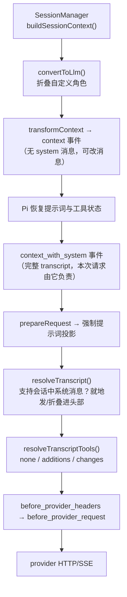

# 第 5 章 上下文装配与系统提示词

← 上一章：[第 4 章 pi-ai：统一模型层](04-pi-ai-model-layer.md) ｜ [返回目录](README.md)

> **本章你将学会**：列出默认系统提示词的全部段名与包装规则；解释"段补丁"为什么能保住 prompt cache；按正确顺序判断哪个钩子真正拥有提示词、哪个只拥有这一次请求；算出缓存预热值不值得做；诊断"我的 AGENTS.md / 技能说明为什么没进模型"。
>
> **对应官方文档**：[How Pi Works](https://pi.dev/docs/latest/how-pi-works) · [Configuration](https://pi.dev/docs/latest/configuration) · [Skills](https://pi.dev/docs/latest/skills) · [Settings](https://pi.dev/docs/latest/settings)

上下文装配是 Pi 里"效果最直接、误解也最多"的一层。常见误解有三种：以为系统提示词是一大段纯文本（其实是可 diff 的结构化段）；以为改提示词只是改字符串（其实决定整轮缓存命中）；以为 `context` 事件能改提示词（其实它只管消息）。本章按代码顺序把这三件事拆开。

## 5.1 装配管线



第 3 章说过这条管线挂在循环的两个钩子字段上；第 4 章说过最终交给 API 实现的是 `TranscriptContext`。这一章关注两件事：提示词长什么样（5.2 到 5.5），以及它怎么变化（5.6 到 5.7）。

## 5.2 段结构

默认提示词不是一整块文本，而是一个有序字典（`buildSystemPromptSections()`，[packages/coding-agent/src/core/system-prompt.ts:128](file:///D:/workspace/harness/earendil/pi/packages/coding-agent/src/core/system-prompt.ts#L128)）：

| 段名 | 包装 | 内容 |
|---|---|---|
| `preamble` | **无标签** | 默认 "You are an expert coding assistant operating inside pi, a coding agent harness…"；有 `customPrompt`（`--system-prompt` 或 `SYSTEM.md`）时整体替换 |
| `tools` | `<tools>` | 每个有 `promptSnippet` 的活动工具一行 `- name: snippet`；一个都没有时写 `(none)`，并附一句"可能有其他自定义工具" |
| `rules` | `<rules>` | 见 5.4 |
| `docs` | `<docs>` | 指向本机 README、docs、examples 路径的静态索引块（`getReadmePath()` / `getDocsPath()` / `getExamplesPath()`） |
| `addendum` | `<addendum>` | `--append-system-prompt` 与 `APPEND_SYSTEM.md` 合并后的文本 |
| `project_context` | `<project_context>` | 每个上下文文件一个 `<project_instructions path="…">` |
| `skills` | `<skills>` | `<available_skills>` 列表（见 5.5） |
| `cwd` | `<cwd>` | 工作目录，反斜杠归一为正斜杠 |
| 自定义段 | `<name>` | `systemPromptOptions.sections`，名字受 `^[a-z][a-z0-9_-]*$` 约束且不得叫 `preamble`，违反即抛错（[system-prompt.ts:58](file:///D:/workspace/harness/earendil/pi/packages/coding-agent/src/core/system-prompt.ts#L58)、[144](file:///D:/workspace/harness/earendil/pi/packages/coding-agent/src/core/system-prompt.ts#L144)） |

段名同名即标签名，这不是排版偏好，而是让模型能把后续更新对应回具体段。`buildSystemPromptState()` 把这份字典装成 `{ content: "", sections }`；只有强制提示词会退化成 `{ content: forced }` 且**没有段**（[system-prompt.ts:199](file:///D:/workspace/harness/earendil/pi/packages/coding-agent/src/core/system-prompt.ts#L199)）。默认活动工具集是 `["read", "bash", "edit", "write"]`（[system-prompt.ts:64](file:///D:/workspace/harness/earendil/pi/packages/coding-agent/src/core/system-prompt.ts#L64)）。

## 5.3 三个入口，三种后果

| 入口 | 机制 | 对缓存 |
|---|---|---|
| `--system-prompt` / `SYSTEM.md` | 设 `customPrompt`，只换 `preamble`，其余段照常 | 前缀变一次，之后照常 diff |
| `--append-system-prompt` / `APPEND_SYSTEM.md` | 合并成 `addendum` 段，位于项目上下文与技能之前 | 同上 |
| `before_agent_start` 返回 `systemPrompt` 或设 `forceSystemPrompt` | 整段替换本轮提示词 | **每次变化都是一次缓存未命中**；transcript 仍记录结构化段 |

`appendSystemPrompt` 的位置是"项目上下文、技能、cwd 之前"，这是文档承诺、代码实现的顺序（[system-prompt.ts:172-183](file:///D:/workspace/harness/earendil/pi/packages/coding-agent/src/core/system-prompt.ts#L172-L183)）。

## 5.4 `rules` 段的合成

`buildRules()`（[system-prompt.ts:88](file:///D:/workspace/harness/earendil/pi/packages/coding-agent/src/core/system-prompt.ts#L88)）按固定顺序产出扁平的 `- ` 列表，用 `Set` 去除重复（trim 后比较）：

1. 一条条件规则：当 `bash` 或 `powershell` 活动、而 `grep`/`find`/`ls` 都不活动时，加入"用 bash/PowerShell 做列举、搜索、查找"（按实际存在的 shell 变体措辞）。
2. 按 `selectedTools` 顺序追加每个工具的 `toolGuidelines`。
3. 追加 `promptGuidelines`（`--prompt-guideline` 之类用户配置）。
4. 结尾恒定两条：`Be concise in your responses`、`Show file paths clearly when working with files`。

第 2 步的顺序性有实际后果：工具顺序变化会改变 `rules` 文本，从而产生一次段补丁。这就是文档要求 `promptGuidelines` 每条必须点名工具（写 "Use my_tool when…"，不要写 "Use this tool when…"）的原因——段里没有任何分组信息可依据（[extensions.md 的 pi.registerTool](https://pi.dev/docs/latest/extensions)）。

`hiddenTools`（由 `prepareLoadout` 的 `hiddenDeclarations` 产生）会从 `declaredTools` 中剔除，因此该工具的 snippet 与 rules 都不出现（[system-prompt.ts:150](file:///D:/workspace/harness/earendil/pi/packages/coding-agent/src/core/system-prompt.ts#L150)）。第 8 章解释这个机制怎么被 `codemode` 用来"自己组织工具目录"。

## 5.5 上下文文件与技能

**上下文文件**（`AGENTS.md` 家族）的发现顺序：每个目录只取第一个命中，候选数组是 `["AGENTS.override.md", "AGENTS.md", "AGENTS.MD", "CLAUDE.md", "CLAUDE.MD"]`（[packages/coding-agent/src/core/resource-loader.ts:213](file:///D:/workspace/harness/earendil/pi/packages/coding-agent/src/core/resource-loader.ts#L213)）。`AGENTS.override.md` 只替换**同目录**的 `AGENTS.md`/`CLAUDE.md`，不影响其他目录或 agent 目录。加载顺序是 agent 目录文件优先，然后从 cwd 向上收集祖先目录（含 git worktree 的处理），最终以 root→cwd 顺序排列，因此**cwd 的文件最后出现**（[resource-loader.ts:242](file:///D:/workspace/harness/earendil/pi/packages/coding-agent/src/core/resource-loader.ts#L242)、[270](file:///D:/workspace/harness/earendil/pi/packages/coding-agent/src/core/resource-loader.ts#L270-L301)）。这一层发现**不需要项目信任**，关闭用 `-nc/--no-context-files`。

**技能**是渐进加载的：`formatSkillsForPrompt()`（[packages/coding-agent/src/core/skills.ts:358](file:///D:/workspace/harness/earendil/pi/packages/coding-agent/src/core/skills.ts#L358)）只输出 `<available_skills>` 里的名字、描述与位置，正文由模型自己用 `read` 取。两个细节：

- `disable-model-invocation: true` 的技能**完全不进提示词**，只能 `/skill:name` 显式调用。
- 提示词里指向"用哪个工具读技能文件"的指引依赖 `read`/`bash`：先取在声明工具里的第一个，两者都被 `prepareLoadout` 隐藏时退化为 `"indirect"`，两者都没被**选中**时整个 `skills` 段消失（[system-prompt.ts:175-182](file:///D:/workspace/harness/earendil/pi/packages/coding-agent/src/core/system-prompt.ts#L175-L182)）。

这解释了最常见的"技能没生效"：不是没发现，而是声明的工具里没有可读书写的工具，或技能描述没有提供路由信息。

## 5.6 段补丁与提示词投影

`diffSystemPromptSections()`（[system-prompt.ts:217](file:///D:/workspace/harness/earendil/pi/packages/coding-agent/src/core/system-prompt.ts#L217)）把"模型已有的段"（从 transcript 回放得到，绝不为 null）与"想要的段"逐名比对：不同的段写入新文本，消失的段写 `null`；没有任何差异时返回 `undefined`。调用点在 `_preparePromptAndToolLoadout()`（[packages/coding-agent/src/core/agent-session.ts:1779](file:///D:/workspace/harness/earendil/pi/packages/coding-agent/src/core/agent-session.ts#L1779-L1791)）：它用 `getCurrentSystemMessage(messages)?.sections` 取当前状态，只追加一条含补丁的 `SystemMessage`。

于是三种变化的代价完全不同：

| 变化 | transcript 动作 | 支持会话中系统消息的模型 | 不支持的模型 |
|---|---|---|---|
| 段文本变 | 一条补丁系统消息 | 前缀不变，缓存保留 | 折叠进头部，一次未命中 |
| 工具集变 | `toolsAdded`/`toolsRemoved` | 增量声明 | 按 `resolveTranscriptTools()` 三档退化（4.7 节） |
| 强制提示词 | **不写 transcript**，仅投影到请求头 | 每次变化一次未命中 | 同样未命中 |

第三条容易误解：`forceSystemPrompt` 不是"持久换提示词"，而是"这一轮/后续请求头部塞这段文本"，会话记录里仍然是结构化段（`_installAgentForcedPromptProjection()`，[agent-session.ts:1828](file:///D:/workspace/harness/earendil/pi/packages/coding-agent/src/core/agent-session.ts#L1828-L1845)）。想持久改，应该改段而不是强制整段。

## 5.7 缓存经济学

Pi 会主动维持提供商侧的 prompt cache，这套逻辑完全可以从代码里读出来（[packages/coding-agent/src/core/cache-warmer.ts](file:///D:/workspace/harness/earendil/pi/packages/coding-agent/src/core/cache-warmer.ts)）：

```typescript
const cacheHitCost  = price(model, { cacheRead: promptTokens });
const cacheMissCost = price(model, model.cost.cacheWrite > 0 ? { cacheWrite: promptTokens } : { input: promptTokens });
const warmCost      = price(model, { cacheRead: promptTokens, output: 1 });
const missCost      = Math.max(0, cacheMissCost - cacheHitCost);
const probability   = run.phase === "idle" ? 0.15 : 1;      // IDLE_CONTINUATION_PROBABILITY
const expectedSavings = probability * missCost - warmCost;
action = expectedSavings >= 0.05 ? "warm" : "stop";          // CACHE_WARMING_MINIMUM_EXPECTED_SAVINGS
```

预热请求在 TTL 的 90% 处发出，并保留至少 10 秒余量，TTL ≤ 10 秒则不预热（`getCacheWarmingDelayMs()`，[cache-warmer.ts:29](file:///D:/workspace/harness/earendil/pi/packages/coding-agent/src/core/cache-warmer.ts#L29)）。流式阶段的预热不超过真实请求启动后 1 小时，空闲阶段上限 30 分钟（`:15`、`:17`）。空闲续接概率是常量 `0.15`，注释说明"按自家使用测得，逐会话估计并不比这个常数更好"——这是 Pi 少见的、把经验参数连理由一起写进代码的地方。

保留层由模型的 `promptCache.short` / `promptCache.long`（秒）决定，`PI_CACHE_RETENTION=long` 会让本次请求使用长保留层（[cache-warmer.ts:36](file:///D:/workspace/harness/earendil/pi/packages/coding-agent/src/core/cache-warmer.ts#L36-L44)）；两者都未设置则该模型不预热。`cacheWrite1h` 是这次写入里按一小时保留的子集（4.4 节）。预热的花费会作为 `kind: "cache_warm"` 的 `usage` entry 落进会话（第 6 章），因此 `/session` 与页脚的成本包含它。扩展可以在 `cache_warming_decision` 里覆写：处理器只拿到成本估计，模型、空闲状态、上下文用量要从 `ctx` 取，多个处理器返回动作时**最后一个生效**。想减少噪声可以打开 `showCacheMissNotices`，`/session` 与 `cache-stats.ts` 会展示命中与未命中明细。

各提供商的打点位置不同，值得在排查"为什么没命中"时对照：Anthropic 在系统消息、最后一条 user、最后一条 tool 上插 `cache_control`；`openai-completions` 只有在 `compat.cacheControlFormat = "anthropic"` 时才给 lastTool/textPart 打点，并用截断到 64 字符的 `prompt_cache_key`；`openai-responses` 用 `prompt_cache_options.ttl`；Mistral 用 `promptCacheKey = options.sessionId`（[packages/ai/src/api/anthropic-messages.ts:1225](file:///D:/workspace/harness/earendil/pi/packages/ai/src/api/anthropic-messages.ts#L1225)、[openai-completions.ts:1119](file:///D:/workspace/harness/earendil/pi/packages/ai/src/api/openai-completions.ts#L1119)、[openai-prompt-cache.ts:1](file:///D:/workspace/harness/earendil/pi/packages/ai/src/api/openai-prompt-cache.ts#L1)、[mistral-conversations.ts:538](file:///D:/workspace/harness/earendil/pi/packages/ai/src/api/mistral-conversations.ts#L538)）。

## 5.8 所有权矩阵

改上下文时要避免"两个钩子抢同一个字段"。按代码事实整理：

| 你想改 | 正确入口 | 生效范围 | 注意点 |
|---|---|---|---|
| 这一轮的系统提示词内容 | `before_agent_start` 的 `systemPromptOptions.sections` / `selectedTools` / `promptGuidelines` | 本轮起，diff 后只补变化段 | 首选：缓存友好、transcript 一致 |
| 整段替换提示词 | `before_agent_start` 返回 `systemPrompt` | 本轮 | 每次变化一次未命中 |
| 消息列表（不含系统消息） | `context` 返回 `messages` | 本次请求 | 改动后 Pi 会重放提示词与工具声明到头部；不会丢提示词 |
| 消息列表（含系统消息） | `context_with_system` 返回 `messages` | 本次请求 | 你**接管**提示词与工具声明；索引 0 必须留一条系统消息，否则 Pi 报错；删掉某条系统消息会连带删掉它携带的补丁 |
| 工具集合（持久） | `pi.setActiveTools()` | 下一请求 | 在 `before_agent_start` 内调用等价于改 `selectedTools` |
| 请求体原始字段 | `before_provider_request` | 本次请求 | `ctx.getSystemPrompt()` 看不到你的改动；`after_provider_response` 之后才有序列化差异可读 |

`context` 与 `context_with_system` 的区别常被混用。前者是**非破坏性**过滤（Pi 保证提示词与工具声明回到头部，因此"从压缩摘要起切片"不会丢掉提示词），后者是完全接管（文档给出用 `getCurrentSystemMessage()` 把被丢前缀折回头部的写法）。链式语义：两者都按扩展加载顺序依次传递上一位的返回值。

> 源码位置：`packages/coding-agent/src/core/system-prompt.ts`（段结构与 diff）、`packages/coding-agent/src/core/agent-session.ts`（`_preparePromptAndToolLoadout()`、强制提示词投影）、`packages/coding-agent/src/core/cache-warmer.ts`（预热经济学）。

## 小结

- 默认提示词是有序段字典，`preamble` 无标签、其余同名标签包装；自定义段名受正则约束且不得叫 `preamble`。
- `rules` 段扁平合成、去重、按 `selectedTools` 顺序，所以每条指南必须自己点名工具。
- 上下文文件按 root→cwd 顺序、每目录 first-hit，且不受项目信任门控；技能只进名字/描述/位置，可读书写工具缺失会整段消失。
- 提示词变化以"段补丁系统消息"追加，保住缓存前缀；强制提示词不写 transcript，每次变化都是未命中。
- 预热有明确成本模型（期望节省 ≥ $0.05 才发），TTL 90% 处触发，空闲续接概率常数 0.15。
- 改上下文要选对钩子：段（首选）、整段替换、`context`（非破坏）、`context_with_system`（接管）、`before_provider_request`（最后序列化）。

## 练习

1. 写一个扩展在 `before_agent_start` 里返回 `event.systemPrompt + "\n\n回答控制在 5 行以内"`，连续发三条消息。验收标准：用 `before_provider_request` 打印 payload，指出这三条请求里提示词字段出现几次，并解释 `showCacheMissNotices` 显示什么。
2. 把 `read` 与 `bash` 都从 `selectedTools` 移除，保留一个技能。验收标准：`<skills>` 段消失，并说出 `system-prompt.ts` 里导致这一结果的具体条件行。
3. 只在 `~/.pi/agent/prompts/` 之外的仓库根与子目录各放一个 `AGENTS.md`，在子目录启动 Pi。验收标准：用 `/debug` 或 `ctx.getSystemPrompt()` 证明两个文件都在、且子目录那份在后面。
4. 给一个本地模型注册 `promptCache` 未设置的 provider，空闲 20 分钟。验收标准：确认没有 `kind: "cache_warm"` 的 `usage` entry，并解释这个模型为什么不需要预热。

## 延伸阅读

- [How Pi Works 的 Context 一节](https://pi.dev/docs/latest/how-pi-works)与 [Extensions 的 context / context_with_system](https://pi.dev/docs/latest/extensions)
- 第 4 章：`resolveTranscript()` 与工具传输三档；第 6 章：段补丁在 transcript 里的存储形态
- 第 9 章：`before_agent_start` 与其他处理器的组合语义

---

→ 下一章：[第 6 章 会话树与存储](06-session-tree-and-storage.md) ｜ [返回目录](README.md)
