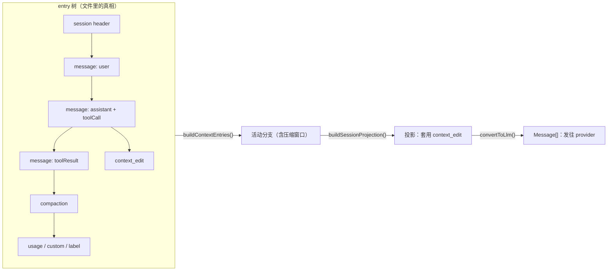

# 第 6 章 会话树与存储

← 上一章：[第 5 章 上下文装配与系统提示词](05-context-assembly.md) ｜ [返回目录](README.md)

> **本章你将学会**：读懂 Pi 的 JSONL 会话文件；说清 entry 树、活动分支、投影（projection）与模型上下文三者之间的关系；解释系统提示词为什么以"段补丁"的形式存在于 transcript 里；用 `context_edit`、`custom`、`usage` 等 entry 为扩展设计持久状态。
>
> **对应官方文档**：[Session File Format](https://pi.dev/docs/latest/session-format) · [Message Types](https://pi.dev/docs/latest/message-types) · [Sessions and Context](https://pi.dev/docs/latest/sessions)

第 2 章从行为上描述了会话与分支，第 5 章讲了进入模型的内容怎么拼出来。本章换一个角度：把会话当成一个**数据结构**来看。Pi 的会话不是"消息数组"，而是一棵 append-only 的 entry 树；模型上下文、终端渲染、HTML 导出、扩展状态、账单统计，全部是从这棵树派生出来的投影。理解这个派生关系，你才能判断一个扩展该把状态写在哪里、一次 `/tree` 导航到底改了什么、为什么压缩后原始历史仍在文件里。

## 6.1 文件格式：一行一条 entry，一棵树

会话文件默认位置：

```text
~/.pi/agent/sessions/--<path>--/<时间戳>_<session-id>.jsonl
```

目录名把 cwd 的可读形式编码进去，而不是哈希：去掉开头的路径分隔符，把 `/`、`\`、`:` 替换成 `-`（`getDefaultSessionDirPath()`，[packages/coding-agent/src/core/session-manager.ts:589](file:///D:/workspace/harness/earendil/pi/packages/coding-agent/src/core/session-manager.ts#L589)）。这意味着会话目录可以直接按项目肉眼定位，也把"换机器/换盘符即换会话目录"这件事变成显式行为。文件名是创建时刻的 ISO 时间戳（`:` 与 `.` 替换为 `-`）加会话 ID，见 [session-manager.ts:1079](file:///D:/workspace/harness/earendil/pi/packages/coding-agent/src/core/session-manager.ts#L1079)。

首行是 `session` header，它不属于树（没有 `id`/`parentId`）：

```json
{"type":"session","version":3,"id":"0194...","timestamp":"2026-10-30T02:11:07.512Z","cwd":"/path/to/project"}
```

当前版本 `CURRENT_SESSION_VERSION = 3`（[session-manager.ts:41](file:///D:/workspace/harness/earendil/pi/packages/coding-agent/src/core/session-manager.ts#L41)）。v1 是线性序列，v2 引入 `id`/`parentId` 树，v3 把 `hookMessage` 角色改名为 `custom`。旧文件在加载时自动迁移，迁移通过整文件重写完成。

写入是**追加式**的：每条持久化 entry 走一次 `appendFileSync(file, JSON + "\n")`（[session-manager.ts:1187](file:///D:/workspace/harness/earendil/pi/packages/coding-agent/src/core/session-manager.ts#L1187)）。文件采用惰性创建——只有出现真正需要落盘的用户或助手消息时才建立文件。这里没有原子 rename：会话文件是 Pi 独占写、外部只读追加日志的产物，读侧要容忍尾部半行（`loadEntriesFromFile()` 用 `StringDecoder` 跨缓冲区拼接，并用 `MAX_SESSION_HEADER_SCAN_BYTES = 1 MiB` 限制 header 扫描）。

ID 的生成规则值得记住，因为它决定分支操作的粒度：

| 对象 | 规则 | 位置 |
|---|---|---|
| 会话 ID | `uuidv7()` | [session-manager.ts:264](file:///D:/workspace/harness/earendil/pi/packages/coding-agent/src/core/session-manager.ts#L264) |
| entry ID | `randomUUID()` 前 8 位十六进制，碰撞最多重试 100 次 | [session-manager.ts:277](file:///D:/workspace/harness/earendil/pi/packages/coding-agent/src/core/session-manager.ts#L277) |

## 6.2 entry 类型全景

`SessionEntry` 是一个 11 个成员的联合类型（[session-manager.ts:183](file:///D:/workspace/harness/earendil/pi/packages/coding-agent/src/core/session-manager.ts#L183)）。按"是否进入模型上下文"分类，是掌握它们的最快路径：

| entry `type` | 进入模型上下文 | 用途 |
|---|---|---|
| `message` | 是 | 承载 `AgentMessage`（user / assistant / toolResult / system / bashExecution / custom / branchSummary / compactionSummary） |
| `compaction` | 是 | 摘要 + `firstKeptEntryId` + 提示词/工具检查点 |
| `branch_summary` | 是 | 放弃分支的摘要，`fromId` 指向被放弃的旧叶 |
| `custom_message` | 是 | 扩展注入的消息，`display` 控制是否显示 |
| `context_edit` | 改写他人 | 对更早一条 entry 的 append-only 覆写（`replacement` 或 `null`） |
| `thinking_level_change` / `model_change` | 否（读取时提取） | 记录选择状态 |
| `usage` | 否 | 非 assistant 消息的模型用量，例如 `kind: "cache_warm"` |
| `custom` | 否 | 扩展私有状态，可配 `registerEntryRenderer` 渲染 |
| `label` / `session_info` | 否 | 书签与显示名 |



注意最后一条边：`message` entry 存的是 `AgentMessage`，而 provider 只认 `Message`。coding-agent 用 `convertToLlm()`（[packages/coding-agent/src/core/messages.ts:148](file:///D:/workspace/harness/earendil/pi/packages/coding-agent/src/core/messages.ts#L148)）把 `bashExecution`、`custom`、`branchSummary`、`compactionSummary` 这些扩展角色折叠成 user 角色文本。自定义角色因此可以在树里存在，而不需要 provider 支持。

## 6.3 从树到上下文：三段管线

`/tree`、`/fork`、压缩、导出之所以互不干扰，是因为 Pi 只在两个地方定义"上下文是什么"：

1. **选条目**：`buildContextEntries()` 从当前叶向根走，得到路径上的条目。若路径上存在 `compaction`，取**最新**一条，返回 `[该 compaction, 从 firstKeptEntryId 起且到 compaction 为止的非 system 条目, compaction 之后的全部条目]`（[session-manager.ts:476](file:///D:/workspace/harness/earendil/pi/packages/coding-agent/src/core/session-manager.ts#L476)）。压缩之前的旧条目不删除，只是不再入选。
2. **投影**：`buildSessionProjection()` 对入选条目套用每个目标最新的 `context_edit`：`replacement` 只换内容、保留角色与元数据，`null` 让目标不产生消息。同时它规定：只有位于索引 0 的 compaction 才贡献检查点与摘要，避免多次压缩重复注入（[session-manager.ts:543](file:///D:/workspace/harness/earendil/pi/packages/coding-agent/src/core/session-manager.ts#L543)）。
3. **定型**：`buildSessionContext()` 在投影之上再产出 `{ messages, thinkingLevel, model }`，即模型可见的最终上下文（[session-manager.ts:576](file:///D:/workspace/harness/earendil/pi/packages/coding-agent/src/core/session-manager.ts#L576)）。

`context_edit` 是**分支相对**的：导航到该编辑之前的位置，目标的原始贡献会重新出现。这条性质让"废弃一次失败的尝试"与"修改历史"区分开来——原始 transcript、导出、账单统计、历史检索型扩展看到的仍是完整历史。第 7 章会看到 Pi 自己就用它实现溢出恢复。

> 源码位置：`packages/coding-agent/src/core/session-manager.ts`（entry 类型、SessionManager、三段管线）、`packages/coding-agent/src/core/messages.ts`（`AgentMessage` 角色与 `convertToLlm()`）。

## 6.4 提示词状态住在 transcript 里

这是 Pi 会话格式里最容易被低估的设计。系统提示词与工具声明**没有**独立的状态 entry，而是以系统消息的形式存在于 `message` entry 中：

- 会话第一条系统消息携带**完整**的 `sections`（每个提示词段一个键）与 `toolsAdded`（全部初始工具声明）。
- 之后的系统消息是补丁：`sections` 里给出新文本的段会覆盖同名段，值为 `null` 的段会被移除；`toolsAdded` / `toolsRemoved` 增删工具声明。
- 按顺序回放这些系统消息，就得到当前的提示词与工具集。

```json
{"type":"message","id":"d4e5f6g7","parentId":"c3d4e5f6","timestamp":"...","message":{"role":"system","content":"","sections":{"skills":"<skills>...</skills>"},"toolsRemoved":[{"name":"write"}],"timestamp":1733234640000}}
```

这样做换来三件实际好处：

1. **缓存友好**。提示词不变时，请求前缀不变，provider 的 prompt cache 命中；段变化只追加一条小的补丁系统消息，而不是重写整段前缀（5.6 节讲 `diffSystemPromptSections()` 如何算出这个补丁）。
2. **分支自洽**。切换分支时提示词状态随分支自然回滚，不需要额外的"提示词快照"逻辑。
3. **可重放与可移植**。第三方工具只读 JSONL 就能重建提示词；跨提供商接力会话时不必携带 Pi 的内部状态。

代价是：任何想读"当前提示词"的代码都必须回放 transcript。`pi-ai` 为此提供 `getCurrentSystemMessage()` / `getCurrentSystemPrompt()` / `getCurrentTools()`，扩展在 `context_with_system`、自定义 streaming 里应该用它们，而不是假设 `context.systemPrompt` 存在（见 4.7 节、11.6 节）。

## 6.5 分支、多根与导航语义

树允许多个根：`resetLeaf()` 或以 `null` 父节点开枝的调用会让后续条目成为另一个根。因此"会话文件里的全部条目"与"当前活动分支"是两个不同集合，`/tree` 界面显示前者、模型只消费后者。

`/tree` 的选择器正是这棵树本身的可视化——被放弃的分支仍然显示，只是不进入下一次请求：

<p align="center">
  
  <br>
  <sub>图 6-1　`/tree` 导航界面（取自 Pi 官方仓库 `packages/coding-agent/docs/images/tree-view.png`，界面随版本变化）。</sub>
</p>

| 操作 | 对树的影响 | 是否新文件 |
|---|---|---|
| 继续对话 | 在当前叶后追加 | 否 |
| `/tree` 导航 | 移动叶；可选写入 `branch_summary` | 否 |
| 从更早条目分叉 | 以该条目为父新建分支 | 否 |
| `/fork` | 复制选中点之前的历史到新文件，`parentSession` 指向源文件 | 是 |
| `/clone` | 复制活动路径到选中条目（`position: "at"`） | 是 |
| `/compact` | 追加 `compaction`，原条目不动 | 否 |

`session_before_switch` / `session_before_fork` / `session_before_tree` 三组钩子分别守护"换运行时""复制文件""移动叶"这三类操作，取消语义也各自不同——第 9 章按这条线整理扩展可见的会话操作矩阵。

## 6.6 给扩展设计持久状态

三条规则的根据都在本节：

1. **进入模型的状态写进工具结果的 `details`**。它随消息天然分枝，`/tree` 后自动正确。重建时遍历 `getBranch()` 而不是 `getEntries()`：被放弃的分支代表另一段历史。
2. **不进模型但要显示的状态写 `custom` entry**，配 `pi.appendEntry()` + `pi.registerEntryRenderer()`。恢复时在 `session_start` 里按 `customType` 扫描重建。
3. **只影响未来的覆写用 `context_edit`**。这是唯一"保留原始历史但改变模型输入"的手段。

Pi 自己也遵守这个约定：虚拟模型的路由状态以 `customType: "pi.virtual-model-state"`、`data: { provider, modelId, state }` 的 `custom` entry 存储（见 11.7 节），因此状态跟随分支、并在压缩后存活。

## 6.7 导出、分享与取证

`/export` 产出 HTML 或 JSONL。JSONL 导出由 `serializeSessionBranch()` / `exportSessionToJsonl()` 完成：它们重排 `parentId` 链、写入新 header，默认文件名 `session-<时间戳>.jsonl`（[packages/coding-agent/src/core/session-export.ts:9](file:///D:/workspace/harness/earendil/pi/packages/coding-agent/src/core/session-export.ts#L9)）。HTML 导出把同一棵树的投影渲染成静态页面，包含工具行、嵌套调用记录与主题色。

自己解析会话文件往往比任何界面都更能定位问题。最小可用片段：

```bash
# 统计各类型 entry 数量
jq -r '.type' ~/.pi/agent/sessions/--path--/*.jsonl | sort | uniq -c

# 打印当前提示词的段名（回放系统消息）
jq -r 'select(.message.role=="system") | .message.sections | keys | join(",")' session.jsonl
```

> 源码位置：`packages/coding-agent/src/core/session-export.ts`（导出）、`packages/coding-agent/src/core/export-html/`（HTML 渲染）、`packages/coding-agent/src/core/usage-totals.ts`（把 `usage`、`compaction.usage` 等汇总成会话账单）。

## 小结

- 会话是 append-only 的 entry 树，文件位置把 cwd 可读地编码进目录名，写入是逐条 `appendFileSync`。
- 11 类 entry 的关键区别在于"是否进入模型上下文"：`message`、`compaction`、`branch_summary`、`custom_message` 进入，`custom`、`usage`、`label`、`session_info` 不进入，`context_edit` 只改写别人。
- 上下文由 `buildContextEntries()` → `buildSessionProjection()` → `buildSessionContext()` 三段派生，`convertToLlm()` 负责把自定义角色折叠给 provider。
- 提示词与工具集以"首条完整 + 后续段补丁"的系统消息形式住在 transcript 里，服务于缓存、分支自洽与可重放。
- 多根与叶位置分离，使 `/tree` 导航、`/fork`、`/clone`、`/compact` 各改各自的东西，互不破坏历史。
- 扩展持久化的选型依据只有一条：这份状态该不该被模型看见、该不该随分支回滚。

## 练习

1. 在一个真实会话里连续执行 `/compact` 两次，用 `jq -r '.type'` 观察 `compaction` 条目的 `firstKeptEntryId` 指向哪里。验收标准：你能说明第二次压缩的摘要区间为什么从第一次的保留边界开始，而不是从第一条 `compaction` 开始。
2. 写一个临时扩展，在 `tool_result` 里对某条历史 `message` 追加 `context_edit`（`replacement: null`），重启后 `/tree` 导航到该编辑之前。验收标准：目标内容在导航后重新出现在模型上下文里，但文件里原始 entry 未被改动。
3. 用 `pi --mode json` 跑一个两句话的会话，把 stdout 与生成的 `.jsonl` 逐行对照。验收标准：你能指出事件流里哪两条记录对应树里的同一个 `message` entry，并解释为什么前者是投影而非真相。
4. 给同一目录连续 `/fork` 两次，检查新文件 header 的 `parentSession`。验收标准：说出 `/fork`（`position: "before"`）与 `/clone`（`position: "at"`）在复制范围与编辑器回填上的差异。

## 延伸阅读

- [Session File Format](https://pi.dev/docs/latest/session-format)（entry 契约与 `buildContextEntries()` 步骤）
- [Message Types](https://pi.dev/docs/latest/message-types)（`AgentMessage` 联合与内容块）
- 第 5 章：上下文怎么装配成请求；第 7 章：压缩与恢复如何改写未来
- 第 10 章：把本章的持久化规则落到一个具体扩展上
- 源码：`packages/coding-agent/src/core/session-manager.ts`、`packages/coding-agent/src/core/messages.ts`

---

→ 下一章：[第 7 章 压缩与分支摘要](07-compaction-and-branch-summaries.md) ｜ [返回目录](README.md)
