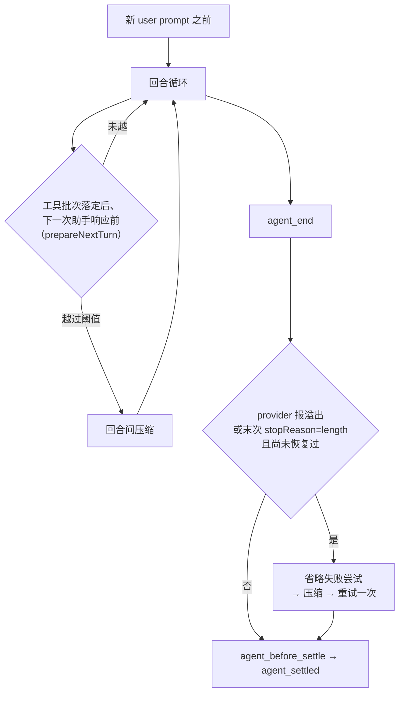

# 第 7 章 压缩与分支摘要

← 上一章：[第 6 章 会话树与存储](06-session-tree-and-storage.md) ｜ [返回目录](README.md)

> **本章你将学会**：算出自动压缩在什么 token 数触发；解释切点选择、拆分用户消息段、重复压缩起点这三条规则；说出溢出恢复为什么必须按特定顺序落盘；把摘要生成换成自己的模型并保留账单统计。
>
> **对应官方文档**：[Compaction Reference](https://pi.dev/docs/latest/compaction) · [Sessions and Context](https://pi.dev/docs/latest/sessions) · [Settings](https://pi.dev/docs/latest/settings)

上下文压缩是 Pi 里少数几个"会改变模型看到什么、但不改变历史真相"的机制之一。第 6 章已经说明压缩只是追加一条 `compaction` entry；本章讲这条 entry 怎么写出来、什么时候写、写坏了怎么办。它同时是扩展最容易出事的地点：自定义摘要要正确携带 `firstKeptEntryId` 与 `usage`，否则会话统计和后续压缩区间都会错。

## 7.1 两套摘要机制

| 机制 | 触发 | 目的 | 产物 entry |
|---|---|---|---|
| 压缩（compaction） | 超过阈值、或 `/compact` | 腾出上下文继续对话 | `compaction` |
| 分支摘要（branch summarization） | `/tree` 导航换分支 | 保留被放弃分支的语境 | `branch_summary` |

两者共用摘要格式与文件追踪工具（`packages/coding-agent/src/core/compaction/utils.ts`），但设置项、区间算法、携带的历史都不同。**摘要请求关闭 prompt cache 写入**：调用侧显式传 `cacheRetention: "none"`（[compaction.ts:630](file:///D:/workspace/harness/earendil/pi/packages/coding-agent/src/core/compaction/compaction.ts#L630)），因为一次性提示词几乎不会被复用（[compaction.md 开头](https://pi.dev/docs/latest/compaction)）——这条策略让压缩本身不额外污染缓存层。

## 7.2 触发条件与检查时机

判定式（[packages/coding-agent/src/core/compaction/compaction.ts:267](file:///D:/workspace/harness/earendil/pi/packages/coding-agent/src/core/compaction/compaction.ts#L267)）：

```typescript
// shouldCompact()
return contextTokens > contextWindow - settings.reserveTokens;
```

默认 `reserveTokens = 16384`、`keepRecentTokens = 20000`、`enabled = true`（`DEFAULT_COMPACTION_SETTINGS`，[compaction.ts:126](file:///D:/workspace/harness/earendil/pi/packages/coding-agent/src/core/compaction/compaction.ts#L126)；同名默认也出现在 [settings-defaults.ts:9](file:///D:/workspace/harness/earendil/pi/packages/coding-agent/src/core/settings-defaults.ts#L9)）。对 200K 上下文的模型，这意味着超过 183,364 token 触发；`reserveTokens` 只决定**何时开始**，不决定摘要请求的大小——摘要请求用模型的输出上限，必要时收窄以保证输入输出都装得下。

`contextTokens` 是估算值而非精确 tokenizer 结果：文本按 `字符数 / 4` 估算，图片按 4800 字符计（[compaction.ts:276](file:///D:/workspace/harness/earendil/pi/packages/coding-agent/src/core/compaction/compaction.ts#L276) 附近的估算函数）。所以你会看到"实际没满但压缩了"的情况，这不是 bug。

检查时机有四处，理解它们能解释大部分"为什么在这里压缩"的疑问：



- 回合间检查发生在工具结果已落盘之后。若这条助手消息的时间戳早于最新压缩边界，检查会被跳过——这是为了防止压缩前留下的旧 usage 或错误在下一个提示时重新触发压缩（[agent-session.ts:3048-3056](file:///D:/workspace/harness/earendil/pi/packages/coding-agent/src/core/agent-session.ts#L3048-L3056)）。
- 若完成的工具批次会终止运行、且没有排队消息需要新响应，则跳过这次回合间检查。
- 溢出恢复只允许**一次**，由 `_overflowRecoveryAttempted` 标记（[agent-session.ts:3100](file:///D:/workspace/harness/earendil/pi/packages/coding-agent/src/core/agent-session.ts#L3100-L3127)）。

`reason` 因此有三个值：`"manual"`（`/compact`）、`"threshold"`、`"overflow"`；扩展事件与 `compaction_start` / `compaction_end` 都携带它。

## 7.3 切点算法与拆分用户消息段

`prepareCompaction()`（[compaction.ts:446](file:///D:/workspace/harness/earendil/pi/packages/coding-agent/src/core/compaction/compaction.ts#L446) 起）从新往旧累计 token 估算，一旦达到 `keepRecentTokens` 就在该处切：切点之前的进摘要，之后（含切点所在条目起点）保留原文。

合法切点只有四类：**user 消息、assistant 消息、`bashExecution` 消息、custom 类消息**（`custom_message`、`branch_summary`）。工具结果**绝不能**做切点——它必须和触发它的工具调用待在一起。

当单个"用户消息段"（一条 user 消息到下一条 user 消息之间的全部回合）本身就超过 `keepRecentTokens` 时，切点会落在段**内部**的某条 assistant 消息上，这就是"拆分用户消息段"（split user-message span）。此时 Pi 生成两份摘要再合并：历史摘要（如果有）与段前缀摘要（`turnPrefixMessages`），后者用专门的 `TURN_PREFIX_SUMMARIZATION_PROMPT`（[compaction.ts:929](file:///D:/workspace/harness/earendil/pi/packages/coding-agent/src/core/compaction/compaction.ts#L929)）产出，合并时插入 `**Turn Context (split turn):**` 标题（[compaction.ts:1018](file:///D:/workspace/harness/earendil/pi/packages/coding-agent/src/core/compaction/compaction.ts#L1018)）。

重复压缩的起点规则容易踩坑，值得单独记：**新的摘要区间从上一次压缩的保留边界（`firstKeptEntryId`）开始，而不是从上一次 `compaction` entry 开始**；找不到那条保留条目时退回到 compaction 之后的条目。retain-none 压缩把自己的 ID 写进 `firstKeptEntryId`，于是下一次从它之后开始。这样才不会出现"上次幸存的消息被反复摘要却没有被摘要进任何一份总结"的丢失。`tokensBefore` 则在写入前按重建后的会话投影重新计算，因此反映真正被替换的那部分规模。

## 7.4 摘要怎么生成

三份提示词都在 [compaction.ts](file:///D:/workspace/harness/earendil/pi/packages/coding-agent/src/core/compaction/compaction.ts)：首次 `SUMMARIZATION_PROMPT`（`:507`）、迭代更新 `UPDATE_SUMMARIZATION_PROMPT`（`:577`）、系统提示 `SUMMARIZATION_SYSTEM_PROMPT`（`compaction/utils.ts`）。待摘要的对话先用 `serializeConversation()` 折成纯文本（[compaction/utils.ts](file:///D:/workspace/harness/earendil/pi/packages/coding-agent/src/core/compaction/utils.ts)），再包进 `<conversation>`，旧摘要包进 `<previous-summary>`：

```text
[User]: 他们说了什么
[Assistant]: 回复文本
[Assistant tool calls]: read(path="foo.ts"); edit(path="bar.ts", ...)
[Tool result]: 工具输出
```

序列化刻意做成"文档样式"而不是"对话样式"，避免摘要模型把它当成要继续的对话。两条削减规则：**thinking 块整体省略**（provider 返回的推理摘要往往本就不在实时上下文里，塞进去可能让摘要请求比被摘要的内容还长）；**工具结果截到 2000 字符**，超出部分替换成说明被截了多少字符的标记——`read` 与 `bash` 的结果是上下文里最大的贡献者。

摘要正文的骨架固定，缺项也保留标题，这让重复压缩的合并可预测：

```markdown
## Goal
## Constraints & Preferences
## Progress   ### Done / ### In Progress / ### Blocked
## Key Decisions
## Next Steps
## Critical Context      ← 仅压缩摘要；分支摘要到 Next Steps 为止

<read-files>…</read-files>
<modified-files>…</modified-files>
```

文件清单是**累积**的：默认压缩从被摘要的消息里抽取文件操作，并继承上一次 Pi 生成的压缩里的清单；分支摘要继承它摘要到的 Pi 生成分支摘要里的清单。`fromHook: true` 的扩展摘要不参与这个继承，扩展自己管 `details` 格式（[compaction.md 的 Cumulative File Tracking](https://pi.dev/docs/latest/compaction)）。

> 源码位置：`packages/coding-agent/src/core/compaction/compaction.ts`（`prepareCompaction()`、`compact()`、`generateSummary()`、`generateSummaryWithUsage()`）、`packages/coding-agent/src/core/compaction/branch-summarization.ts`（`collectEntriesForBranchSummary()`、`prepareBranchEntries()`、`generateBranchSummary()`）。

## 7.5 溢出恢复的落盘顺序

这是全章最需要精确对待的一段。Pi 保证"已完成的尝试对扩展与界面可见，但持久化模型上下文在重试前被修复"，顺序固定（[compaction.md 的 Overflow and Length Recovery Ordering](https://pi.dev/docs/latest/compaction)）：

```text
落盘最终助手响应
→ 对扩展与公开事件流发出 turn_end
→ 对扩展与公开事件流发出 agent_end
→ 追加 context_edit 省略本次失败的尝试
→ 溢出/长度类：跑 session_before_compact，成功则追加 compaction
→ 以全新运行开始重试
```

若恢复压缩失败或被取消：保留省略编辑、不追加压缩、也不再安排内部重试。`agent_before_settle` 看到的是修复后的投影；而原始 transcript、导出、账单总额、做历史检索的扩展仍能看见被放弃的那次尝试。

切点规则在这里再补一条：只有当"保留边界之后的无上下文后缀"恰好包含一条被省略的 assistant 尝试、且不包含任何未被省略的上下文生产者时，边界才允许向后推进。替换编辑若影响本次输入或被摘要前缀，会阻止推进——因为被省略的那次回答是针对编辑前的输入。这条规则的作用是让超预算的失败输入能被摘要掉，同时不把记账变化误当成"新模型输入可原样保留"。

## 7.6 数据结构

```typescript
// packages/coding-agent/src/core/session-manager.ts:91
interface CompactionEntry<T = unknown> {
  type: "compaction";
  id: string; parentId: string | null; timestamp: string;
  summary: string;
  firstKeptEntryId: string;   // 必填；retain-none 时写自身 ID
  tokensBefore: number;
  systemMessage?: SystemMessage;  // 压缩边界的完整提示词/工具检查点
  usage?: Usage;                  // 生成摘要的用量，计入会话总额
  fromHook?: boolean;             // true = 扩展提供（历史字段名）
  details?: T;                    // 默认 { readFiles, modifiedFiles }
}
```

`systemMessage` 是关键：压缩点必须有完整提示词检查点，否则保留区间里的旧系统消息会被错误重放。有了它，保留条目中的系统消息让位给这份检查点。旧会话文件可能没有这个字段。

`BranchSummaryEntry`（[session-manager.ts:106](file:///D:/workspace/harness/earendil/pi/packages/coding-agent/src/core/session-manager.ts#L106)）用 `fromId` 记录被放弃的旧叶，`parentId` 是新分支的续接点；`details` 与 `usage` 语义同上。

## 7.7 设置与一个真实的合并陷阱

```json
{
  "compaction": {
    "enabled": true,
    "reserveTokens": 16384,
    "keepRecentTokens": 20000,
    "modelOverrides": {
      "some-provider/big-model": { "reserveTokens": 400000 }
    }
  }
}
```

`modelOverrides` 的键是**精确、大小写敏感的 `provider/modelId`**；`reserveTokens` 与 `keepRecentTokens` 各自独立地按"模型覆盖 → 普通设置 → 内置默认"回落。匹配模型的覆盖值非法会在读取时报错，只有缺字段才回落；`enabled` 始终是全局的。解析后的值用于手动压缩、全部阈值检查、溢出恢复以及扩展可见的 `preparation.settings`；切换模型影响后续检查但不改普通设置，进行中的压缩使用它捕获的那份模型与设置。分支摘要的设置不受 `modelOverrides` 影响（它有自己的 `branchSummary.reserveTokens = 16384`、`branchSummary.skipPrompt`）。

陷阱在这句上：**全局与项目文件是递归合并后再查表的，因此"全局的模型专属值"会压过"项目-wide 的兜底值"**。如果项目想改某个模型的预算，必须覆盖**同一个模型条目**，只改项目里的 `reserveTokens` 是无效的（[compaction.md 末尾](https://pi.dev/docs/latest/compaction)）。

## 7.8 用自己的模型做摘要

`session_before_compact` 是门（gate）与替换的组合：返回 `{ cancel: true }` 取消，返回 `{ compaction }` 提供摘要，返回 `undefined` 放行给下一个处理器或默认实现。

```typescript
import { convertToLlm, serializeConversation } from "@earendil-works/pi-coding-agent";
import { Type } from "typebox";

pi.on("session_before_compact", async (event, ctx) => {
  const { preparation, reason, willRetry, signal } = event;
  if (reason === "overflow" && !willRetry) return;          // 只接管阈值压缩（示例策略）

  const conversationText = serializeConversation(
    convertToLlm(preparation.messagesToSummarize),
  );

  const response = await ctx.modelRegistry.streamSimple(
    ctx.modelRegistry.find("my-provider", "summarizer-small")!,
    { messages: [{ role: "user", content: [{ type: "text", text: conversationText }], timestamp: Date.now() }] },
    { reasoning: "off", signal },
  );
  const final = await response.result();
  if (final.stopReason === "error") return;                 // 交回默认实现

  return {
    compaction: {
      summary: final.content.filter((c) => c.type === "text").map((c) => c.text).join("\n"),
      firstKeptEntryId: preparation.firstKeptEntryId,       // 必须沿用准备结果
      tokensBefore: preparation.tokensBefore,
      usage: final.usage,                                   // 计入会话总额
      details: { readFiles: [], modifiedFiles: [] },
    },
  };
});
```

四条从代码里读出的约束：`firstKeptEntryId` 与 `tokensBefore` 要取自 `preparation`，否则重复压缩区间会错；`usage` 不填就丢掉摘要成本；`signal` 不传则 `Escape` 无法取消你的摘要调用；`preparation.settings` 已经是**应用模型覆盖之后**的有效值，不要再自己读原始设置。配套的失败出口是 `session_compact_failed`（带 `reason`、`errorMessage`、`aborted`、`willRetry`、`fromExtension`），遥测扩展应该把它和 `session_before_compact` 配成一对。`/tree` 侧同理：`session_before_tree` 总能收到，但自定义摘要只在 `preparation.userWantsSummary` 为真时被采用。

## 小结

- 触发式是 `contextTokens > contextWindow - reserveTokens`，默认 `reserveTokens = 16384`；token 是估算值（字符/4、图片按 4800 字符）。
- 检查发生在四个位置：新提示前、工具批次落定后的回合间、运行结束后的溢出恢复、手动 `/compact`。溢出恢复只做一次。
- 切点只能落在 user / assistant / bashExecution / custom 类消息上，绝不切工具结果；超预算的用户消息段会被拆成两份摘要合并。
- 重复压缩从上次保留边界开始；`tokensBefore` 按重建投影重算；压缩点必须携带提示词与工具的完整检查点。
- 摘要前用 `serializeConversation()` 折成文档样式文本，省略 thinking、工具结果截 2000 字符；文件清单跨 Pi 生成的摘要累积。
- 自定义摘要要沿用 `preparation` 的区间字段、带上 `usage`、传 `signal`；`modelOverrides` 的键是精确 `provider/modelId`，且全局模型专属值会压过项目-wide 兜底。

## 练习

1. 把 `keepRecentTokens` 设为 `2000`，跑一个需要多次 `read` 的任务，观察连续压缩。验收标准：从两份 `compaction` entry 的 `firstKeptEntryId` 与 `summary` 内容证明"第二次从第一次的保留边界开始"。
2. 用 `reserveTokens` 逼近 `contextWindow`（例如小上下文本地模型设为负数以外的极大值）制造 overflow 恢复。验收标准：按 7.5 节顺序在你的 `turn_end`、`agent_end`、`session_before_compact` 日志里排出这个序列，并确认 `willRetry` 为 `true`。
3. 写一个只做"取消压缩"的扩展（`return { cancel: true }`）。验收标准：确认阈值压缩被取消后 Pi 的行为——继续运行直到 provider 报错，并说明为什么生产环境要同时监听 `session_compact_failed`。
4. 阅读 `examples/extensions/custom-compaction.ts`，与 7.8 节代码对比。验收标准：指出它在模型不可用时如何回落到默认实现。

## 延伸阅读

- [Compaction Reference](https://pi.dev/docs/latest/compaction)（算法细节与全部字段）
- 第 6 章：`compaction` entry 在树中的位置；第 3 章：`prepareNextTurn` 为什么是压缩的插入点
- 第 9 章：门型/替换型/边界型处理器的组合语义

---

→ 下一章：[第 8 章 工具系统内参](08-tool-system.md) ｜ [返回目录](README.md)
