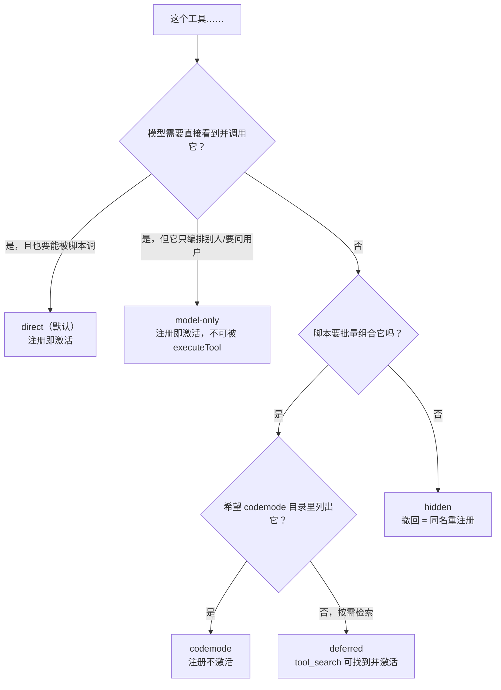

# 第 8 章 工具系统内参

← 上一章：[第 7 章 压缩与分支摘要](07-compaction-and-branch-summaries.md) ｜ [返回目录](README.md)

> **本章你将学会**：说出工具在 Pi 里的四重身份；解释截断、文件变更队列、进程树终止的实现选择；用 `exposure` / `namespace` / `annotations` / `reachesTools` / `prepareLoadout` 设计工具的可及性；正确实现嵌套调用与结构化输出。
>
> **对应官方文档**：[Extensions 的 Custom Tools](https://pi.dev/docs/latest/extensions) · [CLI 的 Tools](https://pi.dev/docs/latest/cli) · [Codemode](https://pi.dev/docs/latest/codemode)

工具是 Pi 唯一改变外部世界的通道。第 3 章看了循环怎么调度工具，第 5 章看了工具声明怎么进提示词，本章看工具本身：8 个内置工具的实现约束、以及写自定义工具时必须遵守的契约。

## 8.1 一个工具的四重身份

同一个 `ToolDefinition` 同时服务四个消费者，任一契约漏掉都会出现"能用但表现怪"的问题：

| 身份 | 消费者 | 由哪些字段决定 |
|---|---|---|
| 模型可见的声明 | provider 请求的 tools 数组 | `name`、`description`、`parameters`、`outputSchema`、`constrainedSampling` |
| 提示词里的使用说明 | 系统提示词的 `tools` / `rules` 段 | `promptSnippet`、`promptGuidelines`、`exposure`、`prepareLoadout` |
| 可执行单元 | 循环与 `codemode` 脚本 | `execute`、`prepareArguments`、`executionMode`、`exposure`、`reachesTools` |
| 界面与状态载体 | TUI、HTML 导出、分支重建 | `renderShell`、`renderCall`、`renderResult`、`details`、`structuredContent` |

`details` 是这里最关键也最容易被忽略的字段：它同时是渲染数据源与**分支可重建的状态**（第 6 章的状态重建就靠它）。因此文档要求包括部分结果（`onUpdate`）在内的每个结果都必须有 `content` 与 `details`，且同一工具的 `details` 类型必须一致。

## 8.2 内置工具

`ToolName` 恰好 8 个：`read`、`bash`、`powershell`、`edit`、`write`、`grep`、`find`、`ls`（[packages/coding-agent/src/core/tools/index.ts:94](file:///D:/workspace/harness/earendil/pi/packages/coding-agent/src/core/tools/index.ts#L94)）。每个都有 `create*Tool(cwd, options?)` 与 `create*ToolDefinition(cwd, options?)` 一对工厂——前者给工具集合，后者返回含提示词片段与规则的完整定义，方便包装。

| 工具 | 参数 | `details` | 备注 |
|---|---|---|---|
| `read` | `path`、`offset`（1 起始）、`limit` | `{ truncation? }` | 用 `truncateHead`；用户给了 `limit` 时先按 limit 取（[read.ts:168](file:///D:/workspace/harness/earendil/pi/packages/coding-agent/src/core/tools/read.ts#L168)） |
| `bash` | `command`、`timeout`（秒） | `{ truncation?, fullOutputPath? }` | 用 `truncateTail`；`structuredContent.output` 另有 1 MB 上限（[bash.ts:24](file:///D:/workspace/harness/earendil/pi/packages/coding-agent/src/core/tools/bash.ts#L24)） |
| `powershell` | 同 `bash` schema | 同族 | 复用 bash 的执行骨架 |
| `edit` | `path`、`edits[{oldText,newText}]` | `{ diff, patch, firstChangedLine? }` | `prepareArguments` 兼容旧的字符串/单对象形态（[edit.ts:103](file:///D:/workspace/harness/earendil/pi/packages/coding-agent/src/core/tools/edit.ts#L103)） |
| `write` | `path`、`content` | `undefined` | |
| `grep` | `pattern`、`path?`、`glob?`、`ignoreCase?`、`literal?`、`context?`、`limit?` | `{ truncation?, matchLimitReached?, linesTruncated? }` | `DEFAULT_LIMIT = 100`，匹配行单行最长 500 字符 |
| `find` | `pattern`、`path?`、`limit?` | `{ truncation?, resultLimitReached? }` | 默认 1000 |
| `ls` | `path?`、`limit?` | `{ truncation?, entryLimitReached? }` | 默认 500 |

`edit` 的 diff 生成与补丁计算在 [packages/coding-agent/src/core/tools/edit-diff.ts](file:///D:/workspace/harness/earendil/pi/packages/coding-agent/src/core/tools/edit-diff.ts)（556 行，本章最不适合压缩的一段）。它的存在解释了一个常见现象：`details.diff` 是 TUI 画彩色 diff 的依据，自定义工具覆盖 `edit` 时若不提供同形状 `details`，界面就退化成纯文本。

## 8.3 截断是硬要求

内置限制是 **50 KB（51200 字节）与 2000 行，先到者胜**：`DEFAULT_MAX_BYTES = 50 * 1024`、`DEFAULT_MAX_LINES = 2000`、`GREP_MAX_LINE_LENGTH = 500`（[packages/coding-agent/src/core/tools/truncate.ts:11](file:///D:/workspace/harness/earendil/pi/packages/coding-agent/src/core/tools/truncate.ts#L11)）。四个工具的取向不同：

- `truncateHead`（[truncate.ts:78](file:///D:/workspace/harness/earendil/pi/packages/coding-agent/src/core/tools/truncate.ts#L78)）保留开头，绝不返回半行；首行就超字节上限时返回空内容并置 `firstLineExceedsLimit`，`read` 据此提示改用 `bash`（[read.ts:182](file:///D:/workspace/harness/earendil/pi/packages/coding-agent/src/core/tools/read.ts#L182)）。适合文件内容与搜索结果。
- `truncateTail`（`:168`）保留结尾，只在末行本身超限时才给出部分行，且按 UTF-8 边界切（`truncateStringToBytesFromEnd`，`:247`）。适合日志与命令输出。
- `truncateLine`（`:268`）按字符截单行，后缀 `... [truncated]`。
- `truncateMiddle`（`:292`）头尾各保留 `maxBytes/2`，中间换成 `…N chars truncated…`，专供 MCP 结果。

流式输出用 `OutputAccumulator`（[tools/output-accumulator.ts](file:///D:/workspace/harness/earendil/pi/packages/coding-agent/src/core/tools/output-accumulator.ts)）累计，只有超过 2000 行或 50 KB 才落临时文件（`shouldUseTempFile`）。完整输出文件路径由 `createOutputFilePath()` 生成：`tmpdir()` 下 `<前缀>-<8 字节十六进制><扩展名>`，权限 `0o600`、标志 `wx`；前缀分别为 `pi-bash`、`pi-powershell`、`pi-codemode`、`pi-mcp`。

自定义工具必须自己截断，并在文本里告诉模型"截了多少、完整版在哪"。不截的后果不只是难看：它直接导致上下文溢出与压缩失败（第 7 章的切点与摘要区间都以条目大小为输入）。

## 8.4 并发写同一个文件：`withFileMutationQueue()`

因为工具默认并行执行（3.6 节），两个改同一文件的工具会各自读到同一份旧内容、分别写入、后写覆盖前写。Pi 用一条 per-file 队列解决：`withFileMutationQueue(path, fn)`（[packages/coding-agent/src/core/tools/file-mutation-queue.ts:32](file:///D:/workspace/harness/earendil/pi/packages/coding-agent/src/core/tools/file-mutation-queue.ts#L32)）。三个实现细节决定了它的正确性：

1. 队列键是 `realpath(resolve(path))`，`ENOENT`/`ENOTDIR` 时回落到 `resolve()` 路径（`:16-26`）。所以**必须传真正解析后的目标路径**，不能传用户原始参数；同一文件符号链接的不同别名共享一条队列。
2. 入队登记由全局 `registrationQueue` 串行化，之后 `fileMutationQueues: Map<string, Promise<void>>` 做同文件链式排队；不同文件仍然并行。
3. `throwIfAborted()` 在每次 `await` 之后检查，避免中断时把队列提前释放给下一个写者。

队列范围要覆盖整个"读—改—写"窗口，而不只是最后那次写。文档明确把这条要求写成自定义工具的义务（[extensions.md 的 Custom Tools](https://pi.dev/docs/latest/extensions)）。

## 8.5 `bash` 的进程管理

Shell 解析在 [packages/coding-agent/src/utils/shell.ts:86](file:///D:/workspace/harness/earendil/pi/packages/coding-agent/src/utils/shell.ts#L86) 的 `getShellConfig()`，命令传输方式有两种：`"argv"`（常规 `-c`）与 `"stdin"`（legacy WSL bash 用 `-s`，`:27`）。可用 `shellPath`、`shellCommandPrefix` 改外壳与命令前缀（平台侧差异见 [Shell aliases](https://pi.dev/docs/latest/shell-aliases) 与 [Windows](https://pi.dev/docs/latest/windows)）。

终止路径 `killProcessTree()`（[shell.ts:220](file:///D:/workspace/harness/earendil/pi/packages/coding-agent/src/utils/shell.ts#L220)）的实现比直觉更粗暴也更安全：Windows 用 `taskkill.exe /F /T /PID`；非 Windows 向进程组 `-pid` 发 `SIGKILL`（失败回落单进程 `SIGKILL`），macOS 先对进程组 `SIGSTOP` 以减少竞态。**这里没有"SIGTERM 等几秒再 SIGKILL"的分阶段策略**：Pi 选择立即硬杀整棵树，因为智能体中断语义要求"子进程一定停下"，而不是"温和退出"。`pi.exec()`（扩展 API）另有那条 5 秒 SIGTERM→SIGKILL 规则，两者不要混淆（[packages/coding-agent/src/core/exec.ts](file:///D:/workspace/harness/earendil/pi/packages/coding-agent/src/core/exec.ts)）。

超时由模型给的 `timeout`（秒）决定，schema 没有默认值；上限 `MAX_TIMEOUT_MS = 2_147_483_647`（[bash.ts:22](file:///D:/workspace/harness/earendil/pi/packages/coding-agent/src/core/tools/bash.ts#L22)），`resolveTimeoutMs()` 负责秒转毫秒与校验。`spawnHook` 在 `resolveSpawnContext()`（[bash.ts:184-186](file:///D:/workspace/harness/earendil/pi/packages/coding-agent/src/core/tools/bash.ts#L184-L186)）里生效，可改 `command`/`cwd`/`env`。`PI_SESSION_ID`、`PI_SESSION_FILE`、`PI_PROVIDER`、`PI_MODEL`、`PI_REASONING_LEVEL` 的注入采用**先删后设**，且发生在 `spawnHook` 之前——所以钩子能在 `env` 里看到它们，而 `exposeSessionEnvironment: false` 时 Pi 会主动清除继承来的同名值，避免嵌套 Pi 进程暴露过期的父会话元数据（[environment-variables.md](https://pi.dev/docs/latest/environment-variables)）。

## 8.6 替换执行后端：operations 接口

每个内置工具把 I/O 抽成一个 operations 接口，SSH/容器/沙箱只需要提供它：

| 接口 | 方法 |
|---|---|
| `ReadOperations` | `readFile(abs): Promise<Buffer>`、`access(abs): Promise<void>`、`detectImageMimeType?(abs)` |
| `WriteOperations` | `writeFile`、`mkdir` |
| `EditOperations` | `readFile`、`writeFile`、`access` |
| `BashOperations` | `exec(command, cwd, { onData, signal?, timeout?, env? }): Promise<{ exitCode: number | null }>` |
| `PowerShellOperations` / `LsOperations` / `GrepOperations` / `FindOperations` | `exists`/`stat`/`readdir`/`isDirectory`/`readFile`/`glob` 等按工具需要 |

本地后端不要重新实现：`createLocalBashOperations()`、`createLocalShellOperations()`、`createLocalPowerShellOperations()` 已经处理了 shell 解析与进程树终止，`user_bash` 处理器可以直接包装它（`!` 与 `!!` 命令的入口顺序见 2.2 节，事件语义见附录 A.9）。

覆盖内置工具时的三条规则（[extensions.md 的 Overriding Built-in Tools](https://pi.dev/docs/latest/extensions)）：同名注册即替换且无警告；**渲染按槽位继承**——省略 `renderCall` 就用内置的，两个都省就完全用内置渲染，这让"包一层做日志/权限"不必重做 UI；但 `promptSnippet` 与 `promptGuidelines` **不继承**，想保留必须显式重写；`details` 形状必须严格一致，UI 与会话逻辑依赖它。

## 8.7 可及性：五个字段的分工

`exposure` 决定模型和别的工具能不能到达这个工具。这张图回答"我该选哪个值"：



| 取值 | 声明给模型 | 可被 `ctx.executeTool()` 调用 | 注册后是否自动激活 |
|---|---|---|---|
| `direct`（默认） | 活动即声明 | 活动即可 | 是（除非 `defaultActive: false`） |
| `model-only` | 活动即声明 | 从不 | 是 |
| `codemode` | 除非显式激活否则不声明 | 只要注册就可达，并被 `codemode` 工具列出 | 否 |
| `deferred` | 否 | 同 `codemode`，但不被 codemode 列出；`tool_search` 能找到并激活 | 否 |
| `hidden` | 否 | 不可达 | 否 |

工具**不能撤销注册**，所以撤回一个工具的正确做法是用 `exposure: "hidden"` 重新注册同名工具。`pi.setActiveTools()` 忽略未知名字与 `hidden` 名字；`codemode` / `deferred` 暴露的工具无论是否活动都仍可被脚本调用。

`namespace: { name, aliases, description, instructions }` 把相关工具分组（MCP 服务器就映射成命名空间）：`codemode` 工具按命名空间列目录，`instructions` 不进目录、脚本用 `describeNamespace(name)` 读，`aliases` 让 `docs` / `my-docs` / `my_docs` 视为同一名字。

`annotations` 是 MCP 语义的四个提示：`readOnlyHint`、`destructiveHint`、`idempotentHint`、`openWorldHint`。默认值保守——未声明即"非只读，可能破坏性，可到达开放世界"，且这些提示**未经验证**，只是给权限扩展决策用。`pi.getAllTools()` 会返回 `exposure`、`namespace`、`annotations`、`reachesTools`，配合 `sourceInfo` 判断工具来源：`source: "builtin"` 覆盖核心工具（`path: "builtin:<tool>"`）与内置扩展注册的工具（如 `builtin:mcp`），`source: "sdk"` 是 `customTools` 传入的，其余是文件扩展。

`prepareLoadout(loadout)` 与 `reachesTools(input)` 服务于编排型工具：

- `prepareLoadout` 在活动工具集变化时被调用，返回被声明工具的替代 `descriptions` 与 `hiddenDeclarations`（活动且可调用、但请求里不声明）。默认提示词会跳过隐藏工具的条目与规则，因此在隐藏 `read` 时必须自己展示技能指引（5.4 与 5.5 节）。`codemode` 只用这个钩子 + `exposure` + `reachesTools` + `ctx.executeTool()` 就实现了"不声明上百个工具、却能调用它们"。
- `reachesTools(input)` 声明一次调用可能到达哪些工具：`"all"` 或输入中可能承载工具名的那些词。`codemode` 对搜索/列目录类脚本返回 `"all"`，否则返回脚本里的词；`tool_search` 恒为 `"all"`。晚注册工具的扩展应在 `tool_call` 里用它，先把这次调用需要的工具注册完再放行——MCP 扩展对仍在连接的服务器就是这么做的。

## 8.8 嵌套调用与结构化输出

`ctx.executeTool(name, args, { signal, onUpdate })` 走与模型发起调用完全相同的路径：参数校验、`tool_call`、`tool_result`、三个 `tool_execution_*` 事件都触发，并携带 `parentToolCallId`；子调用 id 由 Pi 分配为 `<父 id>/<n>`。它**不往 transcript 写工具调用或结果消息**，结果只回到调用方，由调用方通过 `onUpdate` 与 `details` 自行汇报。会话里保留一份有界记录（挂在结果消息的 `nestedCalls` 上）：`maxCalls: 256`、`maxArgumentBytesPerCall: 8 KiB`、`maxArgumentBytesTotal: 32 KiB`，超出即丢弃并置 `complete: false`（[packages/coding-agent/src/core/nested-tool-calls.ts:27](file:///D:/workspace/harness/earendil/pi/packages/coding-agent/src/core/nested-tool-calls.ts#L27)）。这份记录用于压缩的文件清单与 HTML 导出。嵌套调用各层 `usage` 全部累加到最外层结果的 `usage`，所以你的工具只报自己那一份。嵌套调用**永不 reject**：未知工具、校验失败、被阻塞、抛错，都以 `isError: true` 的结果返回。

结构化输出的分工是：`outputSchema` + 结果里的 `structuredContent` 给程序化调用者（`codemode` 脚本），`content` 仍给模型。声明了 `outputSchema` 却没有 `structuredContent` 会被视为错误；未声明的工具在脚本里就是纯文本。要"失败但带数据"，返回 `isError: true` 的结果而不是抛错——模型看到错误，脚本仍能拿到 `structuredContent`。

```typescript
import { Type } from "typebox";
import { defineTool, withFileMutationQueue } from "@earendil-works/pi-coding-agent";
import { writeFile } from "node:fs/promises";
import { resolve } from "node:path";

export default function (pi: any) {
  const writeNote = defineTool({
    name: "write_note",
    label: "Write Note",
    description: "Write a note to a file, atomically with respect to built-in edit/write.",
    promptSnippet: "Write a short note file when the user asks for a note",
    promptGuidelines: ["Use write_note instead of write when only appending a note is needed."],
    parameters: Type.Object({ path: Type.String(), text: Type.String() }),
    outputSchema: Type.Object({ bytes: Type.Number() }),
    executionMode: "sequential",
    async execute(_id, params, signal, _onUpdate, ctx) {
      const abs = resolve(ctx.cwd, params.path.replace(/^@/, ""));
      return withFileMutationQueue(abs, async () => {
        if (signal?.aborted) throw new Error("aborted");
        const data = Buffer.from(params.text, "utf8");
        await writeFile(abs, data, "utf8");
        return {
          content: [{ type: "text", text: `wrote ${abs}` }],
          details: { path: abs },
          structuredContent: { bytes: data.length },
        };
      });
    },
  });
  pi.registerTool(writeNote);
}
```

这段代码刻意把本章的四个契约放在一起：路径归一（含 `@` 前缀，内置工具会剥掉，自定义工具必须自己处理）、变更队列、`details` 与 `structuredContent` 分工、以及 `defineTool()` 保留参数类型推断。

> 源码位置：`packages/coding-agent/src/core/tools/`（内置工具与 `truncate.ts`、`output-accumulator.ts`、`file-mutation-queue.ts`）、`packages/coding-agent/src/utils/shell.ts`（shell 与进程树终止）、`packages/coding-agent/src/core/nested-tool-calls.ts`（嵌套记录边界）。

## 小结

- 一个工具同时是模型声明、提示词说明、可执行单元、界面与状态载体；`details` 一致性是四者的黏合剂。
- 截断是义务：50 KB / 2000 行先到者胜，`head`/`tail`/`line`/`middle` 各有用途，超限内容写 `0600` 临时文件并在文本里指路。
- 并行执行让 `withFileMutationQueue()` 成为写文件工具的必需项，且必须传 realpath 化后的目标、覆盖整个读改写窗口。
- `bash` 用进程组 `SIGKILL`（Windows 走 `taskkill /F /T`）硬杀整棵树，`PI_*` 会话变量先删后设并早于 `spawnHook`。
- 远程执行只替换 operations 接口；覆盖内置工具时渲染按槽位继承、提示词元数据不继承、`details` 形状必须严格一致。
- `exposure`/`namespace`/`annotations`/`reachesTools`/`prepareLoadout` 五件套定义工具的可及性；撤回工具靠 `hidden` 重注册。
- 嵌套调用走完整钩子链但不写 transcript，保留有界 `nestedCalls` 记录并逐层累加 `usage`。

## 练习

1. 写一个自定义 `read` 覆盖版，加一层"禁止读 `.env`"检查，其余全部委托内置实现。验收标准：不写任何渲染代码，TUI 里仍出现带语法高亮的文件视图；说明这依赖 8.6 节的哪条规则。
2. 实现一个 `search_note` 工具，用 `ctx.executeTool("read", …)` 读三个笔记文件。验收标准：在 `/debug` 或事件流里指出两次 `tool_execution_start` 的 `parentToolCallId` 与 `<父 id>/<n>` 形式的 id，并确认 transcript 里没有它们的条目。
3. 造一个超过 2000 行的 `bash` 输出（如 `seq 1 3000`），检查 `details.truncation` 与 `fullOutputPath`。验收标准：说出临时文件前缀、权限位，以及模型从文本里能否得知完整版位置。
4. 把某个 MCP 服务器的 `exposure` 设为 `deferred`，用 `tool_search` 找到并激活它。验收标准：解释激活前后 `tools` 段与请求 `toolsAdded` 各自的变化（第 3 章 `declareToolChanges()`、第 5 章段 diff）。

## 延伸阅读

- [Extensions 的 Custom Tools / Tool Exposure / Calling Other Tools](https://pi.dev/docs/latest/extensions)
- 第 12 章：`codemode` 如何把这套可及性模型用起来；第 9 章：工具在扩展事件链上的位置
- 源码：`packages/coding-agent/examples/extensions/truncated-tool.ts`、`tool-override.ts`、`ssh.ts`、`gondolin/`

---

→ 下一章：[第 9 章 扩展运行时机制](09-extension-runtime.md) ｜ [返回目录](README.md)
