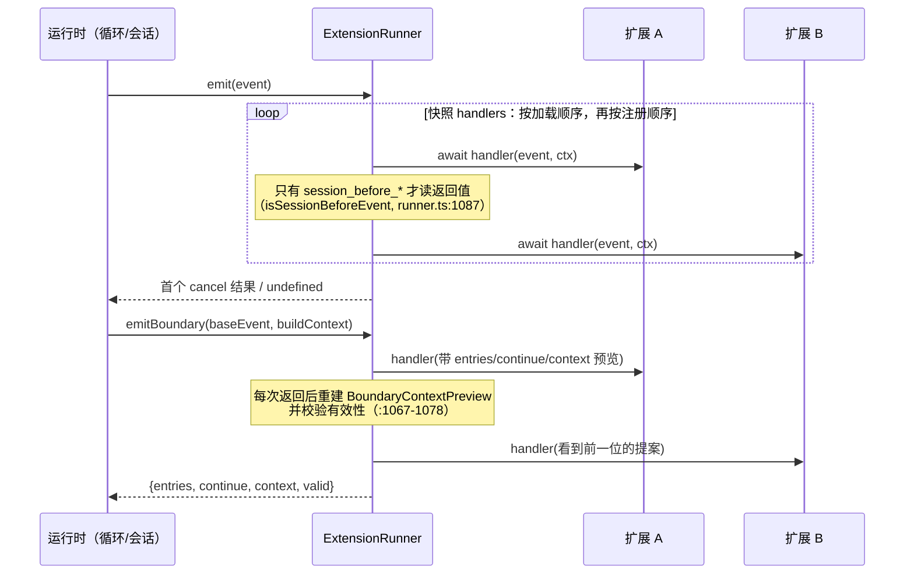

# 第 9 章 扩展运行时机制

← 上一章：[第 8 章 工具系统内参](08-tool-system.md) ｜ [返回目录](README.md)

> **本章你将学会**：说清一个扩展从被发现到能处理事件要经过的每一步；解释 `ExtensionRunner` 里六种处理器组合语义与两条真实存在的分发通道；预测某个扩展 handler 抛错后 Pi 的行为；避免加载顺序、会话替换、热重载这三类最难的坑。
>
> **对应官方文档**：[Extensions](https://pi.dev/docs/latest/extensions) · [RPC Extension UI](https://pi.dev/docs/latest/rpc-extension-ui) · [Security](https://pi.dev/docs/latest/security)

第 2 章把扩展钩子标在生命周期上，第 3 章指出这些钩子其实是循环钩子字段的覆盖。本章讲"扩展系统自己"：模块怎么加载、优先级怎么算、事件怎么分发、错误怎么处理。它是第 10 章所有实战代码能否稳定工作的前提。

## 9.1 加载：jiti + 虚拟模块

扩展是 TypeScript 模块，经 [jiti](https://github.com/unjs/jiti) 在 Pi 进程内直接求值，因此**不需要编译**（[packages/coding-agent/src/core/extensions/jiti-loader.ts](file:///D:/workspace/harness/earendil/pi/packages/coding-agent/src/core/extensions/loader.ts) 与 `loader.ts`，879 行）。加载器做三件事：解析入口、把指定包名映射到 Pi 自己带的那份、执行默认导出的工厂函数。

映射表在 [packages/coding-agent/src/core/extensions/virtual-modules.ts:15](file:///D:/workspace/harness/earendil/pi/packages/coding-agent/src/core/extensions/virtual-modules.ts#L15)。它决定了扩展的 import 语义：

```text
typebox, typebox/compile, typebox/value
@sinclair/typebox/*                      → 同上（旧名）
@earendil-works/pi-agent-core
@earendil-works/pi-tui
@earendil-works/pi-ai                    → compat 入口（不是核心入口！）
@earendil-works/pi-ai/compat | /models | /oauth | /providers/all
@earendil-works/pi-coding-agent
@mariozechner/*                          → 与 @earendil-works/* 同一份
```

三条推论：

1. **共享类与注册表**。扩展 `instanceof` 判断、`StringEnum`、`Type.Object` 都与 Pi 用同一份实现；如果扩展通过 `node_modules` 自带一份 `@earendil-works/pi-tui`，就会拿到**另一个**类实例，`Box`/`Text` 的继承关系与主题单例都会分裂。这正是 Pi 包文档要求把宿主包写进 `peerDependencies: "*"` 而不要放进 `dependencies` 的原因（第 14 章）。
2. **`@earendil-works/pi-ai` 在运行时解析到 compat**，是严格超集，为的是让旧扩展的全局流函数写法继续能跑；写新代码应显式用 `./models` 或 `ctx.modelRegistry`（第 4 章）。
3. `node:` 内置模块可用，扩展目录里的 `node_modules` 也会被解析（`package.json` 声明依赖 + `npm install`）。

工厂函数可以是 `async`。Pi 会 await 它，因此工厂里的异步初始化早于 `session_start`、早于 `resources_discover`，也早于 `pi.registerProvider()` 排队的注册被 flush——这是"启动时就拿到远端模型列表"这种写法成立的原因（11.3 节）。

## 9.2 发现、优先级与信任

自动发现的位置：`~/.pi/agent/extensions/`（全局）与 `<cwd>/.pi/extensions/`（项目级），三种形态：单文件、`<dir>/index.ts`、带 `pi.extensions` 字段的 `package.json` 目录。发现只下探一层，更大的包靠 manifest 声明入口。`settings.json` 的 `extensions` 数组与 `pi install` 的 Pi 包提供另外两类来源，`pi -e ./path.ts` 只为快速测试（自动发现的位置才能 `/reload`）。

优先级由 `resourcePrecedenceRank()` 算出（[packages/coding-agent/src/core/package-manager.ts:215](file:///D:/workspace/harness/earendil/pi/packages/coding-agent/src/core/package-manager.ts#L215)），数字小者优先、同名 first-wins：

| rank | 来源 |
|---|---|
| 0 | 项目 + settings 显式条目（`scope: "project"`, `source: "local"`） |
| 1 | 项目 + 自动发现 |
| 2 | 用户 + settings 显式条目 |
| 3 | 用户 + 自动发现 |
| 4 | Pi 包内资源（`origin: "package"`） |
| 5 | 内置扩展（`source: "builtin"`，永远最后） |

这条 rank 表同样适用于技能、提示词模板与主题，是第 14 章所有"谁覆盖谁"结论的唯一依据。

项目资源受信任门控：`.pi/settings.json`、`.pi/mcp.json`、`.pi/{extensions,skills,prompts,themes}`、`.pi/SYSTEM.md`、`.pi/APPEND_SYSTEM.md` 与 `.agents/skills` 都在 `TRUST_REQUIRING_PROJECT_CONFIG_RESOURCES` 清单里（[packages/coding-agent/src/core/trust-manager.ts:30](file:///D:/workspace/harness/earendil/pi/packages/coding-agent/src/core/trust-manager.ts#L30-L39)）。因此 `project_trust` 事件只有用户/全局扩展与 `pi -e` 扩展能参与——项目本地扩展在信任决定之前根本没被加载。内置扩展（`builtin:<name>`）虽然也按配置加载，但因为加载在信任之后，**无法**处理 `project_trust`。

## 9.3 两种分发通道

`ExtensionRunner`（[packages/coding-agent/src/core/extensions/runner.ts](file:///D:/workspace/harness/earendil/pi/packages/coding-agent/src/core/extensions/runner.ts)，1565 行）有两类派发路径：



- `emit()`（[runner.ts:1096](file:///D:/workspace/harness/earendil/pi/packages/coding-agent/src/core/extensions/runner.ts#L1096)）：逐处理器 await；只在 `isSessionBeforeEvent()` 判真的四种 `session_before_*` 上读取返回值并支持 `cancel` 提前返回。
- `emitBoundary()`（[runner.ts:1036](file:///D:/workspace/harness/earendil/pi/packages/coding-agent/src/core/extensions/runner.ts#L1036)）：给 `turn_end` 与 `agent_before_settle` 用，把 `entries` / `continue` / `context` 当作在处理器间串行传递的可变状态。调用点在 `_dispatchTurnEndBoundary()`（[packages/coding-agent/src/core/agent-session.ts:862](file:///D:/workspace/harness/earendil/pi/packages/coding-agent/src/core/agent-session.ts#L862-L899)），草稿在处理器全部结束后按序提交（`_commitBoundaryDrafts()`，[agent-session.ts:1040](file:///D:/workspace/harness/earendil/pi/packages/coding-agent/src/core/agent-session.ts#L1040)），非法续跑被上报（`:1046`）。注意："actionable boundary"是文档用语，代码里没有这个词。

所有派发都用 `snapshotEventHandlers()` 取快照，因此 `pi.on()` 返回的退订函数不会影响正在进行的派发（文档承诺与代码一致）。

## 9.4 六种组合语义与错误策略

文档把处理器行为归纳成六种（[extensions.md 的 Handler Composition](https://pi.dev/docs/latest/extensions)），落到代码上的差别很清楚：

| 语义 | 代表事件 | 代码依据 |
|---|---|---|
| 通知 | `agent_settled`、`thinking_level_select`、`provider_stream_event` | 返回值被忽略 |
| 原地修改 | `before_provider_headers.headers`、`tool_call.input`、`before_agent_start.systemPromptOptions` | 传同一对象引用，后续处理器看到改动 |
| 链式转换 | `input`、`context`、`context_with_system`、`message_end`、`tool_result`、`before_provider_request` | 用返回值替换 `current*` 变量后再进下一个处理器 |
| 门 | `tool_call`、`input`、`user_bash`、`session_before_*` | 提前 `return` 终止正常回落路径 |
| 可执行边界 | `turn_end`、`agent_before_settle` | `emitBoundary()` 的提案链 |
| 最后一个覆盖 | `cache_warming_decision` | 最后一个返回 action 的处理器胜 |

**错误策略不统一，必须记住哪几类是 fail-closed**：

- `emitToolCall()`（[runner.ts:1249](file:///D:/workspace/harness/earendil/pi/packages/coding-agent/src/core/extensions/runner.ts#L1249)）**没有 try/catch**：处理器抛错会向上传播，结果是工具被阻塞。这就是"权限门写挂了，命令不会执行"的实现来源——安全方向默认保守。
- `emitUserBash()`（[runner.ts:1269](file:///D:/workspace/harness/earendil/pi/packages/coding-agent/src/core/extensions/runner.ts#L1269)）先 `emitError` 再 `throw`：`!` 命令被阻塞而不是回落到本地执行；返回非法形状（既不是 `undefined` 也不是恰好一个 `operations`/`result`）同样抛错。
- 其他链式事件（如 `message_end`）`catch` 后 `emitError` 并 `continue`：`message_end` 里返回的角色与原消息不一致会被拒绝并跳过该处理器（[runner.ts:1165](file:///D:/workspace/harness/earendil/pi/packages/coding-agent/src/core/extensions/runner.ts#L1165-L1172)）。
- 错误出口统一是 `ExtensionError`：`runner.onError()`（[runner.ts:744](file:///D:/workspace/harness/earendil/pi/packages/coding-agent/src/core/extensions/runner.ts#L744)）在 TUI 里显示为扩展错误，在 RPC 里额外作为 `extension_error` 事件发给客户端（[packages/coding-agent/src/modes/rpc/rpc-mode.ts:349](file:///D:/workspace/harness/earendil/pi/packages/coding-agent/src/modes/rpc/rpc-mode.ts#L349)），JSON 模式没有这个通道。

## 9.5 三个 context 形状

`pi.on()` 的第二个参数不是同一个对象类型，这决定了你能做什么：

| 形状 | 出现于 | 额外能力 |
|---|---|---|
| `ExtensionContext` | 所有事件处理器 | `ui`、`mode`、`hasUI`、`cwd`、`isProjectTrusted()`、`sessionManager`（只读）、`modelRegistry`、`model`、`thinkingLevel`、`scopedModels`、`signal`、`isIdle()`/`abort()`/`hasPendingMessages()`、`shutdown()`、`getContextUsage()`、`compact()`、`getSystemPrompt()` |
| `ExtensionCommandContext` | `registerCommand` 处理器 | 再加 `getSystemPromptOptions()`、`waitForIdle()`、`newSession()`、`fork()`、`navigateTree()`、`switchSession()`、`reload()` |
| `ExtensionToolContext` | 工具 `execute()` | 再加 `tools`、`executeTool()`（8.8 节），因此**没有** `reload()` |

会话控制方法只给命令，文档给出的理由是"从事件处理器里调用会死锁"。工具拿不到 `ctx.reload()`，加上"运行中不能重载"，就产生了 10.6 节那套"记录请求 → `agent_settled` 里派发 `/reload-runtime`"的模式。

`ctx.signal` 的实际可用性也要按这张表判断：在 `tool_call`、`tool_result`、`message_update`、`turn_end` 这类活动回合事件里通常有值；在会话事件、命令处理器、空闲时触发的快捷键里通常是 `undefined`。`ctx.shutdown()` 的语义随模式变：交互模式推迟到完全空闲，RPC 推迟到当前命令响应后的空闲态，打印模式是 no-op（进程自己会退）。三种情况都会先把 `session_shutdown` 派发给所有扩展。

## 9.6 会话替换：最容易写错的一段


`withSession` 收到的是全新的 `ReplacedSessionContext`（带绑定到新会话的 `sendMessage()` / `sendUserMessage()`），但它运行在**原扩展实例的闭包**中，而旧实例已经跑完 `session_shutdown`。由此得出四条硬约束（[extensions.md 的 Session replacement lifecycle and footguns](https://pi.dev/docs/latest/extensions)）：捕获的旧 `pi` 与旧命令 `ctx` 在替换后使用会抛错；提前抽出的裸对象（例如 `const sm = ctx.sessionManager`）仍指向旧管理器；被你的 `session_shutdown` 失效掉的状态在 `withSession` 里已经不存在；只有字符串、id、序列化配置这类纯数据可以安全带走。

`ctx.reload()` 同理特殊：`await ctx.reload()` 之后仍留在重载前的调用帧里，当前 handler 继续用旧版本代码跑完，之后的命令/事件/工具调用才用新版本。官方建议把 reload 当终止处理——`await ctx.reload(); return;`。

## 9.7 注册时机速查

| API | 工厂里调用 | 加载后调用 | 需要 `/reload` |
|---|---|---|---|
| `pi.on` | 立即登记 | 立即登记（不影响在途派发） | 否 |
| `pi.registerTool` | 加载期注册 | 立即生效，`getAllTools()` 当场可见 | 否 |
| `pi.registerCommand` / `registerShortcut` / `registerFlag` | 加载期 | 生效 | 否（但 `-e` 位置改动需重启） |
| `pi.registerProvider` / `unregisterProvider` | **排队**，runner 初始化后 flush | 立即生效 | 否 |
| `pi.registerVirtualModel` | 同 provider 的排队/立即规则 | 立即 | 否 |
| `pi.registerMcpServer` | 会话启动时随 `mcp.json` 一起连接 | 立即连接；`unregisterMcpServer()` 关连接并让工具不可达 | 否（注册不持久，每次加载都要重注册） |
| 改磁盘上的资源（技能/模板/主题/扩展文件本身） | — | — | 是 |

`getCommands()` 的排序是稳定的：扩展命令、提示词模板、技能命令（名为 `skill:<name>`），与 RPC `get_commands` 一致；内置交互命令（`/model`、`/settings`）不在其中，因为它们只在交互模式里由本地处理。多个扩展注册同名命令时 Pi 全部保留并加数字后缀（`/review:1`、`/review:2`）。

## 9.8 生命周期与资源纪律

扩展工厂可能运行在**永远不会开会话**的调用里（`pi --list-models`、`pi config`、包命令）。因此规则是：不要在工厂里启动进程、socket、文件监听器、定时器；把后台资源的启动推迟到 `session_start` 或真正需要它的命令/工具/事件，并注册幂等的 `session_shutdown` 清理（[extensions.md 的 Long-lived resources and shutdown](https://pi.dev/docs/latest/extensions)）。

`session_start.reason` 有 `startup | reload | new | resume | fork`，`session_shutdown.reason` 有 `quit | reload | new | resume | fork`；退出覆盖 Ctrl+C、Ctrl+D、SIGHUP、SIGTERM。恢复会话**不**触发 `model_select`，需要模型相关初始化的扩展要在 `session_start` 里读 `ctx.model`。

模式差异（`ctx.mode` 与 `ctx.hasUI`）汇总成一张决策表：

| 模式 | `ctx.mode` | `ctx.hasUI` | 交互能力 |
|---|---|---|---|
| interactive | `"tui"` | `true` | 全部，含 `custom()`、组件工厂、终端输入 |
| rpc | `"rpc"` | `true` | 对话框/通知走 JSON 子协议；`custom()` 返回 `undefined`，组件工厂被忽略（15.4 节给完整清单） |
| json | `"json"` | `false` | UI 方法为 no-op |
| print | `"print"` | `false` | 扩展照跑，但无法提问 |

习惯写法是：要 TUI 专属能力就判 `ctx.mode === "tui"`，要用对话框/通知就判 `ctx.hasUI`。

> 源码位置：`packages/coding-agent/src/core/extensions/loader.ts`（发现与 jiti 加载）、`packages/coding-agent/src/core/extensions/runner.ts`（分发、注册表、错误）、`packages/coding-agent/src/core/extensions/types.ts`（2314 行的事件与 API 类型，是本章全部签名的事实来源）。

## 小结

- 扩展经 jiti 在进程内求值，指定包名被映射到 Pi 自带副本；`@earendil-works/pi-ai` 解析到 compat 超集，自带依赖会造成类与注册表分裂。
- 优先级是一张 0..5 的 rank 表，同名 first-wins，内置扩展最后；项目资源在信任门之后才加载，因此 `project_trust` 只有用户/全局/`-e` 扩展能参与。
- 两条分发通道：`emit()`（只有 `session_before_*` 读返回值）与 `emitBoundary()`（`turn_end` / `agent_before_settle` 的提案链，带有效性校验）。
- 六种组合语义中，`tool_call` 与 `user_bash` 是 fail-closed：处理器抛错就阻塞，不回落本地执行。
- 三个 context 形状决定能力边界：会话控制只在命令里，`executeTool` 只在工具里，`ctx.signal` 只在活动回合里可靠。
- 会话替换与 reload 是两个高危点：`withSession` 跑在旧闭包，reload 后当前 handler 仍在旧帧。
- 注册类 API 大多即时生效，`/reload` 只对磁盘资源必要；工厂里不要启动长生命周期资源。

## 练习

1. 写一个扩展，在 `tool_call` 里对未知情况直接 `throw new Error("cannot decide")`。验收标准：证明工具被阻塞而不是执行，并引用 `emitToolCall` 缺少 try/catch 这一点解释原因。
2. 用两个扩展注册同一事件 `message_update`，第二个抛错。验收标准：观察第一个仍收到调用、错误以扩展错误呈现，并在 `--mode rpc` 下看到 `extension_error` 记录。
3. 写一个命令做 `ctx.newSession({ withSession })`，故意在里面使用替换前捕获的 `pi`。验收标准：复现抛错，然后按 9.6 节改成正确写法（只用回调的 `ctx`）。
4. 在 `pi --list-models` 场景下验证 9.8 节的资源纪律：把 `setInterval` 放进工厂。验收标准：解释为什么进程没有按预期退出或留下了什么，并给出把启动移到 `session_start` + 幂等 `session_shutdown` 的改法。

## 延伸阅读

- [Extensions 的 Events / Handler Composition / Mode Behavior](https://pi.dev/docs/latest/extensions)
- 第 10 章：把本章语义用到能跑的扩展上；第 15 章：RPC 扩展 UI 的完整支持矩阵
- 源码：`packages/coding-agent/examples/extensions/plan-mode/`（一个用满事件、命令、快捷键、flag、状态与 UI 的完整扩展）

---

→ 下一章：[第 10 章 扩展开发实战](10-extension-development.md) ｜ [返回目录](README.md)
