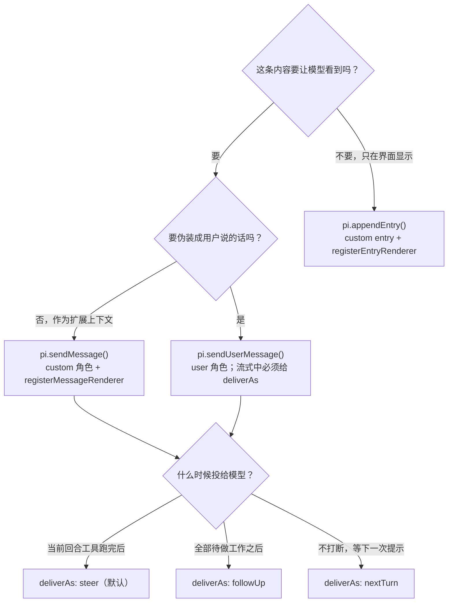

# 第 10 章 扩展开发实战

← 上一章：[第 9 章 扩展运行时机制](09-extension-runtime.md) ｜ [返回目录](README.md)

> **本章你将学会**：搭一个能热重载、能类型检查的扩展开发回环；实现权限门、状态化工具、自定义命令与界面、上下文注入、模型触发热重载、代码检查点这六类最常用的模式；避开官方示例之外真正会踩的坑。
>
> **对应官方文档**：[Extensions](https://pi.dev/docs/latest/extensions) · [Terminal UI](https://pi.dev/docs/latest/tui) · [RPC Extension UI](https://pi.dev/docs/latest/rpc-extension-ui)

第 9 章给的是机制，本章给的是可复制的写法。所有代码都按第 9 章的语义约束检查过：门型处理器在不能决策时阻塞、状态进 `details`、TUI 能力判 `ctx.mode`、后台资源在 `session_start` 起、在 `session_shutdown` 清。

## 10.1 开发回环

```bash
mkdir -p ~/.pi/agent/extensions
cd /path/to/project
pi -e ./my-extension.ts            # 快速试：改一次重启一次
```

`pi -e` 适合调试，但它有两处与自动发现位置不同：不能被 `/reload`，以及 `-e` 传入的 npm/git 包会被缓存到 `<agent-dir>/tmp/extensions/` 并在每次启动与 `/reload` 时检查更新（精确版本 pin 不检查，git 会重置到远端 ref）。因此正式开发要尽早把文件放进 `~/.pi/agent/extensions/`（全局）或 `.pi/extensions/`（项目），在那里才能获得"改代码 → `/reload` → 立即生效"的回环。

类型与规范直接从仓库拿：在 monorepo 里写扩展时，`npm run check` 会跑 Biome 与 `tsc --noEmit`（第 17 章给完整清单）；在仓库外写时，把 `@earendil-works/pi-coding-agent` 作为 `peerDependencies` 并让宿主提供，避免 9.1 节说的类实例分裂。

按目的挑起点，比从空文件开始快得多（完整表在 `packages/coding-agent/examples/extensions/`：79 个条目，含 9 个目录示例；官方文档的 Examples Reference 表列出其中 78 个）：

| 你要做的 | 直接读 |
|---|---|
| 工具注册与渲染 | `hello.ts`、`built-in-tool-renderer.ts`、`minimal-mode.ts` |
| 交互式工具 | `question.ts`、`questionnaire.ts`、`tic-tac-toe.ts` |
| 状态与分支 | `todo.ts`（304 行，本章 10.3 的参考实现）、`preset.ts`、`tools.ts` |
| 门与拦截 | `permission-gate.ts`、`protected-paths.ts`、`confirm-destructive.ts`、`dirty-repo-guard.ts` |
| 输入改写 | `input-transform.ts`、`input-transform-streaming.ts`、`inline-bash.ts` |
| 提示词与上下文 | `pirate.ts`、`claude-rules.ts`、`prompt-customizer.ts`、`system-prompt-header.ts` |
| 压缩与会话 | `custom-compaction.ts`、`trigger-compact.ts`、`git-checkpoint.ts`、`git-merge-and-resolve.ts` |
| 界面 | `status-line.ts`、`widget-placement.ts`、`custom-footer.ts`、`custom-header.ts`、`modal-editor.ts`、`overlay-qa-tests.ts` |
| provider 与路由 | `custom-provider-anthropic/`、`custom-provider-gitlab-duo/`、`jev-router.ts` |
| 远程与沙箱 | `ssh.ts`、`interactive-shell.ts`、`sandbox/`、`gondolin/` |
| 完整功能 | `plan-mode/`（事件、命令、快捷键、flag、状态、widget 全用一遍） |

## 10.2 模式一：权限门

门型处理器的三条纪律：不能决策时阻塞（fail-closed）、无 UI 时不要假装问过、改写 `input` 时明白没有二次校验。

```typescript
import { isToolCallEventType, type ExtensionAPI } from "@earendil-works/pi-coding-agent";

const DANGEROUS = [/\brm\s+(-rf?|--recursive)/i, /\bsudo\b/i, /\b(chmod|chown)\b.*777/i];
const PROTECTED = [/(^|\/)\.env$/, /(^|\/)node_modules\//, /(^|\/)\.git\//];

export default function (pi: ExtensionAPI) {
  // 用 annotations 做通用审批：破坏性或可达开放世界的调用需要确认
  const needsApproval = (name: string) => {
    const hints = pi.getAllTools().find((tool) => tool.name === name)?.annotations;
    return hints?.destructiveHint === true || (!hints?.readOnlyHint && (hints?.openWorldHint ?? true));
  };

  pi.on("tool_call", async (event, ctx) => {
    if (isToolCallEventType("bash", event)) {
      const command = event.input.command;
      // 改写：所有命令先载入 shell 环境（无二次 schema 校验，改动即最终命令）
      if (!command.startsWith("source ")) event.input.command = `source ~/.profile\n${command}`;
      if (DANGEROUS.some((p) => p.test(command))) {
        if (!ctx.hasUI) return { block: true, reason: "危险命令被拦截（当前模式无法确认）" };
        const ok = await ctx.ui.confirm("危险命令", command);
        if (!ok) return { block: true, reason: "用户拒绝", terminate: true };
      }
      return;
    }

    if (isToolCallEventType("write", event) || isToolCallEventType("edit", event)) {
      const path = String(event.input.path ?? "");
      if (PROTECTED.some((p) => p.test(path))) return { block: true, reason: `受保护路径：${path}` };
      if (needsApproval(event.toolName) && ctx.hasUI) {
        const ok = await ctx.ui.confirm("允许写入？", path);
        if (!ok) return { block: true, reason: "未获批准" };
      }
    }
  });
}
```

`terminate: true` 只在被阻塞时使用，且只有当该批**所有**最终结果都是终止时才生效（8.7 节、3.6 节），所以"拒绝一条、放过其他"的批处理仍然会继续。`isToolCallEventType("bash", event)` 对内置工具不需要类型参数；自定义工具要显式传泛型并导出输入类型（附录 A.6 的 `tool_call` 行）。

## 10.3 模式二：状态化工具

状态要能随分支重建，唯一可靠载体是工具结果的 `details`。骨架（完整实现见 `todo.ts`）：

```typescript
import { Type } from "typebox";

interface TodoState { items: Array<{ text: string; done: boolean }> }

export default function (pi: any) {
  let state: TodoState = { items: [] };

  // 分支变化时要重建：session_start 与 session_tree 两个入口
  const rebuild = (ctx: any) => {
    state = { items: [] };
    for (const entry of ctx.sessionManager.getBranch()) {          // 不是 getEntries()
      if (entry.type === "message" && entry.message.role === "toolResult" && entry.message.toolName === "todo") {
        const details = entry.message.details as TodoState | undefined;
        if (details?.items) state = { items: details.items };       // 最后一次结果即当前状态
      }
    }
  };

  pi.on("session_start", async (_e: any, ctx: any) => rebuild(ctx));
  pi.on("session_tree", async (_e: any, ctx: any) => rebuild(ctx));

  pi.registerTool({
    name: "todo",
    label: "Todo",
    description: "Maintain a task list. Returns the whole list every time.",
    promptSnippet: "Track multi-step work with a todo list",
    promptGuidelines: ["Use todo to record progress on multi-step tasks instead of describing it in prose."],
    parameters: Type.Object({
      add: Type.Optional(Type.String()),
      complete: Type.Optional(Type.Integer({ minimum: 0 })),
    }),
    async execute(_id, params, _signal, _onUpdate, ctx: any) {
      if (params.add) state.items.push({ text: params.add, done: false });
      if (params.complete !== undefined) {
        const item = state.items[params.complete];
        if (item) item.done = true;
      }
      // 每次返回完整状态：这样任何一条结果都能独立重建
      return {
        content: [{ type: "text", text: state.items.map((i, n) => `${n}. ${i.done ? "x" : " "} ${i.text}`).join("\n") }],
        details: { items: state.items.map((i) => ({ ...i })) } satisfies TodoState,
      };
    },
  });
}
```

三个要点：`content` 是给模型的、`details` 是给渲染与重建的，不要只写 `details`；每次返回**完整**状态而非增量，重建逻辑就是"取最后一次"，最省心；用 `executionMode: "sequential"` 保护纯内存状态（`tic-tac-toe.ts` 的做法），否则并行调用会读到同一份旧状态。

## 10.4 模式三：命令、对话框与自定义界面

对话框三种退出要区分清楚（`timeout` 与 `signal` 的返回值语义不同）：

```typescript
pi.registerCommand("deploy", {
  description: "Deploy to an environment",
  getArgumentCompletions: (prefix) => {
    const items = ["dev", "staging", "prod"].map((e) => ({ value: e, label: e }));
    const hits = items.filter((i) => i.value.startsWith(prefix));
    return hits.length ? hits : null;
  },
  handler: async (args, ctx) => {
    const env = args || (await ctx.ui.select("选择环境", ["dev", "staging", "prod"]));
    if (!env) return;                                        // 取消或超时都是 undefined

    const ok = await ctx.ui.confirm(`部署到 ${env}？`, "这一步不可撤销", { timeout: 8000 });
    if (!ok) { ctx.ui.notify("已取消", "warning"); return; }

    ctx.ui.setStatus("deploy", `deploying ${env}`);
    const r = await pi.exec("make", ["deploy", `ENV=${env}`], { signal: ctx.signal, timeout: 120_000 });
    ctx.ui.setStatus("deploy", undefined);
    ctx.ui.notify(r.code === 0 ? "部署完成" : `部署失败：${r.stderr.slice(0, 200)}`, r.code === 0 ? "info" : "error");
  },
});
```

需要键盘控制自己的界面时用 `ctx.ui.custom()`，四条纪律来自 9.8 与 13 章：判 `ctx.mode === "tui"`；每行用 `truncateToWidth(line, width)` 保证不超宽；状态变化后 `invalidate()` + `tui.requestRender()`；只能通过 `done()` 结束（不要对 `ctx.ui.custom()` 创建的 overlay 调 `handle.hide()`）。等待用户输入的 inline 组件要传 `blocked: { kind: "question", message: "…" }`，支持 program status 的终端才会显示"被阻塞"而不是"在跑"。持久停靠的内容用 `setWidget(key, lines | factory, { placement })`，整块替换用 `setFooter` / `setHeader` / `setEditorComponent`。

`pi.registerCommand` 与 `pi.on("input")` 的取舍：前者语义稳定、可出现在 `/` 菜单、可带参数补全；后者能改写**任何**输入（包括别人的模板），只在你确实要拦全局输入时用。

## 10.5 模式四：往上下文里放东西

三种"发消息"的区别必须分清，否则会出现"模型看到了不该看的"或"界面有但模型没有"：



| API | 进模型上下文 | 进 transcript | 典型用法 |
|---|---|---|---|
| `pi.sendMessage(msg, opts)` | 是（`custom` 角色） | 是（`custom_message`） | 给模型补充规则/状态，配 `registerMessageRenderer` |
| `pi.appendEntry(type, data)` | 否 | 是（`custom`） | 界面卡片、检查点数据，配 `registerEntryRenderer` |
| `pi.sendUserMessage(content, opts)` | 是（`user` 角色） | 是 | 伪装用户输入驱动模型；可 `expandPromptTemplates: true` 派发命令 |
| `before_agent_start` 返回 `message` | 是 | 是 | 每轮注入固定提醒，按 `event.messageType` 跳过自定义消息启动的运行 |

投递时机由 `deliverAs` 决定：`"steer"`（默认，当前助手回合与其工具执行结束后、下一次模型调用前）、`"followUp"`（等全部工具做完）、`"nextTurn"`（只排队给下一次用户提示，不打断不触发）。`triggerTurn: true` 只在 `"steer"`/`"followUp"` 下有意义，且表示"空闲时立即起一轮"；流式中传 `triggerTurn: false` 会让消息在本回合结束后追加而不是被投递。

```typescript
pi.on("agent_end", async (_event, ctx) => {
  if (!ctx.hasUI) return;
  const diff = await pi.exec("git", ["diff", "--stat"]);
  if (!diff.stdout.trim()) return;
  pi.sendMessage({
    customType: "review-hint",
    content: "工作区有改动，回复前请先总结 diff --stat 的影响面。",
    display: false,                       // 模型看得到，界面不显示
    details: { stat: diff.stdout },
  }, { deliverAs: "followUp" });
});
```

`details` 不进模型；`display: false` 时界面不出现但仍在 transcript 里，因此**永远不要**把 secret 放进 `content` 之外的字段并指望它安全——`details` 会被导出、被 `/session` 类扩展读到（第 17 章的安全边界）。

## 10.6 模式五：让模型触发热重载

约束：工具上下文没有 `ctx.reload()`，且 Pi 不能在智能体运行中重载。做法是"工具记账 + 落定后派发命令"（`reload-runtime.ts`）：

```typescript
let reloadRequested = false;

pi.registerTool({
  name: "reload_runtime",
  label: "Reload Runtime",
  description: "Reload extensions, skills, prompts, themes, and context files",
  parameters: Type.Object({}),
  async execute() {
    reloadRequested = true;
    return {
      content: [{ type: "text", text: "已请求重载，本轮回答结束后重载。" }],
      details: {},
      terminate: true,                       // 让本轮在此结束，避免无意义的追问
    };
  },
});

pi.on("agent_settled", () => {
  if (!reloadRequested) return;
  reloadRequested = false;
  pi.sendUserMessage("/reload-runtime", { expandPromptTemplates: true });   // 作为命令派发
});

pi.registerCommand("reload-runtime", {
  description: "Reload the extension runtime",
  handler: async (_args, ctx) => { await ctx.reload(); return; };           // 视为终止
});
```

`expandPromptTemplates: true` 是关键：缺了它，这段文本会被当成普通用户消息进模型。`agent_settled` 里请求的工作会延到所有 settled 处理器结束后执行（附录 A.4 的 `agent_settled` 行，通知派发因此不可重入）。

## 10.7 模式六：外部世界与会话对齐

`git-checkpoint.ts` 展示了把外部状态（代码）与会话位置（entry id）绑定的最小闭环，三个手法都值得抄：

1. 在 `tool_result` 里记住 `ctx.sessionManager.getLeafEntry().id` 作为"当前修改属于哪个位置"的锚，因为 `tool_call` 之前 Pi 已保证 `sessionManager` 同步到当前 assistant 消息。
2. `turn_start` 时用 `git stash create`（只创建不改变工作区）拿 ref，存进内存 `Map<entryId, ref>`。
3. `session_before_fork` 里按 `event.entryId` 找 ref，问用户后 `git stash apply`——把"会话分支"与"代码状态"重新对齐；`agent_settled` 里清空 Map，避免跨运行泄漏。

同一模式可扩展到 CI 触发、索引重建、外部工单同步。共同纪律是：**内存状态必须能从 transcript 重建，或者明确只活在一次运行内**，否则跨 `/fork`、`/tree`、`/resume` 就会不一致（6.6 节）。

## 10.8 自检清单

写完扩展，按这份清单过一遍——每条都对应本章或第 9 章的一处机制：

- [ ] `tool_call` 的每个分支都有明确返回：放行用 `undefined`，拦截带 `reason`；不确定的情况阻塞。
- [ ] 所有工具结果（含 `onUpdate` 的部分结果）都有 `content` 与 `details`，且 `details` 类型一致。
- [ ] `promptGuidelines` 每条点名工具名；需要出现在 `<tools>` 里就设 `promptSnippet`。
- [ ] 会改文件的工具走 `withFileMutationQueue(realpath)`，覆盖整个读改写窗口。
- [ ] 状态重建遍历 `getBranch()`，并在 `session_start` 与 `session_tree` 两处都做。
- [ ] 后台资源在 `session_start`（或首个使用者）启动，`session_shutdown` 幂等清理，工厂里没有副作用。
- [ ] 用了 TUI 专属 API 就判 `ctx.mode === "tui"`；用了对话框就判 `ctx.hasUI`，并给非交互模式一个明确行为。
- [ ] 不在流式高频事件（`message_update`、`provider_stream_event`）里做慢活。
- [ ] 覆盖内置工具时显式重写 `promptSnippet`/`promptGuidelines`，并保持 `details` 形状。
- [ ] 注册 `mcp.json` 之外的 MCP 服务器时每次加载都重注册（注册不持久）。
- [ ] 依赖走 `peerDependencies: "*"`，不把宿主包塞进 `dependencies`。

调试手段按成本递增：`pi -e` + 启动头（列出加载了哪些资源）→ `ctx.ui.setStatus()` / `setWidget()` 观察运行态 → `/debug`（把渲染行与当前会话消息写进 `<agent-dir>/pi-debug.log`）→ `/hotkeys` 看实际生效的快捷键 → `pi config` 开关资源 → `before_provider_request` / `provider_stream_event` 看真实请求与原始流（`debug-provider.ts`）→ `/export` 或 `pi-debug.log` 做离线复盘。

> 源码位置：`packages/coding-agent/examples/extensions/`（本章全部模式的参考实现）、`packages/coding-agent/src/core/extensions/types.ts`（签名事实来源）、`packages/coding-agent/src/core/diagnostics.ts` 与 `src/core/crash-log.ts`（诊断落盘）。

## 小结

- 开发回环是"`-e` 起步 → 移入自动发现位置 → `/reload`"，因为热重载只对发现位置生效。
- 门型处理器 fail-closed 是 Pi 的实现事实，不是风格建议：`tool_call` 抛错即阻塞。
- 状态化工具的三条不变式：完整状态入 `details`、遍历 `getBranch()` 重建、必要时 `executionMode: "sequential"`。
- 四种"注入"各有归属：进模型/只进界面/伪装用户/每轮提醒，投递时机由 `deliverAs` 与 `triggerTurn` 决定。
- 让模型重载需要"工具记账 + `agent_settled` 派发命令 + `expandPromptTemplates`"三段配合。
- 自检清单的最后两条（依赖形态与 MCP 重注册）是分发阶段最容易翻车的地方。

## 练习

1. 给 10.2 的门加上"仅首次写 `.env` 时告警、之后同一会话不再问"的记忆，并跨 `/fork` 保持正确。验收标准：说明你把记忆放在哪里（`details`？`appendEntry`？）以及为什么。
2. 用 `ctx.ui.custom()` 写一个三行选择面板，要求支持 `up/down/enter/escape` 与 `tui.select.*` 快捷键。验收标准：在 40 列与 200 列终端里都不破版，且 `invalidate()` 后不留旧 ANSI。
3. 实现"回答结束后自动跑 `git diff --stat` 并把结果作为自定义消息注入"（10.5 片段），然后在 `pi --mode rpc` 下运行。验收标准：解释 RPC 客户端会收到哪些记录，以及 `display: false` 是否影响事件流。
4. 把 10.6 的重载工具改造成"重载后自动继续上一句提示"。验收标准：说明为什么必须在 `withSession`/`agent_settled` 之后而不是 `execute()` 里做，并引用 9.6 与 3.4 的约定。

## 延伸阅读

- [Extensions 的 Examples Reference](https://pi.dev/docs/latest/extensions)（78 行示例分类表）
- 第 13 章：组件契约、焦点与 IME、overlay 选项；第 15 章：RPC 下的 UI 支持矩阵
- 第 14 章：把扩展连同技能、模板、主题打包成 Pi 包分发

---

→ 下一章：[第 11 章 模型服务接入与虚拟模型](11-provider-integration.md) ｜ [返回目录](README.md)
