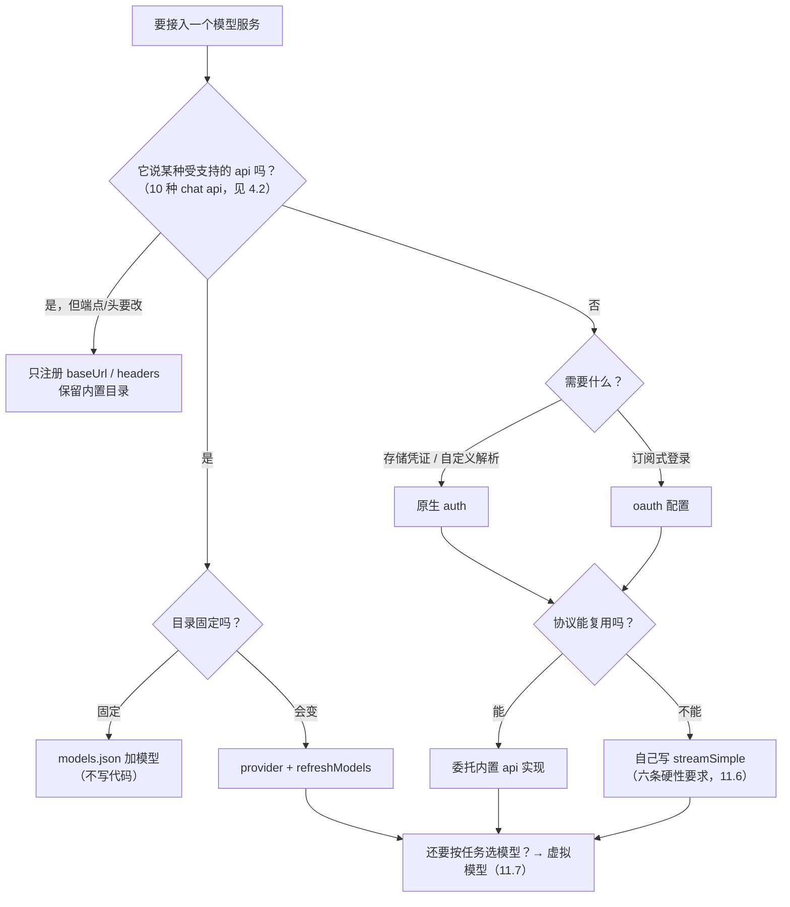

# 第 11 章 模型服务接入与虚拟模型

← 上一章：[第 10 章 扩展开发实战](10-extension-development.md) ｜ [返回目录](README.md)

> **本章你将学会**：为一个新的模型服务选到最轻的接入方式；写出质、鉴权、目录、流式四个维度都正确的 provider 扩展；把 `compat` 键与第 5 章的缓存行为对上；实现一个会按任务与状态路由、并保住缓存前缀的虚拟模型。
>
> **对应官方文档**：[Custom Providers](https://pi.dev/docs/latest/custom-provider) · [Models Configuration](https://pi.dev/docs/latest/models-configuration) · [Virtual Models](https://pi.dev/docs/latest/virtual-models) · [Providers](https://pi.dev/docs/latest/providers)

接入一个新模型服务有五种做法，代价相差一个数量级。本章的第一职责是让你选对，第二职责是把最贵的那两种（自定义 streaming、路由模型）写对。

## 11.1 选型阶梯



| 需求 | 方式 | 要写代码吗 |
|---|---|---|
| 受支持 API 后面加模型 | `models.json` 的 `providers.<id>.models` | 否 |
| 改已有 provider 的端点或头 | `models.json` 的 `baseUrl` / `headers` / `modelOverrides`，或很小的 provider 扩展 | 否/极少 |
| 目录随服务变化 | provider + `refreshModels` | 是 |
| 要 `/login` 流程 | provider 原生 `auth` 或 legacy `oauth` | 是 |
| 不支持的线协议 | provider + `stream` / `streamSimple` | 是（最贵） |

`models.json` 的三层结构是"provider 默认 + 每模型覆盖 + 全局 `modelOverrides`"，对象字段（如 `cost`）按字段合并、其余整体替换，未知 `modelOverrides` 键被忽略（[models-configuration.md](https://pi.dev/docs/latest/models-configuration)）。加 `"$schema": "https://pi.dev/schemas/models.schema.json"` 获得编辑器校验。`samplingParams` 只对 OpenAI 兼容 API 生效；`cost.tiers` 是整请求阶梯价，取匹配到的最高 `inputTokensAbove` 阈值套全请求。

一句判据：**只要不需要"运行时代码"，就用 `models.json`**。扩展的价值在于动态发现、自定义鉴权、以及和其他扩展功能共享状态。

## 11.2 `pi.registerProvider()` 的两种形态

形态一（legacy config）适合静态端点覆盖：

```typescript
import type { ExtensionAPI } from "@earendil-works/pi-coding-agent";

export default function (pi: ExtensionAPI) {
  // 只改端点：保留内置目录、鉴权、API 实现与兼容性设置
  pi.registerProvider("anthropic", {
    baseUrl: "https://gateway.example.com/anthropic",
    headers: { "X-Gateway-Key": "$GATEWAY_API_KEY" },
  });

  // 新 provider：只列服务真正暴露的模型
  pi.registerProvider("acme", {
    name: "Acme AI",
    baseUrl: "https://api.acme.example/v1",
    apiKey: "$ACME_API_KEY",
    api: "openai-completions",
    models: [
      {
        type: "chat",
        id: "acme-chat",
        name: "Acme Chat",
        reasoning: false,
        input: ["text"],
        cost: { input: 0, output: 0, cacheRead: 0, cacheWrite: 0 },
        contextWindow: 128000,
        maxTokens: 8192,
      },
    ],
  });
}
```

legacy 键的语义要点：`apiKey` 支持字面量、`$ENV` / `${ENV}` 插值、前导 `!command`（`$$` 转义 `$`、`$!` 转义前导 `!`），可省略——省略后用户用 `/login` 存 key；`authHeader: true` 自动加 `Authorization: Bearer`；`api` 是 `KnownApi` 之一或自定义字符串。**覆盖语义最容易踩**：只注册 `baseUrl`/`headers` 会保留内置模型；一旦提供 `models`，就替换该 provider 在 chat、image、classifier **三种操作**上的全部模型，且 `type` 缺省为 `"chat"`，图像与分类模型必须显式写判别字段并用 `images` / `classifiers` 按 `api` 挂实现（[custom-provider.md](https://pi.dev/docs/latest/custom-provider)）。因此"把内置模型列表抄进扩展"是一个反模式：一个小端点覆盖会变成一个会漂移的目录替换。

形态二（完整 `Provider`）适合新集成：

```typescript
import { createProvider, openAICompletionsApi } from "@earendil-works/pi-ai/compat";

const provider = createProvider({
  id: "local-server",
  baseUrl: "http://localhost:8080/v1",
  auth: {
    apiKey: {
      name: "Local server setup",
      async login(interaction) {
        return { type: "api_key", key: await interaction.prompt({ type: "secret", message: "API key" }) };
      },
      async resolve({ credential }) {
        return credential?.key ? { auth: { apiKey: credential.key }, source: "stored API key" } : undefined;
      },
    },
  },
  models: [],
  api: openAICompletionsApi(),
});

pi.registerProvider(provider);
```

注册的时机规则（9.7 节）在这里落地：工厂里的调用**排队**，runner 初始化时 flush，所以启动时的模型选择与 `pi --list-models` 都能看到；工厂之后（例如某个命令里走完用户引导流程后）调用则立即生效，不需要 `/reload`。`pi.unregisterProvider(name)` 移除动态 provider 并**恢复**它此前覆盖掉的内置模型。Pi 把 `models.json` 的覆盖组合在注册的原生 provider **之上**（4.5 节的分层顺序）。

## 11.3 动态目录：两种刷新契约

两种形态的 refresh 契约不同，选错会得到"每次启动都看不到新模型"或"每次都往磁盘写"：

| 形态 | 契约 | 目录可见性 |
|---|---|---|
| 完整 `Provider` | `refreshModels(context)` **不返回**模型，调用 `context.publish({ update })` 安装 provider 自有状态，之后同步 `getModels()` 返回最新列表 | `getModels()` 不得抛（抛出=无模型） |
| legacy `ProviderConfig` | `refreshModels` **返回**混合操作的模型定义数组，Pi 用它替换该注册的实时模型并按需持久化 | 由 Pi 管理 |

内置实现把 `fetchModels` 生成成"restore → publish update → fetch → `publish({ persist: { models, checkedAt }, update })`"（[packages/ai/src/models.ts:1129](file:///D:/workspace/harness/earendil/pi/packages/ai/src/models.ts#L1129-L1156)），持久化只发生在 `context.publish({ persist: entry })`，`persist: null` 删除快照。generation 检查保证旧刷新不会覆盖新结果（4.8 节）。实时服务（llama.cpp，配置步骤见 [Run Local Models](https://pi.dev/docs/latest/llama-cpp)）的正确写法是返回模型但**不**持久化：

```typescript
pi.registerProvider("llama.cpp", {
  baseUrl: "http://localhost:8080/v1",
  apiKey: "local",
  api: "openai-completions",
  async refreshModels({ signal }) {
    const response = await fetch("http://localhost:8080/v1/models", { signal });
    const { data } = (await response.json()) as { data: Array<{ id: string }> };
    return data.map(({ id }) => ({
      id, name: id, reasoning: false, input: ["text"] as const,
      cost: { input: 0, output: 0, cacheRead: 0, cacheWrite: 0 },
      contextWindow: 128000, maxTokens: 16384,
    }));
  },
});
```

`context.signal` 必须是具体 signal 并透传给阻塞 I/O。取消后调用方仍会终止等待，但底层工作的停止需要 provider 配合。

## 11.4 鉴权与凭证

凭证解析顺序与"存储类型不匹配不静默回落 env"在第 4 章已经给出。扩展侧要做对三件事：

1. 原生 `auth` 提供 `login()` 与 `resolve()`，让 `/login` 出现该项并把结果写进 `~/.pi/agent/auth.json`；需要 provider 作用域环境变量时用 `ProviderAuth` 的完整形态，配合 `ctx.modelRegistry.getProviderAuth(id)`（它不需要已加载模型就能解析 key、headers、baseUrl）。
2. OAuth 形态提供 `login(callbacks)` / `refreshToken(credentials, signal)` / `getApiKey(credentials)`；回调是 UI 中立的（可开 URL、显示设备码、请求输入、让用户选登录方式），并且必须尊重取消与 signal。`onDeviceCode` / 原生 `AuthEvent` 上有 `openBrowserOnConfirm`、`copyCodeOnConfirm` 两个开关。
3. 永远不要把 access token、refresh token、鉴权头、完整 provider 响应写进常规日志（[custom-provider.md](https://pi.dev/docs/latest/custom-provider)）。这条与第 17 章的"日志与导出物都可能含敏感内容"是同一条纪律。

## 11.5 `compat` 不是可选装饰

第 5 章的缓存与补丁行为，实际由模型声明的能力决定。以下几项直接改变 Pi 发请求的方式，接新服务时最该核对：

| 键 | 作用 | 不设置时的后果 |
|---|---|---|
| `supportsMidConvoSystemMessages` | 是否接受会话中途的 system/developer 消息 | `false` 时后续段补丁被折叠进头部系统消息，每次段变化一次缓存未命中 |
| `supportsMidConvoToolAdditions` / `supportsMidConvoToolChanges` | 中途能否加工具（Responses 用 `additional_tools`，Anthropic 用 `tool_addition`/`tool_removal`） | 动态工具（8.7、12 章）退化为整段重放 |
| `supportsMidConvoEffort` | 思考等级变化是否作为 `configuration_update` 发送以保住缓存 | 改思考等级会破坏前缀 |
| `cacheControlFormat: "anthropic"` | 给 OpenAI 兼容端点打 Anthropic 式 `cache_control`（系统提示、最后一个工具定义、最后一个文本内容） | 不写缓存 |
| `supportsLongCacheRetention` | 长保留层（`prompt_cache_retention: "24h"` 或 `cache_control.ttl: "1h"`） | `PI_CACHE_RETENTION=long` 无效；5.7 的预热层选不到 long |
| `promptCache.short` / `.long` | 保留时长（秒），决定预热时机与是否预热 | 该模型完全不预热 |
| `sessionAffinityFormat` / `sendSessionAffinityHeaders` | 会话亲和头（Fireworks 类需要路由到同一副本才有命中） | 缓存在副本间抖动 |
| `thinkingFormat` / `maxTokensField` / `supportsFinishReason` / `supportsUsageInStreaming` | 请求与响应字段形状 | 思考不生效、报错、拿不到流式 usage |

一句判据：**"端点自称兼容"不足以打开这些开关**，要实测确认（[models.md](https://pi.dev/docs/latest/models)）。目录生成器只为已验证的模型启用严格工具、语法工具、中途系统消息等能力。

## 11.6 自定义 streaming 的六条硬性要求

只有当现有 API 实现无法表达该服务时才写（先读 `packages/ai/src/api/` 下的实现）。规范来自 [custom-provider.md](https://pi.dev/docs/latest/custom-provider)，逐条对应可测行为：

1. 造一条助手消息：provider、model、timestamp、`stopReason: "pending"`、空 content、零值 usage。
2. 请求建立成功后，先emit 一条 `start`，再有内容事件。允许在 `start` 之前失败并直接 `error`；缺鉴权也可以在返回流之前同步抛。
3. 边发 `text_*` / `thinking_*` / `toolcall_*` 事件边更新 `partial`；每个块在发对应事件前先更新它；`toolcall_end` 时参数必须已完整解析。
4. 终态确定 usage、cost、content、stopReason；错误与中断消息需要 `errorMessage`，成功消息需要准确的 input/output/cache/total/cost。
5. 恰好一条终态 `done` 或 `error`，然后关闭流。
6. 取消转成 aborted 结果。

上下文读法是最容易写错的一点：系统提示词与工具声明住在 transcript 的系统消息里，要用 `getCurrentSystemPrompt(context.messages)` 与 `getCurrentTools(context.messages)` 读，不要指望 `context.systemPrompt`；不支持中途系统消息的模型先 `collapseSystemMessages(context)`（4.7 节）。

`SimpleStreamOptions` 的三个插桩钩子必须转发，否则你的 provider 在扩展眼里行为与内置不同：发请求前调用 `options.onPayload` 并使用其返回值；收到响应、消费 body 前调用 `options.onResponse`；每条解析后的 provider 事件先 `await options.onProviderStreamEvent?.(event, model)` 再归一化。signal 与 provider 作用域 env 也要透传。

错误归一化只有一类允许改写：把该 provider 自己的上下文溢出文案归一成 `context_length_exceeded`（Pi 据此走压缩重试），而且要包在 `message_end` 判断里。**不要**把限流或瞬时故障改写成溢出——那会剥夺它们本该得到的重试路径（第 3 章的两层重试）。

验收至少覆盖：普通与空文本响应、工具调用与结果、图片输入与图片工具结果、usage 与 cost、中断行为、上下文溢出、畸形或截断的流、Unicode 边界、跨 provider 会话接力、鉴权刷新与取消。`packages/ai/test` 下的 provider 测试定义了内置实现的行为，应该借用相应套件而不是只靠手工提问。

## 11.7 虚拟模型：把路由做成可选择的模型

虚拟模型是一个"可选但每次请求才决定物理模型"的目录条目。两条轨道必须分开理解：

| | 选择（selection） | 派发（dispatch） |
|---|---|---|
| 记录位置 | `model_change` / `thinking_level_change` entry | 每条 assistant 消息的 `provider` / `api` / `model` / `thinkingLevel` |
| 可见于 | `ctx.model`、`ctx.thinkingLevel`、`/model`、`PI_MODEL`、`PI_REASONING_LEVEL` | 每条响应本身 |

provider 只收到物理模型；因此跨物理模型接力对话与手工切换模型完全等价。恢复会话时按最新 `model_change` 恢复虚拟选择，若该虚拟模型已不再注册，Pi 回落到最后应答的物理模型。交互模式页脚显示 `auto • high → gpt-5.6-luna • medium`，`/session` 按物理模型分别列成本。上下文用量与压缩阈值使用**最新响应那个物理模型**的限制（没有响应时用虚拟模型声明的限制）；若路由到的模型窗口太小，Pi 会在发送前压缩，路由本身不改。

`route(request, ctx)` 每次请求前运行，返回 `{ model, thinkingLevel, state? }`。`request.reason` 四值是设计的关键：

| `reason` | 含义 |
|---|---|
| `user` | 用户写的消息之后的首个请求（含 steering 与 follow-up） |
| `continuation` | 循环里的其他请求，如工具结果后、扩展消息后 |
| `retry` | 自动重试（含溢出压缩后的重试），此时 `request.failed` 带上失败消息 |
| `direct` | 循环之外的请求，如压缩摘要、扩展自己调 `streamSimple()`；无 state，返回的 state 被忽略 |

```typescript
pi.registerVirtualModel({
  provider: "router",
  id: "auto",
  name: "Auto",
  thinkingLevels: ["low", "high"],
  route(request, ctx) {
    const sticky = request.failed ?? request.previous;
    if (request.reason !== "user" && sticky) {
      return { model: sticky.model, thinkingLevel: sticky.thinkingLevel ?? "medium" };
    }
    const id = request.thinkingLevel === "high" ? "claude-sonnet-4-5" : "claude-haiku-4-5";
    return { model: ctx.modelRegistry.find("anthropic", id)!, thinkingLevel: "medium" };
  },
});
```

这条示例体现路由的三条正确性约束：`continuation` 沿用 `previous`、`retry` 沿用 `failed`，否则工具 follow-up 与重试换模型会让 prompt cache 与 thinking signature 失效；虚拟模型不能路由到另一个虚拟模型；返回无凭证的模型或抛错会让请求以错误结束。思考等级会被钳制到返回模型支持的范围。

路由状态用 `state` 承载（分类器结果、阶段机这类 transcript 不记录的信息）。它的语义很精确：必须是 JSON 可序列化；返回 `undefined` 或 `request.state` 本身表示"不变"，而返回任何其他对象都会被当作**新状态**存储（即使内容相等），所以只在变化时返回新对象；状态按会话分支存储、跨压缩存活、`/fork` 与 `/tree` 看到的是各自分支的值。落盘形态是 `customType: "pi.virtual-model-state"`、`data: { provider, modelId, state }` 的 `custom` entry（第 6 章）。

注册字段还有几条规则：`provider` 可以是任意 provider ID——挂在真实 provider 下时受该 provider 凭证影响，挂在无人使用的 ID 下则始终可用；`id` 不得与该 provider 的物理模型 ID 相同，若后续目录刷新出现同 ID 物理模型，虚拟模型会**遮蔽**它；`thinkingLevels` 默认 `["off"]`；`input` 默认文本与图片（物理模型不支持图片时得到占位）；`contextWindow` / `maxTokens` 只在首次响应前用于展示。路由里可以调用别的模型（`ctx.modelRegistry.classify()` 等），代价是首 token 前多一段延迟。完整实例见 `examples/extensions/jev-router.ts`：用 Jev 分类器选规划模型、让该模型完成首次编辑、之后一次性切到更便宜的模型，接受一次缓存未命中，并把阶段保存在路由 state 里。

## 小结

- 接入的代价阶梯是 `models.json` → 端点覆盖 → `refreshModels` → 原生鉴权/OAuth → 自定义 streaming；不需要运行时代码就用配置。
- legacy 形态里给 `models` 会替换该 provider 三种操作的全部模型；只给 `baseUrl`/`headers` 才保留内置目录。
- 两种 refresh 契约不同：完整 provider 用 `context.publish()`，legacy 返回模型列表；持久化只在该目录应跨运行存活时做。
- `compat` 不是装饰：中途系统消息/工具变化/effort 三项直接决定第 5 章的补丁能否保住缓存，`promptCache` 与 `supportsLongCacheRetention` 决定预热。
- 自定义 streaming 有六条可测约束与三个必须转发的插桩钩子；只有上下文溢出可以被归一化。
- 虚拟模型把"选择"与"派发"分成两轨；`reason` 四值与 `previous`/`failed` 粘滞是缓存正确性的来源，`state` 按分支存储并跨压缩存活。

## 练习

1. 用 `pi -e` 写一个只改 `baseUrl` 的 Anthropic 网关扩展。验收标准：`/model` 里内置模型仍在，`before_provider_request` 里能看到 `X-Session-Id` 之类头（配 2.3 节的 `before_provider_headers`）。
2. 给一个不支持中途系统消息的自建端点注册 `supportsMidConvoSystemMessages: false`，然后在 `before_agent_start` 里改一个段。验收标准：`before_provider_request` 中提示词只出现在头部系统消息里，并解释这与 5.6 节表格哪一行对应。
3. 实现一个"按 `request.thinkingLevel` 二选一、其余全部粘滞"的虚拟模型，连续做三次工具调用。验收标准：从 assistant 消息的 `model` 字段证明三次 `continuation` 都留在同一物理模型，并给出一次会破坏缓存的改动方案。
4. 让虚拟模型在 `state.phase === "plan"` 时切到强模型、首次编辑后切到便宜模型。验收标准：`/fork` 到编辑之前的位置，证明 state 回到 `plan`，并说明它落在哪种 entry 上。

## 延伸阅读

- [Custom Providers](https://pi.dev/docs/latest/custom-provider)（六条流式要求与测试清单的原文）
- [Models Configuration](https://pi.dev/docs/latest/models-configuration)（`compat` 全表，按 api 分组）
- 第 4 章：`createProvider` 契约与 generation 检查；第 5 章：能力开关如何影响缓存；第 12 章：把非对话模型（分类器、图像）接到 codemode

---

→ 下一章：[第 12 章 MCP 与 Codemode](12-mcp-and-codemode.md) ｜ [返回目录](README.md)
