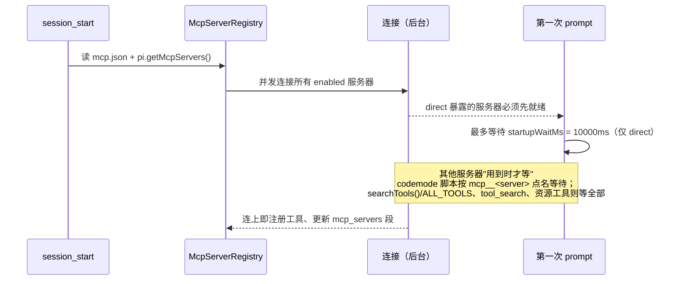

# 第 12 章 MCP 与 Codemode

← 上一章：[第 11 章 模型服务接入与虚拟模型](11-provider-integration.md) ｜ [返回目录](README.md)

> **本章你将学会**：说清 Pi 的 MCP 客户端在传输、命名、连接时机、暴露策略上的实现选择；解释 codemode 沙箱的能力边界与全部限额；用 `exposure` + `toolExposure` + `autoEnableCodemode` 把上百个 MCP 工具压进一个可用的上下文；写出不炸上下文也不丢账单的脚本。
>
> **对应官方文档**：[MCP Servers](https://pi.dev/docs/latest/mcp) · [Codemode](https://pi.dev/docs/latest/codemode) · [CLI 的 Tools](https://pi.dev/docs/latest/cli) · [Extensions 的 Tool Exposure](https://pi.dev/docs/latest/extensions)

MCP 解决"外部系统有工具"，codemode 解决"一次任务要调很多次工具"，`tool_search` 解决"工具太多声明不下"。Pi 把三者都做成了**内置扩展**（`builtin:mcp`、`builtin:codemode`、`builtin:tool_search`），因此它们与用户扩展走同一套加载与替换机制（9.2 节的 rank 5），也因此**SDK 会话默认不带**——要显式加（15.5 节）。

## 12.1 三件套的分工

| 组件 | 提供什么 | 何时激活 |
|---|---|---|
| MCP 扩展 | 连接 `mcp.json` 与注册的服务器，把工具注册为 `mcp__<server>__<tool>`，提供 `/mcp` 与资源工具 | 加载即连接（`session_start`） |
| `codemode` 工具 | 一个 `model-only` 编排工具：模型写 JS 脚本，脚本调用其他工具与非对话模型 | 有 `codemode` 暴露的服务器连上时自动激活（可用 `autoEnableCodemode: false` 关掉），或 `defaultTools: ["+codemode"]` |
| `tool_search` 工具 | BM25 检索并按需激活 `deferred` 工具 | 有 `deferred` 暴露的服务器连上时自动激活 |

这三者的耦合点正是 8.7 节的 `exposure` 与 `reachesTools`：MCP 扩展只有在"那个同名工具声明了 `reachesTools`"时，才会为 MCP 工具激活 codemode 或 tool_search——替换内置实现的扩展由此获得"什么时候该等哪个服务器"的主动权。

## 12.2 MCP 客户端的实现事实

传输层在 [packages/mcp/src/transports/](file:///D:/workspace/harness/earendil/pi/packages/mcp/src/transports)：`StdioTransport`、`StreamableHttpTransport`、`InMemoryTransport`。**legacy SSE 被明确拒绝**（[packages/coding-agent/src/core/mcp-servers.ts:270](file:///D:/workspace/harness/earendil/pi/packages/coding-agent/src/core/mcp-servers.ts#L270)），文档提示很多只有 SSE 的服务其实也在 `/mcp` 提供 streamable HTTP。

关键限额与版本：单消息上限 `DEFAULT_MAX_MESSAGE_BYTES = 16 MB`（[packages/mcp/src/transports/transport.ts:3](file:///D:/workspace/harness/earendil/pi/packages/mcp/src/transports/transport.ts#L3)）、客户端请求超时 `DEFAULT_REQUEST_TIMEOUT_MS = 30_000`（[client.ts:38](file:///D:/workspace/harness/earendil/pi/packages/mcp/src/client.ts#L38)）、配置项 `timeout` 单位为秒且默认 60（`DEFAULT_TIMEOUT_SECONDS`，[runtime.ts:48](file:///D:/workspace/harness/earendil/pi/packages/coding-agent/src/extensions/mcp/runtime.ts#L48)，进度通知会重置它）、协议版本 `LATEST_PROTOCOL_VERSION = "2025-11-25"`（[protocol/types.ts:4](file:///D:/workspace/harness/earendil/pi/packages/mcp/src/protocol/types.ts#L4)）。

命名是硬约束（[packages/coding-agent/src/extensions/mcp/tools.ts:84](file:///D:/workspace/harness/earendil/pi/packages/coding-agent/src/extensions/mcp/tools.ts#L84)）：服务器名只允许字母数字 `_` `-`；工具名 `mcp__<server>__<tool>`，非 `[A-Za-z0-9_]` 字符一律换成 `_`；超过 `MAX_TOOL_NAME_LENGTH = 64` 或重名时截断并加 sha256 前 8 位后缀。仅靠 `-`/`_` 区分的两个服务器名视为同一服务器，后者被拒绝，`mcp.json` 的条目优先于注册条目。这条规则有第二个后果：脚本里 `tools.mcp__dev-radius__search` 变成 `tools.mcp__dev_radius__search`（12.6）。

配置分层：用户 `~/.pi/agent/mcp.json`，项目 `.pi/mcp.json`（信任之后才读）。同名时项目条目整体替换用户条目；但**不带 `command`/`url`/`type` 的项目条目只覆写 `enabled`、`exposure`、`toolExposure`**，保留 `env`、`headers`、`auth`——这是"在某个项目里关掉个人服务器"的正确写法。OAuth 凭证按"服务器名 + URL"存进 `~/.pi/agent/mcp-auth.json`，服务器日志写 `~/.pi/agent/mcp.log`（超过 5 MB 轮转到 `mcp.log.1`）。

## 12.3 连接生命周期与等待策略



`startupWaitMs` 默认 10000（[packages/coding-agent/src/extensions/mcp/index.ts:93](file:///D:/workspace/harness/earendil/pi/packages/coding-agent/src/extensions/mcp/index.ts#L93)），因为 `direct` 工具必须出现在这次请求的声明里。其余服务器"按需等待"的设计让启动不被慢服务器拖住。HTTP 网络错误与瞬时状态（408、429、5xx）重试两次；连接断开显示为 disconnected 并在下次调用时重连；服务器通告工具列表变化时，新增的加入、撤回的变为不可达。停止 stdio 服务器的顺序是关 stdin → SIGTERM → 对进程组 SIGKILL，因此 `npx`/`uvx` 这类包装器也不会留下孤儿子进程——注意这与 8.5 节的 bash 工具终止策略不同（那里是直接 SIGKILL 整棵树）。

`pi.registerMcpServer(name, config)` 的时机语义：加载期注册随 `mcp.json` 一起连接；之后注册立即连接，`unregisterMcpServer()` 关连接并让工具不可达；注册不持久，每次加载都要重注册。若没有任何实现去连接（内置被替换且替代品不连接），每条注册都会被上报为扩展错误；其他 MCP 扩展可以通过 `pi.getMcpServers()`（`session_start`）+ `mcp_servers_change` 自己承担连接职责。

## 12.4 暴露策略：MCP 侧的四个值

`McpExposure = "codemode" | "deferred" | "direct" | "hidden"`（[mcp-servers.ts:52](file:///D:/workspace/harness/earendil/pi/packages/coding-agent/src/core/mcp-servers.ts#L52)），`codemode-deferred` 是 `codemode` 的别名。与 8.7 节的工具级 exposure 相比，MCP 多了"服务器级默认 + 工具级覆写"：`toolExposure` 的键是精确名或含 `*` 的模式，精确名胜模式，模式之间首个匹配胜。

```json
{
  "mcpServers": {
    "github": {
      "url": "https://api.githubcopilot.com/mcp/",
      "exposure": "deferred",
      "toolExposure": { "search_code": "direct", "get_*": "codemode", "delete_*": "hidden" }
    }
  }
}
```

`codemode` 与 `deferred` 的工具都能被脚本调用、被 `tool_search` 找到，区别在**目录稳定性**：`codemode` 暴露的服务器连上时，`codemode` 的描述不列它们，所以描述不变（缓存友好）；`deferred` 的工具要经过检索才进入声明。两者都不依赖活动工具集，因此 `/tree`、resume、fork 之后仍然可调用；`tool_search` 激活的工具会写进 transcript 并在该分支上持续声明。

有 `codemode`/`deferred` 工具的服务器会出现在系统提示词的 `mcp_servers` 段里，含"如何触达其工具"与一行 `description`（缺省时连上后用服务器 instructions 首行）。当该段因服务器连上而变化时，Pi **追加新的段落而不是改工具声明**，让更早的消息保持缓存——这是第 5 章段补丁机制在 MCP 场景下的具体运用。`describeNamespace()` 与 `searchTools()` 的 `namespace` 选项接受 `mcp__dev-radius`、`mcp__dev_radius`、`dev-radius`、`dev_radius` 四种写法。

文本结果超 20 KB 时用 `truncateMiddle` 去掉中段（`MCP_OUTPUT_MAX_BYTES = 20KB`），完整版落 `pi-mcp` 前缀的临时文件并在结果里指路（8.3 节；实现见 [`truncate.ts:292`](file:///D:/workspace/harness/earendil/pi/packages/coding-agent/src/core/tools/truncate.ts#L292)）。脚本拿到的是完整 `CallToolResult`（含 `structuredContent`、`isError`），`isError` 在脚本里是 resolve、在直接调用里按错误上报。资源工具三个：`list_mcp_resources`、`list_mcp_resource_templates`、`read_mcp_resource`，其暴露取所有可达服务器里**最宽**的那个（`direct` 优先）；`ui://` 与 `text/html;profile=mcp-app` 的资源被省略，因为 Pi 不渲染 MCP Apps。权限侧没有特例：所有 MCP 调用都走 `tool_call` / `tool_result` 管线，脚本发起的调用带 `parentToolCallId`；资源工具被标为只读。

## 12.5 替换内置实现

注册同名命令 `/mcp` 的扩展会**替换**内置 MCP 支持：Pi 不再读 `mcp.json`、不再连接，`/mcp` 归扩展所有；想只关掉不替换，用 `pi config` 里 Built-in 分组的开关，或 `"extensions": ["-builtin:mcp"]`，或 `--no-mcp`。同理可替换 `codemode` 与 `tool_search`。`pi mcp` 这类 shell 子命令**不加载扩展**，永远用内置实现，也只看文件配置的服务器。

## 12.6 codemode：QuickJS 沙箱与全局

隔离模型是两层（[packages/codemode/src/runtime/](file:///D:/workspace/harness/earendil/pi/packages/codemode/src/runtime)、[packages/coding-agent/src/extensions/codemode/execute.ts](file:///D:/workspace/harness/earendil/pi/packages/coding-agent/src/extensions/codemode/execute.ts)）：每个脚本一个 Node `worker_threads.Worker`，里面跑一个 `quickjs-wasi`（3.6.2）VM。终止靠 `SharedArrayBuffer(4)` 的中断标志加 `terminate()`。脚本被包成 `(async (tools, console) => { <你的代码> })`，因此 top-level `await` 与 `return` 可用；`RESERVED_GLOBALS` 之外的东西一概不存在——**没有 Node API、文件系统、网络、timer**。外部世界只能通过 `tools` 与 `models` 到达。

全局清单：

| 全局 | 说明 |
|---|---|
| `tools.<name>(args)` | 调用工具，一个参数对象 |
| `text(v)` / `image(v)` / `console.log(...)` / `return v` / `exit()` | 输出通道；`image()` 同时落临时文件并把路径写在图前 |
| `store(key, value)` / `load(key)` | 跨调用保存小 JSON；成功的脚本把值追加为 `codemode-store` 自定义 entry，因此分支各自只看自己路径上写的值 |
| `ALL_TOOLS` | 所有可调用工具的 `{ name, description }`（含描述里未列出的） |
| `searchTools(query, { limit?, namespace? })` | BM25 排名，默认返回 8 条 |
| `describeTool(name)` / `describeNamespace(name)` | 拿声明 / 拿命名空间（含 `instructions` 与工具名列表） |
| `models` | 目录查询与 `classify()` / `generateImages()` |

调用返回值按工具类型分化：有 `outputSchema` 的解析成结构化值（`bash` → `{ output, truncated, full_output_path?, exit_code, wall_time_seconds }`，非零退出也正常返回，`output` 上限 1 MiB，超出保留首尾各 512 KiB）；MCP 工具 → `CallToolResult`；`read` → 文本或图片块（含 `note`）；`edit`/`write` 等 → 文本。失败、被阻塞、参数非法都以携带工具错误文本的 `Error` **reject**，所以批量调用要用 `Promise.allSettled()`。

限额与失败语义必须一起读：

```text
VM 内存            256 MB（CODEMODE_MEMORY_LIMIT_BYTES，execute.ts:56）
输出字符上限        16 Mi（MAX_OUTPUT_CHARS，prelude-source.ts:42）
输出条目上限        100000 次 text()/image()/console
默认输出预算        10000 token（max_output_tokens；按 4 字符/token 换算）
store 单值/总量     262144 / 1048576 字符
进程内并发 worker   2（PI_CODEMODE_MAX_WORKERS），等不到 worker 60 秒即失败且不执行
单脚本并发模型调用   4（MAX_CONCURRENT_MODEL_CALLS）
timeout_ms          默认不设；是含排队在内的硬截止
```

超时与失败的行为有几点很容易踩：脚本失败**保留部分输出**并追加 `Script error:`；已经执行的工具调用**不会撤销**；结束时仍在跑的调用被取消、未 await 的 promise 被丢弃；等待一个永不落定的 promise 会**立即失败**（因为没有 timer）；脚本不能启动别的 codemode 脚本；在 Bun 上，不轮询 QuickJS 中断处理器的内置函数可能继续算到自己返回。`codemode.inlineBudget` 默认 3000 估算 token，用来限制 `codemode` 描述里列出的声明数量；`codemode.mode` 取 `on`（默认，声明的工具仍声明，但描述里说明"怎么从脚本调用"）或 `only`（对模型隐藏，改由描述列出，模型只能通过脚本调）。描述、`describeTool()`、`ALL_TOOLS` 都会带上工具的 `promptGuidelines`，因为系统提示词的 `<rules>` 只覆盖已声明工具（5.4 节）。

编排逻辑示例（对多个文件并行取 diff 后再汇总，只让摘要进模型）：

```js
// @options: {"max_output_tokens": 1200}
const files = await tools.bash({ command: "git diff --name-only" });
const paths = files.output.split("\n").filter(Boolean);
const diffs = await Promise.allSettled(
  paths.map((p) => tools.bash({ command: `git diff -- "${p}"` })),
);
const summary = paths.map((p, i) => {
  const d = diffs[i];
  const added = d.status === "fulfilled" ? (d.value.output.match(/^\+/gm) ?? []).length : 0;
  return { path: p, added, error: d.status === "rejected" ? String(d.reason) : undefined };
});
store("lastDiffSummary", summary);
return summary.filter((s) => s.added > 0 || s.error);
```

这段脚本体现三个要点：并行调用后再聚合，模型只看到聚合结果；`Promise.allSettled` 处理单个失败；`store()` 只存摘要这类小状态，不存 diff 全文。

## 12.7 `tool_search` 的检索实现

排名是 Okapi BM25（`k1 = 1.2`、`b = 0.75`，[packages/coding-agent/src/extensions/tool-search/tool.ts:144](file:///D:/workspace/harness/earendil/pi/packages/coding-agent/src/extensions/tool-search/tool.ts#L144)），**不是嵌入**——代码注释明确写着"hybrid ranker with embeddings can replace it"，当前未实现。文档由 `createToolSearchDocument()` 拼接工具名、描述、schema 描述与命名空间；`tokenize()` 按 camelCase 与非字母拆分、去停用词、做朴素单数化；查询恰好等于某个工具名时把它前置；默认返回 `DEFAULT_TOOL_SEARCH_LIMIT = 8`。codemode 里的 `searchTools()` 复用同一个 `Bm25Ranker`。

激活路径是 `searchAndLoad()`：过滤出可检索（`codemode`/`deferred`）且未激活的工具，排名后 `setActiveTools([...active, ...matches])`，于是这些工具在下一次模型调用被声明（3.4 节的 `declareToolChanges()` 负责把增量写成系统消息补丁）。`tool_search` 自身是 `model-only` 且 `reachesTools: () => "all"`。

## 12.8 怎么选

```mermaid
flowchart TD
    Q1{"工具数量会让声明<br/>挤占上下文吗？"} -->|否| E1["exposure: direct<br/>模型直接调用"]
    Q1 -->|是| Q2{"需要组合/过滤/并行<br/>多次调用吗？"}
    Q2 -->|是| E2["exposure: codemode<br/>+ 写脚本"]
    Q2 -->|否| E3["exposure: deferred<br/>+ tool_search 按需激活"]
    E2 --> Q3{"要保留个别工具<br/>给模型直接看？"}
    Q3 -->|是| E4["toolExposure: { \"x\": \"direct\" }"]
    Q3 -->|否| E5["全部走脚本"]
```

配套开关：`--tools` 只有在条目以 `mcp__` 开头时才会移除 MCP 工具（`pi --tools read,codemode,'mcp__radius__*'`）；`--exclude-tools` 接受同样的模式；`--no-mcp` 单次关闭；不用 MCP 但想让 codemode 常驻就设 `"defaultTools": ["+codemode"]`。`codemode` 与 `tool_search` 都不活动时，Pi 会在启动后告警一次"非 direct 的工具无法调用"。

> 源码位置：`packages/mcp/src/`（传输、客户端、协议、OAuth）、`packages/coding-agent/src/extensions/mcp/`（服务器注册、命名、资源工具、`/mcp` UI）、`packages/coding-agent/src/extensions/codemode/`（worker 池与限额）、`packages/codemode/src/runtime/prelude-source.ts`（脚本全局）、`packages/coding-agent/src/extensions/tool-search/`（BM25）。

## 小结

- 三件套都是内置扩展：MCP 连接与注册，codemode 编排，tool_search 检索；SDK 会话必须显式加入。
- MCP 的硬事实：拒绝 SSE、16 MB 消息上限、30 秒客户端超时与 60 秒配置超时、`mcp__<server>__<tool>` 命名与 64 字符截断哈希、按需等待（只有 `direct` 拖慢首个 prompt，上限 10 秒）。
- `exposure` 决定上下文代价：`codemode` 保目录稳定，`deferred` 走检索激活，`direct` 换即时可用与更长声明，`hidden` 撤回。
- `mcp_servers` 段的更新走"追加新段"而非改工具声明，为的是保住前缀缓存。
- codemode 是"每脚本一个 Worker + 一个 QuickJS VM"，无 fs/net/timer；限额是明确数字（256 MB、16 Mi 字符、100k 条目、2 worker、4 并发模型调用），失败保留部分输出且不撤销已执行的调用。
- `tool_search` 是 BM25 而非嵌入，激活通过 `setActiveTools()` 落到 transcript 的系统消息补丁上。

## 练习

1. 接一个提供 30 个工具的 MCP 服务器，分别用 `exposure: "direct"` 与 `"codemode"` 各跑一次同一个任务。验收标准：比较两次 `codemode` 描述与 `mcp_servers` 段的 token 量，并指出哪一次在服务器连接后追加了新的系统消息。
2. 用 `toolExposure` 把某个服务器全部设为 `hidden`，只放开两个为 `direct`。验收标准：`/mcp` 与 `pi.getAllTools()` 都符合预期，并说明为什么 `pi mcp list` 会标记"与服务器不同"的工具。
3. 写一个 codemode 脚本调用一个仍在连接中的服务器（`mcp__<server>__…` 出现在脚本里）。验收标准：证明脚本按需等待该服务器而不是失败，并给出一个会让整批等待全部服务器的写法（`searchTools()` 或 `ALL_TOOLS`）。
4. 让脚本产生超过 1 MiB 的 `bash` 输出并读取 `full_output_path`；再让脚本故意抛错。验收标准：分别描述模型看到的文本形态，以及 `store()` 里的值是否保留（提示：只有成功的脚本会写入）。

## 延伸阅读

- [MCP Servers](https://pi.dev/docs/latest/mcp) 与 [Codemode](https://pi.dev/docs/latest/codemode)（配置键与脚本全局的完整清单）
- 第 8 章：`exposure` / `reachesTools` / `prepareLoadout` 的工具级语义；第 3 章：激活如何变成一条系统消息补丁
- 第 15 章：SDK 里加载这三件套的确切写法（`14-codemode-mcp.ts`）

---

→ 下一章：[第 13 章 TUI 与主题](13-tui-and-themes.md) ｜ [返回目录](README.md)
