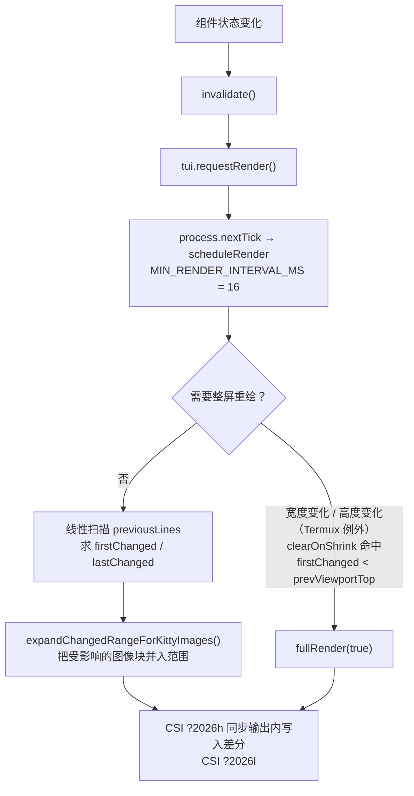

# 第 13 章 TUI 与主题

← 上一章：[第 12 章 MCP 与 Codemode](12-mcp-and-codemode.md) ｜ [返回目录](README.md)

> **本章你将学会**：按 Component 契约写出不破版、不丢 IME、不残留 ANSI 的终端组件；解释主屏差分与全屏重绘的判定条件；说出输入解析、鼠标路由、图像协议、原生模块各自的能力边界；用 `THEME_TOKENS` 与 OKHSL 设计一套主题并正确消费它。
>
> **对应官方文档**：[Terminal UI](https://pi.dev/docs/latest/tui) · [Customize Pi with themes](https://pi.dev/docs/latest/themes) · [Keybindings](https://pi.dev/docs/latest/keybindings) · [Terminal Setup](https://pi.dev/docs/latest/terminal-setup)

`@earendil-works/pi-tui` 是一个独立的差分终端 UI 库：它不依赖 agent、不依赖模型，甚至不依赖 Pi（[packages/tui](file:///D:/workspace/harness/earendil/pi/packages/tui) 的 `dependencies` 为空）。理解它的渲染与输入契约，扩展的自定义组件才不会在流式输出时拖慢整个会话。

## 13.1 集成点阶梯

先按需要选层，越往下代价越高（[tui.md 的 Choose an integration point](https://pi.dev/docs/latest/tui)）：

| 需要 | 用什么 |
|---|---|
| 选择 / 确认 / 输入 / 多行编辑 | `ctx.ui.select()` / `confirm()` / `input()` / `editor()` |
| 非阻塞反馈 | `ctx.ui.notify()` / `setStatus()` |
| 常驻在编辑器附近的内容 | `ctx.ui.setWidget()` |
| 替换 header / footer / 编辑器 | 对应的组件工厂 |
| 临时交互界面或浮层 | `ctx.ui.custom()` |
| 工具或会话条目的显示形态 | 扩展渲染器（`renderCall` / `renderResult` / `registerMessageRenderer` / `registerEntryRenderer`） |

不要在扩展里再建一个终端渲染器：这些 API 已经拿到当前主题与键位管理器，自己起一份会导致焦点、重绘、主题切换三处失控。

交互模式的界面由这几层拼成：顶部启动头、可滚动的转录区（消息、工具行、`!` 命令输出）、编辑器边框（同时指示思考等级）、页脚（目录、会话、模型、上下文与成本）。全屏模式下编辑器与状态区固定、转录区在窗口内滚动；常规模式把滚动交给终端（13.4 的鼠标归属差异即来自这里）。

<p align="center">
  
  <br>
  <sub>图 13-1　交互模式的组成（取自 Pi 官方仓库 `packages/coding-agent/docs/images/interactive-mode.png`，界面随版本变化）。</sub>
</p>

`ctx.ui.custom()` 有两种形态：内联（临时替换交互区）与 overlay（浮在既有内容之上，可指定锚点、尺寸、边距与响应式可见性）。overlay 是"持续渲染的浮层"的能力上限，官方示例把 Doom 跑在浮层里：

<p align="center">
  
  <br>
  <sub>图 13-2　`examples/extensions/doom-overlay/` 的浮层渲染（取自 Pi 官方仓库 `packages/coding-agent/docs/images/doom-extension.png`）。它同时是 13.3 差分渲染的极端用例：每帧都变。</sub>
</p>

## 13.2 Component 契约

```typescript
// packages/tui/src/tui.ts:117（成员按代码事实列出）
interface Component {
  render(width: number): string[];          // 必须：每条终端一行，且不得超宽
  handleInput?(data: string): void;         // 键盘
  handleMouse?(event: TuiMouseEvent): void; // 鼠标（全屏模式才路由）
  wantsKeyRelease?: boolean;                // 是否接收 key release
  capturesViewportInput?: boolean;          // 是否独占视口输入
  invalidate(): void;                       // 状态或主题相关缓存失效
}
```

宽度纪律是硬性的：**可见列宽不等于字符串长度**，ANSI 转义、宽字符、emoji、组合字符都会改变占位。因此必须用 `visibleWidth()`、`truncateToWidth()`、`sliceByColumn()`、`wrapTextWithAnsi()`（[packages/tui/src/utils.ts](file:///D:/workspace/harness/earendil/pi/packages/tui/src/utils.ts)），不要自己数 `.length`。另一个反直觉点：Pi 在**每一行末尾重置样式与超链接**，所以多行内容要在每行重新贴色，而不是只贴第一行。

状态变化后要做两件事：`invalidate()`（清自己的缓存），再调注入的 `tui.requestRender()`。TUI 会合并多次请求（13.3）。

内置组件覆盖了绝大多数需求，重新实现它们是纯浪费：内容类 `Text`、`Markdown`、`Image`、`TruncatedText`；布局类 `Container`、`VStack`、`HStack`、`Box`、`Spacer`；输入类 `Input`、`Editor`、`EditorComponent`（[packages/tui/src/editor-component.ts:11](file:///D:/workspace/harness/earendil/pi/packages/tui/src/editor-component.ts#L11)）；交互类 `SelectList`、`SettingsList`、`ScrollView`、`Loader`、`CancellableLoader`、`MouseRegion`。

## 13.3 渲染管线与差分策略



节流阈值 `MIN_RENDER_INTERVAL_MS = 16`（约 60 fps，[packages/tui/src/tui.ts:524](file:///D:/workspace/harness/earendil/pi/packages/tui/src/tui.ts#L524)），`requestRender()` 经 `process.nextTick` 进入 `scheduleRender()`；`requestImmediateRender()` 与 `renderNow()` 是逃生阀。写入分块上限 `MAX_RENDER_WRITE_CHARS = 1 MiB`，由 `BoundedTerminalWriter` 承担（[packages/tui/src/tui-main-screen.ts:12](file:///D:/workspace/harness/earendil/pi/packages/tui/src/tui-main-screen.ts#L12)），避免一次大输出把 stdout 写成阻塞源。

主屏（regular 模式，用终端 scrollback）在 [tui-main-screen.ts](file:///D:/workspace/harness/earendil/pi/packages/tui/src/tui-main-screen.ts) 里逐行比较：`firstChanged`/`lastChanged` 确定改动区间，Kitty 图像行会把区间向前后扩张到整个图像块（`:213`），并且要显式删除已失效的图像（`deleteChangedKittyImages()`，`:236`）；整屏重绘会 `fullRedrawCount += 1` 并包在 `\x1b[?2026h` … `\x1b[?2026l` 的同步输出里（`:283`、`:285`、`:307`），这样终端不会闪出半成品帧。

全屏（alt screen）在 [tui-alt-screen.ts:1717](file:///D:/workspace/harness/earendil/pi/packages/tui/src/tui-alt-screen.ts#L1717)：`changedRows[]` 逐行比较，`previousScreen.length === 0` 或宽高变化触发 `fullRedraw`；图像锚点或图像单元格变化触发 `imagesNeedRedraw`；每行以 `\x1b[r;1H\x1b[2K` 定位后重写；整屏行由 `renderLayoutFrame(root, width, height)` 生成（[packages/tui/src/layout.ts:383](file:///D:/workspace/harness/earendil/pi/packages/tui/src/layout.ts#L383)）。

布局是一棵 layout node 树（[packages/tui/src/layout-node.ts](file:///D:/workspace/harness/earendil/pi/packages/tui/src/layout-node.ts) 的 `LAYOUT_NODE`、`StackLayoutNode`、`ScrollLayoutNode`），滚动条几何与命中区域由 `getScrollbarGeometry()`（`layout.ts:280`）、`getLayoutBoxesAt()`（`:419`）、`getScrollViewBox()`（`:431`）提供。

## 13.4 输入、焦点与鼠标

原始字节先进 `StdinBuffer`（[packages/tui/src/stdin-buffer.ts:305](file:///D:/workspace/harness/earendil/pi/packages/tui/src/stdin-buffer.ts#L305)）做序列边界判定：`DEFAULT_SEQUENCE_TIMEOUT_MS = 50`、`DEFAULT_ESCAPE_TIMEOUT_MS = 10`（`:23`、`:24`）。这就是 `PI_TUI_ESC_TIMEOUT` 的来源——SSH 下 Pi 默认把 ESC 超时放宽到 100 ms（第 17 章的终端设置），否则 `Alt+键` 会被误读成 Escape。括号粘贴用 `ESC[200~` / `ESC[201~` 定界。

键位判定用 `matchesKey()` 与 `Key`（[packages/tui/src/keys.ts](file:///D:/workspace/harness/earendil/pi/packages/tui/src/keys.ts)），它会考虑终端协议与修饰键；应用级动作要走注入的 `KeybindingsManager`（[packages/tui/src/keybindings.ts:231](file:///D:/workspace/harness/earendil/pi/packages/tui/src/keybindings.ts#L231)），不要硬编码。命名空间约定：coding-agent 动作用 `app.*`（`app.tools.expand`、`app.editor.external`、`app.session.rename`），共享 TUI 动作用 `tui.*`（`tui.select.confirm`、`tui.select.cancel`、`tui.input.tab`）。渲染里显示按键提示用 `keyHint(keybinding, description)`、`keyText(keybinding)`、`rawKeyHint(key, description)`——它们读的是当前生效的键位配置，用户改过 `keybindings.json` 后仍然正确。

IME 是最容易被忽略的正确性问题：显示文本光标的组件要实现 `Focusable`，并把 `CURSOR_MARKER` 放在视觉光标**之前**，用 `renderFakeCursor()` 包裹该单元格（终端支持硬件光标时反显，否则由 TUI 在 marker 处隐藏光标）。包含 `Input`/`Editor` 的容器必须把 `focused` 传播给孩子，否则中日韩候选窗会出现在错误位置。替换主编辑器要继承 `CustomEditor`（不是基类 `Editor`），这样 `Escape` 中断、`Ctrl+D`、模型切换等应用快捷键仍然工作；自己不接的键要 `super.handleInput(data)` 转发；恢复默认就是把工厂置 `undefined`；与别的扩展共存时先 `ctx.ui.getEditorComponent()` 拿到旧工厂再包一层。

鼠标只在全屏模式由 Pi 路由到组件：处理器可以标记已处理、捕获拖拽、请求焦点、请求重绘。未被处理的滚轮事件交给最近的 `ScrollView`；未被处理的左键拖拽保留给转录选择；OSC 8 链接优先于其所在点击区域。regular 模式把鼠标留给终端（scrollback 归终端管）。因此**每个交互都要有键盘路径**。

## 13.5 图像与原生模块

内联图像只有两种协议：`ImageProtocol = "kitty" | "iterm2" | null`（[packages/tui/src/terminal-image.ts:7](file:///D:/workspace/harness/earendil/pi/packages/tui/src/terminal-image.ts#L7)），**没有 Sixel**。能力探测从环境变量与终端自述出发：Kitty、Ghostty、WezTerm、herdr、Orca（需 `ORCA_IMAGE_PROTOCOL=kitty`）、Warp、iTerm2 各自分支；`tmux` 下 `images: null`，超链接只有在 `tmux display-message -p '#{client_termfeatures}'` 确认转发时才发 OSC 8（`:56`、`:80`）。用 `PI_IMAGE_PROTOCOL=kitty|iterm2|none|auto` 覆盖判定，`terminal.showImages` 与 `terminal.imageWidthCells`（默认 60）控制显示与宽度。多路复用器与移动终端下的能力差异见 [tmux](https://pi.dev/docs/latest/tmux) 与 [Termux](https://pi.dev/docs/latest/termux)（高度变化时的重绘例外也来自 Termux 判定，13.3）。

一个反直觉的差别：**同一种终端在两种模式下图像能力不同**。进入全屏（alt 屏）时，若探测到的是 iTerm2 协议，TUI 会把能力临时置为 `images: null`（[packages/tui/src/tui-alt-screen.ts:357-360](file:///D:/workspace/harness/earendil/pi/packages/tui/src/tui-alt-screen.ts#L357-L360)），于是图像组件渲染成文本占位；退出全屏时再把保存的能力还原（`:425-427`）。原因写在库的 README 里：iTerm2 的内联图像协议**不能在视口重绘时删除已有放置或裁切其源**，留下真图会在滚动后残留脏像素；Kitty 协议支持垂直裁切，所以全屏下正常显示。主屏（常规模式）仍按 iTerm2 正常渲染，只在需要图像重绘的那一帧用 `\x1b[2J` 清屏兜底（`:1754`）。

原生模块只用于终端本身做不到的事（[packages/tui/native/](file:///D:/workspace/harness/earendil/pi/packages/tui/native)，加载器在 [packages/tui/src/native-module-path.ts](file:///D:/workspace/harness/earendil/pi/packages/tui/src/native-module-path.ts)）：剪贴板读写与文件路径粘贴（`getText` / `getImage` / `getFilePaths` / `setText`）、Windows 的 `enableVirtualTerminalInput()`（[terminal.ts:437](file:///D:/workspace/harness/earendil/pi/packages/tui/src/terminal.ts#L437)）、修饰键状态 `isModifierPressed()`（[native-modifiers.ts:7](file:///D:/workspace/harness/earendil/pi/packages/tui/src/native-modifiers.ts#L7)）。查找逻辑覆盖多候选位置，包含单文件二进制场景（`build:native:{darwin,linux,win32}` 三套 prebuild）。这也是 Pi 的 npm 安装不需要 lifecycle scripts 的原因之一。

## 13.6 主题：单一来源与颜色模型

主题 token 的唯一来源是 `THEME_TOKENS`（[packages/coding-agent/src/modes/interactive/theme/theme-tokens.ts:24](file:///D:/workspace/harness/earendil/pi/packages/coding-agent/src/modes/interactive/theme/theme-tokens.ts#L24)），每项带 `{ slot: "foreground" | "background", description, fallback? }`，`defineThemeTokens` 校验 fallback 必须同槽位。JSON Schema 用 TypeBox 从同一张表生成（`theme-schema.ts`），所以发布到 `https://pi.dev/schemas/theme.schema.json` 的 schema 与代码不会漂移——写主题时以 schema 为准，就是与代码一致。

主题文件是严格对象：`$schema`、`name`（必填，唯一，不含 `/`，不得叫 `system`）、`appearance`（省略时由主题色推断）、`vars`（可互相引用，链式解析，缺失或循环即整份无效）、`colors`（必填，角色到颜色）、`export`（覆写 HTML 页面与面板背景）。自定义颜色只能进 `vars`；`colors`/`export` 下加自定义键或额外顶层元数据都会被拒绝。

一个颜色可写六种形态：`"#0af"` / `"#00aaff"`、`oklch(62% 0.1 200)`、`okhsl(250 60% 55%)`、256 色索引整数、`"vars 名引用"`、`""`（终端默认）。选 OKHSL 的理由写在文档里：饱和度是相对"该色相该亮度下 sRGB 允许的最大饱和度"，因此每个值都在色域内、同等饱和度看起来同样鲜艳。渲染时 Pi 在可用时走 truecolor，把 OKLCH 做色域映射到 sRGB，对 256 色终端做近似，HTML 导出把 OKHSL 转成十六进制（CSS 不支持）。颜色计算在 [packages/tui/src/oklab.ts](file:///D:/workspace/harness/earendil/pi/packages/tui/src/oklab.ts)（`rgbToOklab` `:94`、`oklabToOkhslLightness` `:72`、`okhslToRgb` `:187`）与 [colors.ts](file:///D:/workspace/harness/earendil/pi/packages/tui/src/colors.ts)（`parseColor` `:121`、`mixColors` `:241` 默认按 oklch 混合、`foregroundAnsi`/`backgroundAnsi`/`styleText`）。

`system` 主题（默认）不是固定调色板，而是从终端自述构造：查询终端默认前景/背景与 16 色 ANSI 调色板，每个 Pi 颜色取一个 ANSI 色相，再按"与背景的最小对比度"设定亮度，正文保证 4.5:1 的 WCAG 对比度；终端切换明暗时重新查询并重建。启动时最多等 100 ms 以显示头部，之后如果颜色到了仍然应用（慢 SSH 场景）。终端什么都不报时退化为 ANSI 索引 + 默认色，次要文本变淡、面板无背景。

消费侧的三条纪律（[tui.md 的 Apply themes correctly](https://pi.dev/docs/latest/tui)）：

1. 用回调传进来的 `theme`，不要用全局变量。`theme.fg()` / `theme.bg()` 是**预计算 ANSI 前缀查表拼接**（[theme.ts:297](file:///D:/workspace/harness/earendil/pi/packages/coding-agent/src/modes/interactive/theme/theme.ts#L297)、[303](file:///D:/workspace/harness/earendil/pi/packages/coding-agent/src/modes/interactive/theme/theme.ts#L303)），`theme.bold()` 走 chalk，`theme.style(text, { fg, bg, bold })` 一次组合多个属性。
2. 语义 token 只能出现在它所属槽位：要把背景 token 当前景色，必须传具体色值，例如 `{ fg: theme.colors.userMessageBg }`；`theme.colors` 报的是终端自述的色（未自述时按 `theme.appearance` 猜黑或白）。
3. **不要把带 ANSI 的字符串长期存进应用状态**。主题切换会清渲染缓存，但清不掉你存在状态里的旧颜色；能重建的路径必须经过 `invalidate()`。

明暗自动模式存成 `"theme": "light/dark"`（先浅后深），判定顺序是终端自述背景 → 终端的明暗通知 → `COLORFGBG` → 默认暗；`pi --use-theme light` 只改本次会话。热重载只对 `<agent-dir>/themes/<name>.json` 里的当前用户主题生效，其他来源改完要 `/reload`。

## 13.7 性能与诊断

渲染跑在交互关键路径上，因此：把昂贵的高亮与布局按 **宽度和内容**缓存，并在 `invalidate()` 里清；默认视图保持紧凑，细节靠展开或独立界面；`renderResult` 要处理 `isPartial` 并尽量复用 `context.lastComponent`（同实例就地更新）。诊断渲染问题时用 `PI_TUI_WRITE_LOG` 抓原始 ANSI 流，`/debug` 会把渲染行与当前会话消息写进 `<agent-dir>/pi-debug.log`；要覆盖的测试维度是窄宽度、宽字符、resize、主题切换、焦点切换、regular 与 fullscreen 两种模式。

> 源码位置：`packages/tui/src/tui.ts`（Component、requestRender、焦点）、`packages/tui/src/tui-main-screen.ts` 与 `tui-alt-screen.ts`（两套差分策略）、`packages/tui/src/layout.ts` 与 `layout-node.ts`（布局与滚动）、`packages/tui/src/terminal-image.ts` 与 `colors.ts`/`oklab.ts`（能力与颜色）、`packages/coding-agent/src/modes/interactive/theme/`（token 与 schema 同源）。

## 小结

- Component 的四条硬约束：`render(width)` 每行不超宽、按可见列宽度量、每行重贴样式、状态变化后 `invalidate()` + `requestRender()`。
- 渲染以 16 ms 合并、1 MiB 分块写出；主屏按改动区间差分并扩张到 Kitty 图像块，全屏逐行比较并在同步输出里重绘。
- 输入经 `StdinBuffer` 做序列与 ESC 边界判定，键位一律用 `KeybindingsManager` 与 `app.*` / `tui.*` 命名空间；IME 正确性依赖 `Focusable` + `CURSOR_MARKER` + `focused` 传播。
- 内联图像只有 kitty 与 iterm2，tmux 下禁用；原生模块只负责剪贴板、Windows 虚拟终端输入、修饰键。
- 主题 token 与 JSON Schema 同源生成，文件严格、颜色六种写法、OKHSL 保色域；`system` 主题按终端对比度实时构造。
- 消费主题时不要长期保存带 ANSI 的字符串，自定义颜色只能进 `vars`。

## 练习

1. 写一个 `ctx.ui.custom()` 组件，在 20 列终端里显示含 emoji 与中文的三行内容。验收标准：不出现换行错位；说明为什么 `truncateToWidth` 而不是 `slice(0, width)`。
2. 继承 `CustomEditor` 实现"Normal 模式下屏蔽所有插入、只响应 `i`/`:`"的最小编辑器。验收标准：`Escape` 中断与模型切换快捷键仍生效，且 `setEditorComponent(undefined)` 能恢复默认。
3. 在流式回答期间用 `PI_TUI_WRITE_LOG` 抓一段输出，检查是否存在整屏重绘。验收标准：找出触发 `fullRedraw` 的条件（对照 13.3 的三个判定），并说明 `clearOnShrink` 打开后行为差异。
4. 复制内置 `dark.json` 改成一个只有 `vars` 层调整的主题，`/settings` 里切换。验收标准：故意在 `colors` 下加一个自定义键，记录 Pi 的报错文案，证明严格校验生效。

## 延伸阅读

- [Terminal UI](https://pi.dev/docs/latest/tui) 与 [Themes](https://pi.dev/docs/latest/themes)（组件清单与主题字段完整表）
- [Keybindings](https://pi.dev/docs/latest/keybindings)（全部键位 id 与默认值）、[Terminal Setup](https://pi.dev/docs/latest/terminal-setup)（能力覆盖与 program status）
- 源码：`packages/tui/README.md`（库级 API 说明）、`packages/coding-agent/src/modes/interactive/components/tool-execution.ts`（工具行的组合方式）

---

→ 下一章：[第 14 章 资源定制与 Pi 包分发](14-resources-and-packaging.md) ｜ [返回目录](README.md)
