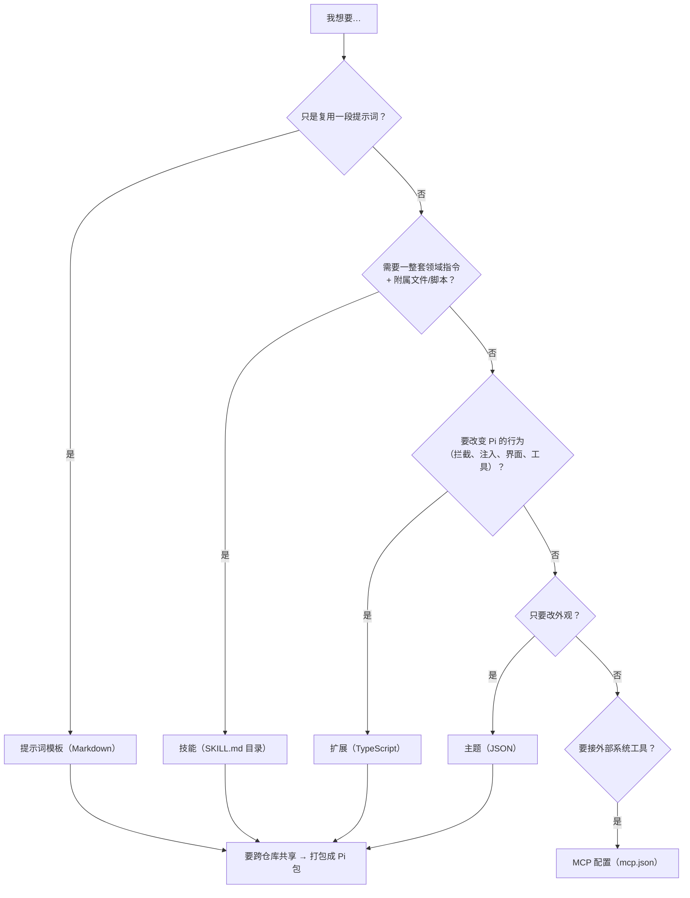

# 第 14 章 资源定制与 Pi 包分发

← 上一章：[第 13 章 TUI 与主题](13-tui-and-themes.md) ｜ [返回目录](README.md)

> **本章你将学会**：在五种定制机制里选到最轻的那个；说清资源的目录、优先级、碰撞与开关键；写出可移植的技能与提示词模板；把一套定制做成可安装的 Pi 包，并避开依赖与身份识别上的坑。
>
> **对应官方文档**：[Configuration](https://pi.dev/docs/latest/configuration) · [Skills](https://pi.dev/docs/latest/skills) · [Prompt Templates](https://pi.dev/docs/latest/prompt-templates) · [Pi Packages](https://pi.dev/docs/latest/packages) · [Settings](https://pi.dev/docs/latest/settings)

入门教程第 7 章按"怎么用"讲了资源。本章按"怎么生效、怎么共存、怎么分发"重新组织：目录与命名、优先级与碰撞、资源自身的规范、打包与依赖。定制机制的正确选择，决定了你是在维护一段 Markdown 还是在维护一个扩展项目。

## 14.1 选最轻的机制



代价梯度是真实的：模板与技能不占运行时（只有描述进上下文），扩展占进程与信任面（它和你的凭证同权限），MCP 还要多一个子进程。选型判据：**能不写代码就不写代码；需要"读取时机由模型决定"就用技能；需要事件与副作用才用扩展。**

## 14.2 目录、命名与配置目录名

agent 目录默认 `~/.pi/agent`（`getAgentDir()`，[packages/coding-agent/src/config.ts:605](file:///D:/workspace/harness/earendil/pi/packages/coding-agent/src/config.ts#L605)），受 `PI_CODING_AGENT_DIR` 或 SDK 的 `agentDir` 覆写；`CONFIG_DIR_NAME` 默认 `.pi`，可被 `package.json` 顶层的 `piConfig.configDir` 改写（[config.ts:581](file:///D:/workspace/harness/earendil/pi/packages/coding-agent/src/config.ts#L581)）。扩展代码里**不要硬编码 `.pi`**，用导出的 `CONFIG_DIR_NAME` 拼路径——fork 换名后你的扩展才不会读错目录（15.6 节）。

| 位置 | 内容 |
|---|---|
| `<agent-dir>/settings.json`、`keybindings.json`、`mcp.json`、`models.json`、`auth.json`、`trust.json` | 用户级配置、凭证与信任决策 |
| `<agent-dir>/{extensions,skills,prompts,themes}/` | 用户级资源 |
| `<agent-dir>/AGENTS.override.md` / `AGENTS.md` / `AGENTS.MD` / `CLAUDE.md` / `CLAUDE.MD` | 跨目录生效的用户指令 |
| `<agent-dir>/SYSTEM.md` / `APPEND_SYSTEM.md` | 替换 / 追加系统提示词 |
| `<cwd>/.pi/…` 同名结构 | 项目级资源（信任后才读） |
| `~/.agents/skills/`、`.agents/skills/` | Agent Skills 规范位置；项目侧从 cwd 向上直到仓库根发现 |

`SYSTEM.md` 与 `APPEND_SYSTEM.md` 在项目里优先于 agent 目录的同名文件，**同名文件不合并**（[configuration.md](https://pi.dev/docs/latest/configuration)）。设置合并规则是"项目覆盖 agent 目录，但资源列表合并"；两个设置键例外且只能在 agent 目录设置：`defaultProjectTrust` 与 `httpProxy`（[settings.md](https://pi.dev/docs/latest/settings)）——项目不能自己批准自己的信任，也不能把自己塞进代理路径。

## 14.3 优先级、碰撞与开关

9.2 节那张 0..5 的 rank 表对所有资源类型通用，同名 first-wins。补充两条碰撞语义：主题重名会作为资源碰撞报错（每份加载的主题名字必须唯一）；技能重名保留先发现的那份并给出警告。

开关分三层：

| 层 | 手段 |
|---|---|
| 一次性 | `--no-extensions`/`-ne`、`--no-skills`/`-ns`、`--no-prompt-templates`/`-np`、`--no-themes`、`--no-context-files`/`-nc` |
| 设置列表 | `extensions`、`skills`、`prompts`、`themes`（支持 `!pattern` 排除、`+path` 精确包含、`-path` 精确排除）；`enableSkillCommands`（默认 `true`，关掉后 `/skill:name` 仍可手输） |
| 交互式 | `pi config`（个人配置起步，`Tab` 切作用域，`pi config --local` 从项目覆写起步），内置扩展列在 Built-in 分组 |

用户与项目设置里列出的资源**都会**加载（不是后者替换前者），替换发生在同名解析阶段。资源路径的相对基准不同：用户设置里的相对路径从 agent 目录解析，项目设置里从 `.pi` 目录解析。

## 14.4 技能：可移植写法

Pi 实现 [Agent Skills 规范](https://agentskills.io/specification)，多数非法字段只警告不阻断。目录形态是便携形态：

```text
pdf-tools/
├── SKILL.md
├── scripts/extract.sh
├── references/formats.md
└── assets/template.json
```

frontmatter 字段与约束（[packages/coding-agent/src/core/skills.ts:92](file:///D:/workspace/harness/earendil/pi/packages/coding-agent/src/core/skills.ts#L92) 起）：`name` 匹配 `^[a-z0-9-]+$`、最长 64 字符（缺省取父目录名；Pi 不要求与目录同名，但其他实现会要求，所以**保持同名**才是便携选择）；`description` 必填、最长 1024，决定模型是否加载它——"Helps with PDFs" 这类描述没有路由信息；`license`、`compatibility`、`metadata`、`allowed-tools`（实验性）、`disable-model-invocation`。

发现规则有两条容易踩：包含 `SKILL.md` 的目录被当作技能根，**不再向下递归**；否则收集根级 `.md` 并继续递归找 `SKILL.md`。发现过程尊重 `.gitignore` / `.ignore` / `.fdignore`（`:16`）。格式错误或声明了却没描述的 `SKILL.md` 不会被加载。

加载时机由模型决定：启动时只有名字、描述、位置进 `<available_skills>`（5.5 节），模型判断匹配后自己 `read` 正文。因此"模型没加载相关技能"是正常风险，需要强制时用 `/skill:name 参数`——参数会作为用户请求追加在技能正文之后（`_expandSkillCommand()`，[packages/coding-agent/src/core/agent-session.ts:2232](file:///D:/workspace/harness/earendil/pi/packages/coding-agent/src/core/agent-session.ts#L2232-L2256)），正文去掉 frontmatter 后被包成 `<skill name=… location=…>` 注入用户消息。引用附属文件要用相对技能目录的路径，Pi 会把位置告诉模型。

安全边界要点：项目技能可以让模型运行脚本或改文件。**授予项目信任前要先读技能与其附属文件**（[security.md](https://pi.dev/docs/latest/security)）。

## 14.5 提示词模板：参数语法

```markdown
---
description: Review staged git changes
argument-hint: "[focus]"
---
Review the staged changes. Focus on ${1:-correctness, security, and error handling}.
```

文件名即命令名（`~/.pi/agent/prompts/review.md` → `/review`）；`description` 缺省用第一行非空文本；`argument-hint` 里 `<尖括号>` 表必填、`[方括号]` 表选填。替换语法：

| 写法 | 结果 |
|---|---|
| `$1`、`$2`… | 单个位置参数 |
| `$@` 或 `$ARGUMENTS` | 全部参数，空格连接 |
| `${1:-default}` | 第一个参数，或默认值 |
| `${@:-default}` | 全部参数，或默认值 |
| `${@:N}` / `${@:N:L}` | 从第 N 个开始 / 取 L 个 |

参数按 shell 风格引号切分，`/review "API compatibility"` 是一个含空格的参数。约定目录只加载**直接**子项 `.md`；嵌套文件要靠设置或包清单的显式路径与 glob。展开发生在 `input` 事件**之后**（2.2 节顺序），所以扩展看到的是原始 `/review …` 文本。

## 14.6 Pi 包：结构、筛选、身份

包就是普通目录或 npm 包。最简形态靠约定目录：

```text
my-pi-package/
├── package.json
├── extensions/  skills/  prompts/  themes/
```

没有 `pi` 清单时，Pi 从这四个目录分别发现 TS/JS 扩展、技能目录、Markdown 提示词、JSON 主题。资源在别处或需要过滤时用清单：

```json
{
  "name": "my-pi-package",
  "keywords": ["pi-package"],
  "pi": {
    "extensions": ["./src/extension.ts"],
    "skills": ["./resources/skills"],
    "prompts": ["./resources/prompts/*.md"],
    "themes": ["./resources/themes/*.json"]
  }
}
```

路径相对包根；数组接受 glob 与 `!` 排除；**以点开头的目录或符号链接的资源根要直接列出**，靠 glob 遍历发现不了它们。`keywords: ["pi-package"]` 让 npm 包进入 [Pi 包画廊](https://pi.dev/packages)，`pi.image` / `pi.video` 提供预览。

设置里的对象形态做二次筛选：省略属性=加载包允许的全部；`[]`=该类型一个都不加载；`!pattern` 排除；`+path` / `-path` 精确包含/排除。筛选**只能缩窄**，不能暴露包自己没声明的资源。

身份与作用域：npm 包按**包名**识别，git 包按**去掉 ref 的仓库 URL**，本地包按**解析后的绝对路径**——这防止等价声明加载两次。同一包可同时出现在个人与项目设置：项目条目默认替换个人条目；若项目条目设 `autoload: false`，它就变成对个人包的一条**筛选增量**。

来源行为差异要记清：`npm:@foo/bar@1.0.0` 与 `git:github.com/user/repo@v1` 是 pin（tag/commit 也算 pin，更新会 reconcile checkout 但不会移动已配置的 ref）；`https://…` 按 git 处理；`./local` 直接从解析路径加载、不复制、也不被安装或修改，因此它的依赖树是包作者的责任。`pi install` 写个人设置，加 `--local`/`-l` 写 `.pi/settings.json`（后者只在项目信任后读）。`pi -e npm:@example/pi-tools` 单次试用不入设置，缓存到 `<agent-dir>/tmp/extensions/` 并在每次启动与 `/reload` 时检查（精确版本不查、git 会 fetch 到远端 ref、检查失败或离线则用缓存副本）。配置包安装失败时 Pi 只警告、跳过该包资源并继续，下次启动或 `/reload` 再试；而 `pi install` 与 `pi update --extensions` 会报错并非零退出。

## 14.7 依赖规则：一条硬约束

Pi 会向扩展与技能供给这些包：`@earendil-works/pi-ai`、`@earendil-works/pi-agent-core`、`@earendil-works/pi-coding-agent`、`@earendil-works/pi-tui`、`typebox`。正确写法是把它们声明为 `peerDependencies: { "*": ... }` 且**不打包**：

```json
{
  "name": "my-pi-package",
  "dependencies": { "zod": "^3.23.0" },
  "peerDependencies": { "@earendil-works/pi-coding-agent": "*", "typebox": "*" }
}
```

原因在 9.1 节：物理副本会绕过 Pi 的扩展模块映射，产生重复的类、重复的注册表、重复的初始化。把宿主包放进 `dependencies` 会被 Pi 报扩展警告。Pi 在安装托管 npm/git 包时抑制这些 peer 的自动安装；本地包不受处理。安装在同一进程里的多个包使用**独立的模块根**：不要假定两个包共享同一个依赖实例，也不要依赖某个包能解析它没声明的依赖。运行时依赖必须放 `dependencies`（`devDependencies` 不会被安装）。

其他 Pi 包（非宿主提供）作为依赖时，必须包含在发布的 tarball 里并通过 `node_modules` 路径引用。

## 14.8 变更日志与更新可见性

包更新后，Pi 会在下次全新启动时读包的 changelog，并把"上次见过的版本之后"的条目显示在 Extension Updates 区（与自己 changelog 同一机制）。规则：

- 只对**至少加载一个扩展**的包生效（纯技能/提示词/主题包不显示）。
- 默认读包根 `CHANGELOG.md`；`pi.changelogPath` 指向别的文件，设为 `""` 关闭。
- 版本标题要和 Pi 的格式一致（`## [1.2.0]` 或 `## 1.2.0 - 2026-01-01`），并与 `package.json` 的 `version` 匹配——因此 git 包只有 `version` 字段增加时才显示。
- 首次见到的包只记录版本，不显示任何东西。
- `collapseChangelog` 把每个包压成一行（`Updated my-pi-package to v1.2.0.`）。
- `/changelog` **不**显示包 changelog，细节要读文件本身。

> 源码位置：`packages/coding-agent/src/core/skills.ts`（发现与校验）、`packages/coding-agent/src/core/prompt-templates.ts`（模板与替换）、`packages/coding-agent/src/core/package-manager.ts`（rank、身份、筛选、安装与更新）、`packages/coding-agent/src/core/resource-loader.ts`（发现装配）、`packages/coding-agent/src/core/pi-manifest.ts`（`pi` 字段读取）。

## 小结

- 选型梯度按运行时代价排：模板/技能（几乎零常驻）→ 主题/MCP 配置 → 扩展（同权限代码）→ Pi 包（分发形态）。
- 目录名来自 `CONFIG_DIR_NAME`，可被 fork 改写；扩展代码要引用常量而不是硬编码 `.pi`。
- 资源优先级是一张 0..5 的 rank 表加"同名 first-wins"；主题重名报错，技能重名警告；开关有一次性、设置列表、`pi config` 三层。
- 技能靠描述路由、正文按需读，`disable-model-invocation` 让它只走显式命令；含 `SKILL.md` 的目录不再向下递归。
- 模板的文件名即命令，参数替换有固定语法，展开发生在 `input` 之后。
- Pi 包的资源筛选只能缩窄；身份按包名/去 ref 的 URL/绝对路径识别；宿主包必须走 `peerDependencies` 且不打包，否则类和注册表分裂。
- changelog 只对含扩展的包生效，且与 `version` 字段严格挂钩。

## 练习

1. 把一套"扩展 + 技能 + 模板 + 主题"打包成本地 Pi 包，用 `pi install ./pkg` 与 `pi -e ./pkg` 各装一次。验收标准：`pi list` 与启动头显示一致，并解释为什么 `-e` 版本每次启动都会检查更新而 `install` 版本不会。
2. 在项目 `.pi/settings.json` 里写 `{ "packages": [{ "source": "npm:@example/pi-tools", "skills": [] }] }`。验收标准：证明技能不加载而扩展仍加载，并说明 `[]` 与省略属性的区别。
3. 造两个同名技能分别放在用户目录与项目 `.pi/skills/`，再造一个同名主题。验收标准：技能给出警告并保留先发现者，主题报资源碰撞——用 14.3 节的 rank 表解释"先发现"实际是谁。
4. 写一个技能，其 frontmatter 的 `name` 与目录名不同、`description` 只有"Helps with PDFs"。验收标准：Pi 不报错，但模型几乎不会主动加载；用 5.5 节的提示词段解释原因，并给出改法。

## 延伸阅读

- [Pi Packages](https://pi.dev/docs/latest/packages) 与 [Settings 的 Resources](https://pi.dev/docs/latest/settings)
- 第 13 章：主题文件格式与 token；第 9 章：扩展的加载与信任门控
- 第 17 章：分发前的安全审查清单（第三方包会执行代码）

---

→ 下一章：[第 15 章 可编程接口：print、JSON、RPC、SDK](15-programmatic-interfaces.md) ｜ [返回目录](README.md)
