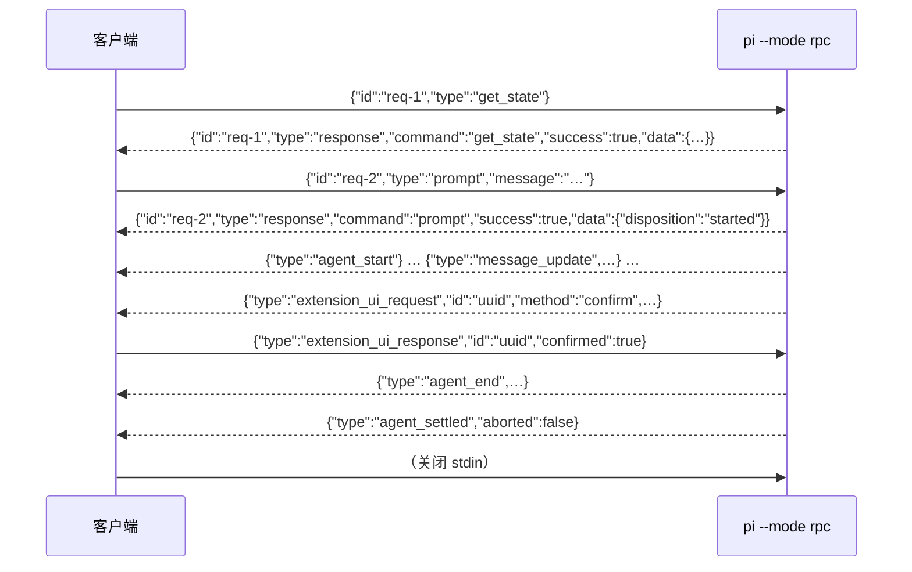

# 第 15 章 可编程接口：print、JSON、RPC、SDK

← 上一章：[第 14 章 资源定制与 Pi 包分发](14-resources-and-packaging.md) ｜ [返回目录](README.md)

> **本章你将学会**：按进程边界与生命周期需求选对接入方式；写出对帧、关联、终态、退出码都正确的客户端；避开 `readline` 分帧、`agent_end` 误用、订阅竞态这三个最常见集成错误；把 SDK 的组合根按需要替换到任意一层。
>
> **对应官方文档**：[CLI Integration](https://pi.dev/docs/latest/cli-integration) · [JSON Event Stream](https://pi.dev/docs/latest/json) · [RPC Mode](https://pi.dev/docs/latest/rpc) · [RPC Commands](https://pi.dev/docs/latest/rpc-commands) · [SDK](https://pi.dev/docs/latest/sdk)

Pi 对外有**四个 CLI 模式**（interactive、print、JSON、RPC）与**一条同进程路径**（SDK）。四者共用同一套 agent 与会话机制（第 2 章已说明它们是同一生命周期路径的不同出口），SDK 则把同一套对象直接嵌进宿主。本章的重点不是"有哪些命令"，而是**边界在哪、终态在哪、谁负责读**。

## 15.1 先选边界

interactive 模式在第 13 章已经讲过，下面比较的是可编程接入的四条路（官方把 SDK 明确排除在 CLI 模式之外）：

| 接口 | 进程边界 | 控制模型 | 生命周期 | 适用 |
|---|---|---|---|---|
| print | 子进程 | 一次性提示 | 单次调用 | 只要最终文本（命令替换、管道、CI 步骤） |
| JSON | 子进程 | 单向事件流 | 单次调用 | 要结构化进度但不发后续命令 |
| RPC | 子进程 | JSONL 双向 | 长驻 | 其他语言、进程隔离、IDE、自建客户端 |
| SDK | 同进程 | TypeScript 方法与事件 | 宿主管理 | Node/Bun 宿主需要完整 API |

SDK 不是 CLI 模式，它把 agent 直接嵌进宿主进程。判据：**跨语言或要隔离 → RPC；同语言且要深度控制 → SDK；只要结果 → print；只要进度 → JSON。**

模式选择的实现顺序在 `resolveAppMode()`（[packages/coding-agent/src/main.ts:112](file:///D:/workspace/harness/earendil/pi/packages/coding-agent/src/main.ts#L112)）：`rpc` > `json` > `print`（`--print` 或 stdin/stdout 非 TTY）> `interactive`。两个细节：管道 stdin 会把交互降级为 print（`readPipedStdin()`，[main.ts:909](file:///D:/workspace/harness/earendil/pi/packages/coding-agent/src/main.ts#L909)），所以 `echo "…" | pi` 不需要 `--print`；JSON 与 print 的输出接管由 `takeOverStdout()` 完成（[main.ts:668](file:///D:/workspace/harness/earendil/pi/packages/coding-agent/src/main.ts#L668)），因此诊断信息一律走 stderr，stdout 是协议通道。RPC 模式拒绝 `@file` 提示参数，必须用 `prompt` 命令送。

## 15.2 print 与 JSON：退出码和终态

print 模式把最终助手文本写 stdout 后退出，错误写 stderr；最终响应 `stopReason` 为 `error` 或 `aborted` 时**退出码非零**；被输出上限截断（`length`）时仍打印部分文本、写一条 stderr 警告、并**非零退出**（[cli-integration.md](https://pi.dev/docs/latest/cli-integration)）。

JSON 模式的第一条记录是会话 header，随后是事件，最后进程退出。要点三条：

1. **退出码不反映模型层失败**。失败或被中断的助手响应会出现在事件流里，但本身不产生非零退出；只有调用抛出错误才非零。所以成功与否要看事件，不要看 `$?`。
2. **`message_update` 是 delta-only**。为了保持流体积线性，wire 记录去掉了 SDK 事件里的累计 `message` 字段与每个 `assistantMessageEvent.partial` 快照。重建规则：用 `contentIndex` 定位内容块，缓冲 `delta` 做实时显示，但一旦 `text_end` / `thinking_end` / `toolcall_end` 到达就用权威内容替换，`message_end.message` 到达后整条替换。顶层 `usage` 是最新的累计值，某些 provider 在完成前一直是零。
3. **`agent_end` 不是完成**。自动重试、溢出恢复、压缩重试、steering、follow-up 都可能在其后。终态是 `agent_settled`。

分帧是严格 JSONL：一条记录一个完整 JSON 对象，以 LF 结束；读侧只按 LF 切分，可容忍前导 CR。**不要用 Node `readline`**——它还会把 `U+2028`/`U+2029` 当行分隔符，而这两个字符在 JSON 字符串里合法（[json.md 的 Framing and process I/O](https://pi.dev/docs/latest/json)）。读侧要持续消费：停止读会让 Pi 在管道缓冲满时被顶住；写命令侧要尊重 stdin 背压。

```bash
pi --mode json "List files" 2>/dev/null | jq -c 'select(.type == "message_end")'
```

## 15.3 RPC：四类记录与关联



四类记录：stdin 的 command、stdout 的 `response`、stdout 的 session event、双向的 extension UI 记录。关联靠可选的字符串 `id`，命令处理是异步的，**必须按 id 关联而不是响应顺序**。事件一般不带 command id，唯一例外是 `bash_execution_update`：它复用发起 `bash` 命令的 id（[packages/coding-agent/src/core/agent-session.ts:3943](file:///D:/workspace/harness/earendil/pi/packages/coding-agent/src/core/agent-session.ts#L3943)）。

`prompt` 的成功响应只表示"接受/排队/被处理"。`data.disposition` 说明发生了什么；若是 `"handled"`，本轮没有运行，**不要等 `agent_settled`**。

错误形态有两种：命令失败返回 `success: false` 加 `error` 字符串；JSON 解析失败返回不带 id 的 `{"type":"response","command":"parse","success":false,…}`。成功响应只覆盖"命令被正确处理"，provider 失败与中断出现在消息与事件流里。客户端还要自己处理子进程启动失败、意外退出、stderr 诊断、取消与超时；**不要把 stderr 当协议解析**。

关闭方式：关闭子进程 stdin 请求有序退出，Pi 会先 dispose 活动 runtime。扩展也能请求 shutdown，Pi 会在当前命令完成后、或活动运行发出 `agent_settled` 后完成关闭。

33 条命令按用途分组（完整字段见 [RPC Commands](https://pi.dev/docs/latest/rpc-commands)）：

| 组 | 命令 |
|---|---|
| 输入与队列 | `prompt`、`steer`、`follow_up`、`abort`、`clear_queue`、`set_steering_mode`、`set_follow_up_mode` |
| 状态与消息 | `get_state`、`get_messages`、`get_last_assistant_text`、`get_session_stats`、`export_html` |
| 模型与思考 | `set_model`、`cycle_model`、`get_available_models`、`set_thinking_level`、`cycle_thinking_level`、`get_available_thinking_levels` |
| 压缩与重试 | `compact`、`set_auto_compaction`、`set_auto_retry`、`abort_retry` |
| Shell | `bash`、`abort_bash`（伴随 `bash_execution_update` 事件） |
| 会话管理 | `new_session`、`switch_session`、`fork`、`clone`、`get_fork_messages`、`get_entries`、`get_tree`、`set_session_name` |
| 资源 | `get_commands` |

RPC 还额外发出 `extension_error`（某处理器抛错时）与 `thinking_level_changed`、`queue_update`、`entry_appended`、`session_info_changed` 等会话层事件。

## 15.4 RPC 扩展 UI：三档支持度

9.8 节给过结论，这里给完整清单（[rpc-extension-ui.md](https://pi.dev/docs/latest/rpc-extension-ui.md)、实现见 [rpc-mode.ts:136](file:///D:/workspace/harness/earendil/pi/packages/coding-agent/src/modes/rpc/rpc-mode.ts#L136)）：

| 档位 | 方法 | 行为 |
|---|---|---|
| 请求—响应 | `select`、`confirm`、`input`、`editor` | stdout 发 `extension_ui_request`（带 uuid），等 stdin 的 `extension_ui_response`（带同 id 与 `value`/`confirmed`/`cancelled`）。超时或 abort 时返回默认值：前三者 `undefined`，`confirm` 为 `false` |
| 单向通知 | `notify`、`setStatus`、`setWidget`（仅 `string[]`，工厂函数被忽略）、`setTitle`、`setEditorText`（`pasteToEditor` 退化为它）、`get theme` | 客户端可显示也可忽略 |
| 无效或退化 | `custom()` → `undefined`；组件工厂被忽略；`onTerminalInput()` no-op；`setWorkingMessage`/`setWorkingVisible`/`setWorkingIndicator`/`setHiddenThinkingLabel`/`setFooter`/`setHeader`/`addAutocompleteProvider`/`setEditorComponent`/`setToolsExpanded` no-op；`getEditorText()` → `""`、`getEditorComponent()` → `undefined`、`getToolsExpanded()` → `false`、`getAllThemes()` → `[]`、`getTheme()` → `undefined`、`setTheme()` → `{ success: false, error }` | 扩展必须能在这种环境下有意义地降级 |

`ui_prompt_start` / `ui_prompt_end` 在这条路径上仍然发出，所以宿主能区分"在跑"与"在等人"。

最小 Python 客户端的要点是用**二进制管道**读并按 `\n` 切：

```python
import json, subprocess

p = subprocess.Popen(["pi", "--mode", "rpc", "--no-session"],
                     stdin=subprocess.PIPE, stdout=subprocess.PIPE)
p.stdin.write(json.dumps({"id": "p1", "type": "prompt", "message": "Hello"}).encode() + b"\n")
p.stdin.flush()

while line := p.stdout.readline():
    r = json.loads(line)
    if r.get("type") == "message_update" and r["assistantMessageEvent"]["type"] == "text_delta":
        print(r["assistantMessageEvent"]["delta"], end="", flush=True)
    elif r.get("type") == "agent_settled":
        break

p.stdin.close(); p.wait()
```

TypeScript 侧优先用导出的 `RpcClient`：它启动子进程、关联响应、暴露带类型的命令方法、把事件投递给监听器，并提供 `promptAndWait()`（内部先装监听器再发提示，避开快速完成的竞态）。注意仓库示例 `examples/rpc-client.ts` 指向 `dist/cli.js`，从 checkout 运行需要先构建。

## 15.5 SDK：组合根与替换边界

`createAgentSession(options?)`（[packages/coding-agent/src/core/sdk.ts:191](file:///D:/workspace/harness/earendil/pi/packages/coding-agent/src/core/sdk.ts#L191)）的装配顺序是一条明确的链：解析 `cwd` / `agentDir` → `ModelRuntime.create()`（读 `auth.json` 与 `models.json`）→ `SettingsManager.create()` → `SessionManager.create()` → `DefaultResourceLoader` + `reload()` → 若恢复已有会话则还原 model/thinking（`findInitialModel` 兜底、`clampThinkingLevel` 钳制）→ 工具选择 → `new Agent({ streamFn, convertToLlm, … })` → `new AgentSession({ … })`。

可替换的每一层都有对应选项：`modelRuntime` / `model` / `thinkingLevel` / `scopedModels`（模型与选择）、`settingsManager`（合入或内存配置）、`sessionManager`（持久或 `SessionManager.inMemory()`）、`resourceLoader`（扩展/技能/模板/主题/上下文文件的发现）、`tools` / `noTools`（`"all" | "builtin"`）/ `excludeTools` / `customTools`。

四条 SDK 专属语义：

1. **`SessionManager` 是已定型模型上下文的权威**。外部历史要通过"带着那些 entry 的 manager"注入；**给 `session.agent.state.messages` 赋值不会替换持久上下文**（[sdk.md 的 Session storage](https://pi.dev/docs/latest/sdk)）。
2. **`session.systemPrompt` 只读**，返回当前生效提示词，包含尚未发给模型的变化；工具变化在下一次请求前声明。
3. **流式中调用 `prompt()` 必须表态**（steer 还是 follow-up），不表态直接拒绝而不是猜。`steer()` / `followUp()` 返回 `"queued"` 或 `"handled"`（扩展改写或消费过输入时）。
4. **`dispose()` 有副作用**：中断活动工作、失效扩展上下文、断开 agent、移除监听器。

内联扩展走 `DefaultResourceLoader` 的 `extensionFactories`。三条规则来自代码事实：给 `InlineExtension` 起名字只在你需要稳定的诊断名时才必要；具名且 `replaceable: true` 的内联扩展，若别的扩展在加载期注册了它要注册的同名工具/命令/flag，会被**跳过**而不是冲突（CLI 自带的 codemode、tool search、MCP 就是 replaceable）；具名且 `builtin: true` 的条目不是内联扩展，它提供 `builtin:<name>` 扩展的代码，默认加载、出现在 `pi config`、可用 `-builtin:<name>` 或 `noExtensions` 关掉，`additionalExtensionPaths: ["builtin:<name>"]` 显式加载，并且因为加载在信任之后，不能处理 `project_trust`。

CLI 的三个内置能力在 SDK 会话里默认**不加载**：要自己加 `createCodemodeExtension()`、`createToolSearchExtension()`、`createMcpExtension()`，它们注册为不活动，用 `defaultTools: ["+codemode", "+tool_search"]` 保留其他默认工具地启用，或由 MCP 扩展按服务器 exposure 自动激活；MCP 扩展在 `session_start` 连接服务器，所以要调 `session.bindExtensions()`。完整写法见 `examples/sdk/14-codemode-mcp.ts`。

会话级替换要格外小心：`AgentSessionRuntime`（[packages/coding-agent/src/core/agent-session-runtime.ts:74](file:///D:/workspace/harness/earendil/pi/packages/coding-agent/src/core/agent-session-runtime.ts#L74)）提供 `newSession()`、`switchSession()`、`fork()`、`importFromJsonl()`，每个操作**替换活动 `AgentSession` 并为目标工作目录重建服务**。替换后原来的订阅属于旧会话，必须重绑——`setRebindSession()` / `setBeforeSessionInvalidate()` 就是模式侧用来做这件事的钩子（`examples/sdk/13-session-runtime.ts`）。

事件订阅的正确姿势（同 15.2 的终态规则，SDK 里差别只在 `message_update` 带累计快照）：

```typescript
import { createAgentSession } from "@earendil-works/pi-coding-agent";

const { session } = await createAgentSession({ cwd: "/path/to/project" });
const unsubscribe = session.subscribe((event) => {
  if (event.type === "message_update" && event.assistantMessageEvent.type === "text_delta") {
    process.stdout.write(event.assistantMessageEvent.delta);
  }
});
try {
  await session.prompt("Explain this repository");   // 运行结束（含自动重试）才 resolve
} finally {
  unsubscribe();
  session.dispose();
}
```

需要"确定不会再自动继续"时判 `agent_settled`；需要权威完成消息时取 `message_end`。模式侧的三个消费者分别在 [print-mode.ts:108](file:///D:/workspace/harness/earendil/pi/packages/coding-agent/src/modes/print-mode.ts#L108)、[rpc-mode.ts:355](file:///D:/workspace/harness/earendil/pi/packages/coding-agent/src/modes/rpc/rpc-mode.ts#L355)、[interactive-mode.ts:3461](file:///D:/workspace/harness/earendil/pi/packages/coding-agent/src/modes/interactive/interactive-mode.ts#L3461)。

## 15.6 fork 与改名

源码 fork 可以改 CLI 名与配置目录：

```json
{ "piConfig": { "name": "my-agent", "configDir": ".my-agent" } }
```

配合修改顶层 `bin` 决定可执行文件名。影响面是 CLI banner、配置路径、以及**由名字派生的环境变量名**（例如 `PI_CODING_AGENT_DIR` 会随名字变化）。这解释了扩展代码为什么要用 `CONFIG_DIR_NAME` 而不是硬编码 `.pi`（14.2 节），以及第 16 章里 `pi-durable`、`pi-chat` 这类衍生项目如何复用同一套包。

> 源码位置：`packages/coding-agent/src/main.ts`（模式分派与启动顺序）、`packages/coding-agent/src/modes/rpc/`（`rpc-mode.ts`、`rpc-types.ts`、`rpc-client.ts`）、`packages/coding-agent/src/modes/json-event.ts`（wire 变形）、`packages/coding-agent/src/core/sdk.ts`（组合根）。

## 小结

- 边界决定选择：跨语言/隔离用 RPC，同语言深度控制用 SDK，只要结果用 print，只要进度用 JSON。
- 分帧是严格 JSONL 且只按 LF 切；Node `readline` 会因为 `U+2028/2029` 破坏协议；stdout 归协议，stderr 归诊断。
- 终态只有 `agent_settled`；`prompt` 响应成功不等于运行完成，`disposition: "handled"` 时根本不会运行。
- print 的退出码包含 `error`/`aborted`/`length`，JSON 的退出码不反映模型层失败。
- RPC 扩展 UI 分三档：请求—响应、单向通知、无效或返回默认值；扩展必须能在第三档下有意义降级。
- SDK 的替换点是分层的，`SessionManager` 是上下文权威，运行时替换要求重绑订阅，CLI 三件套在 SDK 里要手动加载。

## 练习

1. 用 15.4 的 Python 片段加一条 `{"type":"set_model", …}` 后 `get_available_models`，观察无 id 时的响应。验收标准：说明为什么文档要求"多命令在途必须带唯一 id"，并给出你如何验证乱序。
2. 写一个 JSON 模式消费者，用 `contentIndex` 重建多块响应（文本 + 思考 + 工具调用）。验收标准：与 `message_end.message.content` 完全一致，并证明你处理了 `toolcall_start` 在 wire 上额外携带 `id` 与 `toolName` 这一点。
3. 用 SDK 建一个 `SessionManager.inMemory()` 会话，把另一个会话的 JSONL 历史以 manager 方式注入。验收标准：解释为什么直接改 `session.agent.state.messages` 不生效（引 15.5 第一条）。
4. 在 SDK 会话里加载 codemode + MCP 三件套（照 `14-codemode-mcp.ts`）。验收标准：证明不调 `bindExtensions()` 时服务器不连接，并在 `defaultTools` 用 `["+codemode"]` 而非替换语义地保留了默认工具。

## 延伸阅读

- [CLI Integration](https://pi.dev/docs/latest/cli-integration)（四模式对照与 `RpcClient` 建议）
- [RPC Commands](https://pi.dev/docs/latest/rpc-commands) 与 [RPC Extension UI](https://pi.dev/docs/latest/rpc-extension-ui)（逐命令字段）
- 第 2 章：事件在生命周期里的位置；第 16 章：`chord` 与 `pi-durable` 提供的另一种跨进程模型

---

→ 下一章：[第 16 章 周边运行时：chord、durable、env、telemetry、evals](16-peripheral-runtimes.md) ｜ [返回目录](README.md)
