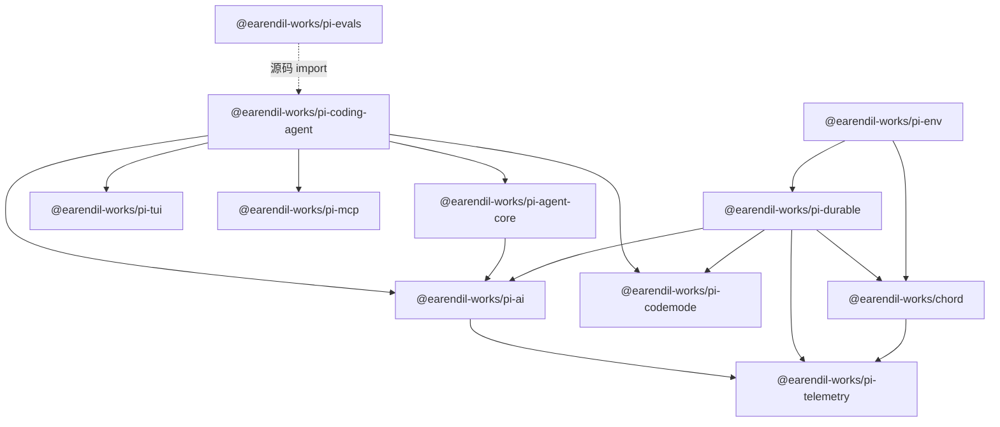

# 第 16 章 周边运行时：chord、durable、env、telemetry、evals

← 上一章：[第 15 章 可编程接口：print、JSON、RPC、SDK](15-programmatic-interfaces.md) ｜ [返回目录](README.md)

> **本章你将学会**：判断四个周边包各自解决的问题与是否出现在 CLI 的依赖图里；用 chord 的契约与复制状态模型理解"durable 为什么需要它"；说清 `pi-durable` 与 coding-agent 的会话/压缩语义差异；知道 `pi-evals` 怎么做文档提升评测。
>
> **对应官方文档**：仓库内 `packages/chord/README.md`、`packages/durable/README.md`、`packages/env/README.md`、`packages/telemetry/README.md`、`packages/evals/README.md`（这些包不在 pi.dev 文档站内）

Pi 的 monorepo 里有两条产品线的痕迹：一条是 `pi` 命令（`coding-agent`），一条是"把 agent 做成可持久、可远程的服务运行时"（`chord` + `durable` + `env`）。它们共用 `pi-ai`，但**没有互相依赖**。把这条分界看清楚了，你在读源码时就不会在 coding-agent 里找 chord 的调用点，也不会以为 `durable` 的会话就是 `~/.pi/agent/sessions/` 里的 JSONL。

## 16.1 谁依赖谁

依赖事实（各包 `package.json` 的 `dependencies`）：

结论三条：`coding-agent` 不依赖 `chord`、`durable`、`env`、`telemetry`（它只经 `pi-ai` 间接拿到遥测契约）；`chord` 与 `durable` 是被 `pi-chat`、自建宿主等外部产品使用的一层；`pi-evals` 无包依赖，但 `src/harness.ts` 直接 import coding-agent，只由根脚本的 `eval` 入口调用。根 `build` 脚本的顺序（telemetry → chord → tui → codemode → mcp → ai → durable → env → agent → coding-agent）就是这张图的拓扑序。

## 16.2 chord：多进程对象与复制状态

Chord 的定位是"把应用拆成活在多个进程里、还能热重载的**对象**"（[packages/chord/README.md](file:///D:/workspace/harness/earendil/pi/packages/chord/README.md)）。核心概念与导出对应：

| 概念 | 语义 | 导出 |
|---|---|---|
| 对象 = 地址上的状态 + 代码 | 按需创建，有人引用就活着 | `createHost`、`defineFacet`、`defineRegistry` |
| 引用而非对象 | 本地与跨进程用法一致，且**跨热重载存活** | 契约描述符 `remote`、`local`、`method`、`opaque` |
| principal | 属主与访客拿到不同对象、不同方法 | 契约声明里的 owner/guest 区分 |
| 可观察 JSON 状态 | 远端订阅者先拿快照、再拿 delta | `replicatedState` 与 `ReplicatedState` / `MutableReplicatedState` / `ReplicatedStateSource` / `Delivery` / `Attachment` |
| 热重载 | 换代码不换状态；在途工作用起始时的代码跑完；不兼容变更在安全点迁移 | facet 模块加载器 `nodeLoader`（`chord/node`） |

契约是**运行时值**，用 TypeBox schema 描述；宿主之间通过 link 交换 JSON 帧：`memoryLinkPair`、`ipcLink`、`webSocketLink`、`acceptWebSockets`，帧协议在 [packages/chord/src/wire.ts](file:///D:/workspace/harness/earendil/pi/packages/chord/src/wire.ts)（含 `Frame` 与 `PROTOCOL_VERSION`）。子入口把能力切开：`chord/node`（子进程宿主管理 `createHostManager` / `forkDriver` / `childControl` / `processLock`）、`chord/context`（`withCancel` / `withAbortSignal` / `withTelemetry` / `traceIn` / `awaitWithContext`）、`chord/delta`（事务性 JSON 追踪、结构 diff、不可变 apply、操作批编解码）、`chord/output`（`OutputBuffer` 的 head/tail 窗口与 `Progress` 的自适应提交）、`chord/sqlite` 与 `chord/telemetry-sqlite`（可移植 SQLite 抽象、`applySqliteMigrations`、`createSqliteTelemetry`）。

值得学的两点设计：`chord/delta` 把"状态同步"做成操作批而不是整值重传，因此远端视图能保住局部性；`chord/output` 的有界输出与 Pi 的工具截断（8.3）解决的是同一类问题（大输出不能被无界传递），只是层次不同。

## 16.3 pi-durable：先提交，后展示

`pi-durable` 明确标注 **Experimental，API 会无预告变动**（[packages/durable/README.md](file:///D:/workspace/harness/earendil/pi/packages/durable/README.md)）。它解决的问题与 coding-agent 不同：

| 维度 | coding-agent（第 6、7 章） | pi-durable |
|---|---|---|
| 存储 | JSONL 会话文件，追加写，进程崩溃时最后一条可能未落 | 先提交到 storage，再展示 |
| 崩溃语义 | 重开会话文件继续，运行中的请求状态丢失 | 重开存储从停止处继续；崩溃期间的模型请求算失败尝试并重试，反复致死的请求会被终止 |
| 扩展模型 | `pi.register*` + 事件 | `defineTool`、`defineExtension`、`hook`、`section`、`wrapTool`、`defineDoc` / `defineDocFamily`、`defineTask` / `TaskGraph` |
| 主要导出 | `createAgentSession`、`SessionManager` | `Harness`（`open`）、`DEFAULT_HARNESS_IDENTITY`、`createRegistry`、`MemoryStorage`、`createSession`、`UsageDoc` / `InboxDoc` / `ProviderDoc`、`DURABLE_TELEMETRY_SCHEMA` |
| 存储后端 | 文件系统 | `memory` / `indexeddb` / `jsonl` / `store` / `sqlite` 多个子入口 |

它依赖 `chord` 做文档状态、`pi-ai` 做模型访问、`pi-codemode` 做脚本、`pi-telemetry` 做遥测契约，因此可以在浏览器与 Durable Objects 里跑——这是 `coding-agent` 做不到的（后者依赖 Node 与终端）。

如果你要建的是"常驻服务、可恢复任务、多租户会话"，`durable` 是合适的基座；如果你要的是"终端里的一次工作会话"，`coding-agent` 已经够了。二者共享的是 `pi-ai` 与 `codemode`，不是会话格式。第 3 章的循环钩子字段设计在这里同样复用：`durable` 是 `Agent` 循环的另一种叠加。

## 16.4 pi-env：把工具搬到另一台机器

`pi-env` 为 durable 提供远程执行环境：智能体的工具在另一台机器（通常 SSH）上跑，而 worker、存储、凭证留在本地（[packages/env/README.md](file:///D:/workspace/harness/earendil/pi/packages/env/README.md)）。两个部件：

- `pi-env`（`daemon/`）：跑在远端的小型 **Rust 程序**，在 stdin/stdout 上说一套带帧协议（`docs/protocol.md`），在那里执行文件操作与命令。
- `RemoteExecutionEnv`：durable 的 `ExecutionEnv` 实现，通过 `Connection` 与守护进程对话；结果与在远端跑 `NodeExecutionEnv` 一致，只有错误文案可能不同（`docs/semantics.md` 把这条差异写成契约）。

安全设计值得注意：`scanHostKey()` 先取指纹给属主、由属主**带外比对后**用 `acceptHostKey()` 接受；`connectSsh()` 检测远端系统、缺失时部署守护进程，部署件按 SHA-256 命名并在每次启动前校验；`sshConnection()` 是惰性形态——首个操作才做检测、部署、连接，失败（无网络、主机密钥不受信）就是该操作的错误，下一个操作再试。

这与第 8.6 节的 `operations` 接口解决同一个问题，但位置不同：coding-agent 用 operations 把**内置工具**换成远程后端（SSH 示例扩展、Gondolin），durable 用 `ExecutionEnv` 把整个执行环境抽象掉。第 17 章的容器化三种模式是第三种答案。

## 16.5 telemetry 与 evals

`pi-telemetry` 是**无后端**的契约包：回调式 `TelemetryContext` / `TelemetrySpan`、共享 `NOOP_TELEMETRY_CONTEXT`、跨进程传播与 span link 的不透明表示、计数器/上下降计数器/直方图与带推导类型的 schema、`InMemoryTelemetryContext` 参考实现、一致性测试。**没有 exporter、没有全局 current-span 状态、不依赖任何遥测后端**（[packages/telemetry/README.md](file:///D:/workspace/harness/earendil/pi/packages/telemetry/README.md)）。`pi-ai` 依赖它并在自己的请求路径上产生 span（[packages/ai/src/telemetry.ts](file:///D:/workspace/harness/earendil/pi/packages/ai/src/telemetry.ts)），因此"要不要上报、报给谁"是宿主决定，不是库决定。Pi 进程侧的安装/更新遥测与 provider 归因头由 `enableInstallTelemetry`（默认 `true`）与 `PI_TELEMETRY` 控制，`enableAnalytics` 默认 `false`（第 17 章）。

`pi-evals` 用 `vitest-evals` 做行为评测，文件约定是两类（[packages/evals/README.md](file:///D:/workspace/harness/earendil/pi/packages/evals/README.md)）：`*.docs.eval.ts` 是**文档提升**评测——`eval:docs` 在 `without_docs` 与 `with_docs` 两种隔离容器里各跑一遍并报告提升量；其他 `*.eval.ts` 是宿主评测（`eval:host` 跑 smoke，`eval:audit` 跑文档审计）。这是一种少见的、把"文档有没有用"变成可测量信号的机制：Pi 的文档不是只给人读的，它同时是模型的行为输入，于是可以被评测。

> 源码位置：`packages/chord/src/{wire.ts,state.ts}`、`packages/durable/src/`（`Harness` 与 storage 子入口）、`packages/env/daemon/`（Rust 守护进程）与 `packages/env/src/`（连接与 host key）、`packages/telemetry/src/`、`packages/evals/src/harness.ts`。

## 小结

- monorepo 里有两个产品：`coding-agent`（终端）与 `chord`+`durable`+`env`（服务运行时），它们只共享 `pi-ai` 与 `codemode`，不共享会话格式。
- chord 提供跨进程对象引用、principal 区分的契约、快照+delta 的复制状态与"换代码不换状态"的热重载。
- durable 把"先提交存储再展示"作为核心承诺，因此崩溃后可续跑，反复致死的请求被终止；它标注实验性，API 会变。
- env 用 Rust 守护进程 + 带帧协议把工具搬到远端，主机密钥与部署件完整性是显式设计。
- telemetry 是无后端契约包，是否上报由宿主决定；evals 用文档提升评测把文档质量变成可测量信号。

## 练习

1. 对照根 `package.json` 的 `build` 脚本与 16.1 的依赖图，指出为什么 `tui` 必须在 `ai` 之前构建。验收标准：给出脚本行与依赖事实，而不是猜测。
2. 阅读 `packages/chord/README.md` 的 principal 一节，构造一个"owner 有写方法、guest 只有读方法"的契约声明。验收标准：说明访客调用写方法时得到的是 `ChordError` 还是 `forbidden`，并引用 API 表。
3. 用 `packages/durable` 的 `MemoryStorage` 跑一个最小 harness，然后换成 `sqlite` 子入口。验收标准：列出两种存储下"崩溃后重开"的差异，并引用 README 的 Persist and Resume 一节。
4. 运行 `npm run eval -- --help`（或直接读 `packages/evals/src/cli.ts`），弄清 `eval:docs` 与 `eval:host` 的容器差异。验收标准：解释为什么文档提升评测必须在隔离容器里跑两遍。

## 延伸阅读

- `packages/chord/README.md`（对象/引用/principal/复制状态的完整叙述）与 `packages/durable/README.md`（Experimental 警告与 20+ 个概念小节）
- `packages/env/docs/protocol.md` 与 `docs/semantics.md`（帧协议与远程语义契约）
- 第 17 章：容器化与沙箱（第三条隔离路线）、供应链加固与发布流程

---

→ 下一章：[第 17 章 工程实践：调试、测试、性能与贡献](17-engineering-practice.md) ｜ [返回目录](README.md)
