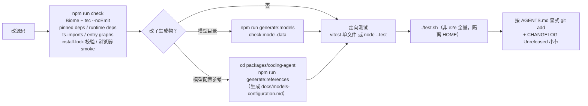

# 第 17 章 工程实践：调试、测试、性能与贡献

← 上一章：[第 16 章 周边运行时：chord、durable、env、telemetry、evals](16-peripheral-runtimes.md) ｜ [返回目录](README.md)

> **本章你将学会**：用非交互手段复现交互模式的问题；在不消耗真实 token 的前提下测扩展与 agent 行为；按症状选对诊断工具；把 Pi 跑在明确的隔离边界里；按仓库规则提交而不踩到别人的会话。
>
> **对应官方文档**：[Run Pi Safely](https://pi.dev/docs/latest/security) · [Isolate Pi](https://pi.dev/docs/latest/containerization) · [Usage 的 Collect diagnostic information](https://pi.dev/docs/latest/usage) · 仓库 `AGENTS.md`、`CONTRIBUTING.md`

Pi 的文档、测试、发布流程本身也是这套扩展机制的消费者（1.6 节）。本章把"日常把一个改动做完"需要的所有工程手段整理成一册：环境、诊断、测试、性能、隔离、贡献。

## 17.1 开发环境

```bash
npm install --ignore-scripts     # 从不执行 lifecycle scripts
npm run build                    # 先刷新模型数据，再构建所有包
npm run build:offline            # 用已有模型数据，不联网
npm run check                    # Biome 检查+格式化、pinned deps、runtime deps、
                                 # ts 相对导入、entry graphs、install-lock 校验、tsc --noEmit、浏览器 smoke
./test.sh                        # 跑全部非 e2e 测试（无 API Key 时跳过依赖 LLM 的用例）
./pi-test.sh                     # 从源码跑 pi（可在任意目录）
```

静态与动态门禁是分开的两条线，日常节奏是"改 → check → 定向测试 → 全量 `./test.sh`"：



`npm run check` **不跑测试**；`check` 是唯一的静态门禁，因此它的输出要完整读完再动手（仓库规则明确要求全量输出、不 tail）。几个会直接影响你写法的仓库约束（[AGENTS.md](file:///D:/workspace/harness/earendil/pi/AGENTS.md)）：

- 只用可擦除 TypeScript 语法：无 parameter properties、无 `enum`、无 `namespace`/`module`、无 `import =`/`export =`。
- 禁止内联导入（`await import()`、`import("pkg").Type`、动态类型导入）——只用顶层导入。
- 不硬编码键位判断（`matchesKey(data, "ctrl+x")`），要加进 `DEFAULT_EDITOR_KEYBINDINGS` / `DEFAULT_APP_KEYBINDINGS` 保持可配置（13.4 节的纪律来源）。
- 资源路径经 `src/config.ts` 的辅助函数，不用 `__dirname`（1.1 节三种运行形态）。
- 绝不直接改 `packages/ai/src/models.generated.ts`；改 `packages/ai/catalog/` 后重新生成。`src/providers/data/` 是 gitignored 的生成物，不要 stage，也不要在 git 历史里找它。
- 除类型确实无法表达处外不用 `any`；注释解释"为什么"（成本、竞态、已定的规则），不解释"下一行做什么"。

## 17.2 诊断工具箱

按"越靠前越便宜"排序：

| 手段 | 拿到什么 | 出处 |
|---|---|---|
| 启动头 | 实际加载了哪些指令、资源、模型范围（`quietStartup` 可关，`"header"` 保留版本与提示） | 设置与 `usage.md` |
| `pi config` | 资源与内置扩展的启用状态（个人/项目两个作用域） | 14.3 |
| `/session` | 会话文件、ID、消息数、token 用量、成本；`cacheWarming` 的下一次决策 | 5.7 |
| `/hotkeys` | 当前会话真正生效的快捷键 | 13.4 |
| `/mcp` | 服务器状态、工具数、exposure、配置来源、连接错误与 stdio stderr 尾部 | 12.3 |
| `/debug` | 把**渲染后的终端行 + 当前会话消息**写进 `<agent-dir>/pi-debug.log` | 17.3 |
| `PI_TUI_WRITE_LOG` | 抓原始 ANSI 流，判断差分是否正确 | 13.7 |
| `before_provider_request` / `provider_stream_event` | 真实 payload 与解析后的原始流事件 | `examples/extensions/debug-provider.ts` |
| `pi --mode json` / `--mode rpc` | 非交互的事件序列与命令响应，最适合复现与回归 | 15 |
| `/bug` | 上传诊断包（Radius 网关，可用 `PI_RADIUS_GATEWAY` 覆写） | `core/bug-report*.ts` |

`pi-debug.log` 与 session 导出都可能包含提示词、模型响应、工具输出、文件内容以及在会话中暴露过的凭证——**分享前先看一眼**（`usage.md` 与 `security.md` 都单独强调这条）。

复现交互问题还有第三条路：`packages/coding-agent/.pi/skills/interactive-testing.md` 描述的方法——在受控 tmux 终端里驱动真实 TUI。AGENTS.md 明确把这条写成"测/调 pi 交互模式"的指定手段。仓库自带的 `tps.ts`（token/秒）与 `redraws.ts`（`/tui` 显示重绘统计）两个扩展，就是用 Pi 的扩展机制观测 Pi 自己。

## 17.3 测试策略

分层清楚，各层工具不同：

| 层 | 工具 | 约定 |
|---|---|---|
| 单元/集成（多数包） | Vitest，各包 `test/` | 从包根跑单个文件：`node "$(git rev-parse --show-toplevel)/node_modules/vitest/dist/cli.js" --run test/specific.test.ts` |
| `packages/tui` | Node 自带 `node:test` | `node --test test/specific.test.ts` |
| coding-agent 行为套件 | `test/suite/harness.ts` + **faux provider** | 禁止使用真实提供商 API、Key 或付费 token |
| MCP 一致性 | `npm run test:mcp-conformance` | 跑 `test/mcp-conformance/run.ts` |
| 模型数据一致性 | `npm run check:model-data`、`diff:model-catalog`、`check:model-catalog-compat` | 4.5 的生成链 |
| 行为评测 | `npm run eval`（`packages/evals`） | `*.docs.eval.ts` 做 with/without docs 提升对比；`eval:host` 跑 smoke，`eval:audit` 跑文档审计 |

三条硬规则：不要直接跑完整 vitest 套件（含 e2e，端点/鉴权环境变量存在时会启动）；不要跑 `npm test`（除非被明确要求）；非 e2e 全量用根目录 `./test.sh`。`./test.sh` 本身值得读一眼——它把 HOME、临时目录、npm 配置与 git askpass 全部隔离进 `mktemp -d` 出来的目录，并在清理时校验所有权标记 `"$test_root/.pi-test-owned"` 才删除，同时把 `git_askpass` 指向 `false`，因此测试既不会污染你的 `~/.pi`，也不会弹凭证窗口（[test.sh](file:///D:/workspace/harness/earendil/pi/test.sh)）。写测试时若新建或改了测试文件，就要跑它并在"测试还是实现有问题"之间迭代到通过。

回归测试的约定：为 GitHub issue 修 bug 时，在对应测试旁加一行注明 issue 号。

## 17.4 性能

已有工具与阈值，别凭感觉优化：

```bash
npm run profile:tui     # scripts/profile-coding-agent-node.mjs --mode tui
npm run profile:rpc     # 同一脚本的 rpc 形态
```

已知常数与结构（都在前文出现，这里给"性能视角"的汇总）：渲染合并阈值 16 ms、单次写入分块上限 1 MiB、codemode 每进程 2 个 worker（`PI_CODEMODE_MAX_WORKERS`）与 256 MB VM、MCP 请求默认 60 秒配置超时与 30 秒客户端超时、工具输出 50 KB/2000 行、摘要序列化的工具结果 2000 字符、`lazyStream()` 与 `.lazy.ts` 让提供商 SDK 不进关键路径。最常见的三类性能问题不在核心，而在扩展：流式高频事件（`message_update`、`provider_stream_event`）里做慢活；自定义工具不截断导致溢出与压缩失败；把带 ANSI 的长字符串存进组件状态导致每帧重建。

## 17.5 隔离与信任边界

先把 `security.md` 的结论复述成一句可执行的话：**Pi 没有内置权限系统，工具与扩展以 Pi 进程的操作系统权限运行；project trust 控制"加载哪些项目资源"，不是沙箱；看着转录、审查 diff 也不构成安全边界。**

| 运行方式 | 被保护的东西 |
|---|---|
| 直接跑（当前 OS 用户权限） | 该用户访问不到的东西。专用账户能收窄权限，但仍共享内核与网络 |
| 整个 Pi 进容器/VM/沙箱 | 未暴露进环境的主机文件与进程。通常是**最强实用选项** |
| Pi 在边界外，只有内置工具在边界内 | 主机资源免受这些工具的操作；Pi 本体与其他扩展仍在边界外，是更窄的隔离 |

`containerization.md` 给出四条落地路径：plain Docker、Docker Sandboxes（可用 Claude Pro/Max token）、OpenShell（策略控制的沙箱，含远程与文件传输）、Gondolin 扩展（`pi` 与提供商鉴权留在主机，把内置工具与 `!` 命令路由进本地 Linux micro-VM）。第三条与第 8.6 节的 `operations` 接口是同一机制——`examples/extensions/gondolin/` 与 `sandbox/` 就是它的实现；`ssh.ts` 是同一路径的另一种目标。

自动化与无人值守的额外纪律：非交互模式没有信任提示，用 `--approve` / `--no-approve` 明确一次性决策，或 `defaultProjectTrust: "always"` 承担加载项目资源的风险；只给任务需要的文件与服务；优先窄范围、短寿命凭证；变更前用快照/备份/版本控制；审查扩展与包源码（扩展在进程内执行代码）；导出或分享会话前先读会话。

## 17.6 贡献流程

`CONTRIBUTING.md` 的规则要先读，因为它决定了 PR 的存活率：

- **一条规则**：你必须理解你的代码。无法解释改动做了什么、与系统其余部分如何交互，PR 会被关闭。用 AI 写代码可以，提交不被理解的 AI 产物不行。让 agent 从 `pi` 根目录运行以便自动加载 `AGENTS.md`。
- **贡献门禁**：新贡献者的 issue 与 PR 默认自动关闭，维护者每天审查并重开有价值的。`lgtmi` 让后续 issue 不再自动关闭，**只有 `lgtm` 才授予提交 PR 的权限**。命令要在回复的起始（或可跟在 `@提及` 之后）或末尾。周五至周日提交的 issue 不保证当天评审，急事去 Discord。
- **issue 质量线**：用两个模板之一；短、具体、值得读（超一屏就太长）；用自己的话写；说清 bug/请求与它为什么重要；打算自己实现就写明。
- issue 上为受影响包加 `pkg:*` 标签（`pkg:agent`、`pkg:ai`、`pkg:coding-agent`、`pkg:tui`，可多个）。
- 长期计划见 RFCs：<https://rfc.earendil.com/keyword/pi/>。

同一仓库还有多条**并行会话安全**规则（因为多个 Pi 会话可能同时在同一目录工作）：只提交本会话自己改的文件；`git add <显式路径>`，绝不 `git add -A`/`.`；提交前 `git status` 核对；绝不 `git reset --hard`、`git checkout .`、`git clean -fd`、`git stash`、`git commit --no-verify`；rebase 冲突只在自己改过的文件里解决，别人的文件冲突就中止并询问；绝不 force push。commit 格式 `{feat,fix,docs}[(ai,tui,agent,coding-agent)]: <信息>`，信息简短而有说明性。changelog 在每个包的 `CHANGELOG.md` 的 `## [Unreleased]` 下按 `Added/Changed/Fixed/Removed/Breaking Changes` 追加（先读完整节再追加，不重复建小节），已发布版本小节不可改；引用形如 `Fixed foo ([#123](https://github.com/earendil-works/pi/issues/123))`，外部贡献附 `by [@user](https://github.com/user)`。

## 17.7 发布与分发

发布动作由 `.pi/skills/release.md` 描述、由脚本承担，日常只需要知道链条：

```text
version:{patch,minor,major}  →  sync-versions.js  →  npm install --package-lock-only --ignore-scripts
        ↓
scripts/pack-packages.mjs（本地与 npm 用同一个 tarball 打包器）
        ↓
release:local（本地发布烟雾测试）/ publish.mjs（npm 发布校验过的 tarball）
        ↓
generate-coding-agent-install-lock.mjs（installer 用的固定传递依赖）
        ↓
standalone 二进制 + SHA256SUMS（源码归档可复现构建）
        ↓
model catalog 发布（publish-model-catalog.mjs --dry-run 校验）与 nix/model-catalog.json 的 pin 刷新
```

值得学的设计：**发布用与本地开发相同的 tarball 打包器**（不是重新打包工作区目录），**CI 用 `npm ci --ignore-scripts` 并有定时 `npm audit --omit=dev` 与 `npm audit signatures --omit=dev`**，**pre-commit 阻断误提交 lockfile**（除非 `PI_ALLOW_LOCKFILE_CHANGE=1`）。隐私侧：`enableInstallTelemetry` 默认 `true`（匿名安装/更新上报与部分提供商归因头，不控制更新检查），`PI_TELEMETRY` 可临时覆写，`PI_SKIP_VERSION_CHECK` 关掉版本检查，`enableAnalytics` 默认 `false`。

> 源码位置：`AGENTS.md` 与 `CONTRIBUTING.md`（规则原文）、`test.sh` 与 `pi-test.sh`（隔离回环）、`scripts/`（`biome-check.mjs`、`check-*.mjs`、`pack-packages.mjs`、`release.mjs`、`profile-coding-agent-node.mjs`）、`packages/coding-agent/.pi/skills/`（发布与交互测试流程）。

## 小结

- 静态门禁是 `npm run check`（不跑测试），运行门禁是 `./test.sh`；两者都不需要真实 API Key，因为行为测试走 faux provider。
- 仓库语法约束（可擦除 TS、无内联导入、键位走配置、路径走 `config.ts`）来自"源码直跑 + 三种分发形态"这一架构事实。
- 诊断按成本排序：启动头 → `pi config` → `/session` → `/hotkeys` → `/mcp` → JSON/RPC 复现 → `/debug` → `PI_TUI_WRITE_LOG` → provider 钩子 → `/bug`；日志与导出物可能含凭证。
- project trust 与人工审查都不是安全边界；真正的边界是容器/VM/沙箱，或只把工具放进边界（Gondolin、SSH、operations 接口）。
- 贡献的前置条件是"理解你的代码"与 `lgtm` 授权；提交纪律围绕"多会话同目录"设计。
- 发布链条把依赖固定、tarball 一致性、审计与目录 pin 都做成脚本，而不是流程约定。

## 练习

1. 在不使用任何真实 API Key 的前提下，为第 10 章的权限门写一个测试。验收标准：用 `test/suite/harness.ts` 与 faux provider，并说明为什么这条路径不消耗 token。
2. 跑一次 `./test.sh`，观察它创建的临时目录与环境变量隔离。验收标准：指出 HOME、npm 配置、`GIT_ASKPASS` 三处的具体设置，并解释为什么测试不会污染你的 `~/.pi/agent/sessions/`。
3. 用 `PI_TUI_WRITE_LOG` 与 `/debug` 组合定位一个"窄终端下工具行错位"的问题。验收标准：给出你判断"是差分逻辑还是组件超宽"的证据链（对照 13.2 与 13.3）。
4. 为"把内置 `read` 换成带审计的实现"这一改动规划提交流程：涉及哪些文件、commit 前缀与标签、changelog 小节、需要跑哪些命令。验收标准：写出完整清单，并指出其中哪一步是 `AGENTS.md` 明确禁止跳过的。

## 延伸阅读

- [Run Pi Safely](https://pi.dev/docs/latest/security) 与 [Isolate Pi](https://pi.dev/docs/latest/containerization)（隔离方式的完整对照与步骤）
- [Keybindings](https://pi.dev/docs/latest/keybindings)（键位 id 与自定义文件）、[Environment Variables](https://pi.dev/docs/latest/environment-variables)（全部 `PI_*`）
- 第 18 章：按症状读源码的路线与可以练手的进阶项目

---

→ 下一章：[第 18 章 源码阅读地图与进阶路线](18-source-map-and-roadmap.md) ｜ [返回目录](README.md)
